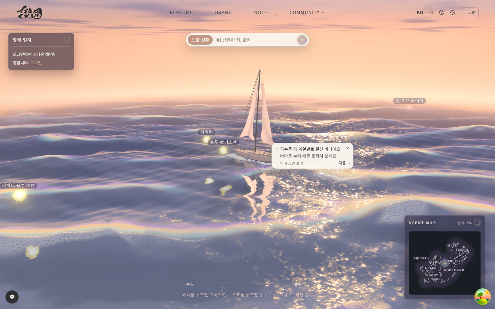

# 향해 — 향을 항해하듯 탐색하는 향수 추천 서비스

> 향수 이름 대신 **향 계열별로 펼친 3D 바다를 배로 누비며** 취향에 맞는 향수를 발견하고 기록하는 서비스



| | |
|---|---|
| 기간 | 2026.08 ~ 2026.10 (SSAFY 15기 특화 프로젝트) |
| 팀 | 6명 — AI · BE · Infra · FE · PM · 디자인 |
| 내 역할 | **웹 프론트엔드 전체 담당** — 3D 향 지도 엔진 · 화면 전환 연출 · 앱 구조 · 진열대 · 커뮤니티 |

---

## 무엇을 만들었나

향수 검색은 이름을 알아야 가능하지만, 사람들의 기억은 대개 **"빨래 냄새 나는 향수"** 같은 느낌.
그 간극을 메우는 두 가지 방법.

- **향 지도** — 대표 향수 200병을 향 계열(시트러스 · 플로럴 · 우디 · 머스크 …)에 따라 바다 위에 배치. 배를 몰고 다니며 가까운 향수를 부표로 발견
- **자연어 추천** — "가을에 쓸 남성적인 우드향" 같은 문장으로 향수 추천. 어떤 표현이 어떤 향 특성을 가리켰고, 그 향수가 그 특성을 얼마나 가졌는지 **추천 근거까지 함께 제시**

찾은 향수는 **진열대**에 보유 중 · 시향해 봄 · 보유 희망으로 정리하고, 컬렉션 묶기와 후기 공유까지 연결.


### 주요 기능

| 기능 | 내용 |
|---|---|
| 🗺️ 3D 향 지도 | 향 계열별로 펼친 바다 · 배로 이동 · 부표를 눌러 향수 확인 · 미니맵(해도) · 탐색률 |
| 🤖 자연어 추천 | 느낌 · 상황 문장 입력 → 추천 + 근거(표현 → 향 특성 → 강도) |
| 🧪 취향 테스트 · 개인화 추천 | 테스트 결과와 최근 본 향수로 고른 한 병을 진열대의 편지로 전달 |
| 🧺 진열대 · 컬렉션 | 보유 · 시향 · 희망 분류 · 취향 적합도 · 메모 · 컬렉션 묶기 |
| 💬 커뮤니티 | 후기 게시판 · 자유 게시판 · 댓글 · 좋아요 · 이미지 첨부 |
| 🌐 한국어 · 영어 | 화면 글자와 오류 문구의 두 언어 지원 |

---

## 내가 맡은 부분 — 웹 프론트엔드

### 1. three.js 로 직접 구현한 3D 향 지도

메인 화면은 라이브러리 위젯이 아닌 **순수 JavaScript + three.js 자체 엔진**(`frontend/landing/`).
React 앱과의 연결은 iframe 과 `postMessage` 한 곳(`host.js`)으로 한정해, 엔진과 앱의 독립적인 수정이 가능한 구조.

- **바다와 배** — 선체 여러 지점의 수면 높이를 읽어 배의 높이와 앞뒤 · 좌우 기울기를 물결에 맞춘 부력 구현
- **기기별 그래픽 품질 자동 조절** — GPU 이름으로 높음 · 보통 · 낮음 중 시작 단계 결정, 프레임이 끊기면 한 단계 하향 · 여유가 생기면 상향. 헤더의 톱니바퀴로 직접 선택도 가능
- **헤더 뒤까지 깔리는 화면** — 3D 가 화면 전체를 차지하고, 헤더는 하늘(낮 · 밤)에 맞춰 바뀌는 유리판

### 2. 메인 스레드가 막혀도 끊기지 않는 전환 연출

3D 엔진 로딩 중 1~3초간 메인 스레드가 막히는 문제. 그 사이에도 화면이 멈춰 보이지 않도록 연출 전체를 **합성 스레드에서 도는 애니메이션**으로 구성.

- **로딩 커튼** — 향 원 세 개의 번짐, 획 순서대로 그려지는 '향해' 글자, 올라가는 퍼센트. 퍼센트는 앞으로 4초 치 흐름을 미리 계산해 Web Animations 로 위임하고, 글자 획은 '흐른 시간' 이 아닌 '그려진 프레임' 기준으로 재어 막힘이 풀린 자리부터 이어 그리기
- **잠수 전환** — 메인에서 다른 화면으로 이동할 때 카메라가 수면으로 숙이는 동안 아래에서 바다색이 차올라 덮었다 걷히는 연출. 진행도를 React 상태 대신 CSS 변수와 엔진에 직접 기록해 매 프레임 앱 전체가 다시 그려지는 문제 방지
- **선실로 들어가기** — 진열대로 이동할 때 배를 향한 줌인과 함께 구름이 잉크처럼 번져 덮는 연출(캔버스에 노이즈를 따라 번지는 경계선 표현)

### 3. 여러 명이 함께 고쳐도 무너지지 않는 앱 구조

- **레이어 의존 방향의 lint 강제** — `app → pages → features → shared` 의 역방향 · 도메인 간 import 를 ESLint 오류로 차단. 도메인 출입은 `index.ts` 로 일원화
- **서버 상태와 클라이언트 상태 분리** — 서버 데이터는 TanStack Query, 로그인 · 모달 같은 앱 상태만 Zustand
- **1920 기준 반응형** — 모든 치수를 `--spacing` 하나에 묶어 1920 에서 1536 까지 비율로 축소
- **목데이터 모드** — 백엔드 없이 `npm run dev:mock` 으로 로그인 · 진열대 · 컬렉션 · 검색 화면 실행. 백엔드 API 완성 전 화면 선행 개발에 활용
- **테스트와 검증 기준** — 공용 UI 와 순수 함수의 테스트 동반(Vitest · Testing Library), MR 전 `npm run verify`(포맷 · lint · 타입 · 테스트 · 빌드) 통과 필수

---

## 기술 스택

| 파트 | 기술 |
|---|---|
| Frontend | TypeScript · React 19 · Vite · TanStack Query · Zustand · Tailwind CSS 4 · **three.js** · react-router · i18next · Vitest |
| Backend | Java 21 · Spring Boot 3.5 · Spring Security + JWT · JPA · Redis · Flyway · springdoc-openapi |
| AI / Data | Python 3.11 · FastAPI · pandas · LLM(SSAFY GMS) · 향수 129,161건 · 향 특성 92종 · 자체 한국어 향 사전 |
| Infra | PostgreSQL 17 · Redis 7.4 · Docker Compose · Jenkins · nginx · AWS S3 · CloudFront · k6 |

<details>
<summary>버전까지 보기</summary>

#### Frontend

| 분류 | 사용 기술 |
|---|---|
| 언어 | TypeScript 6.0 |
| 프레임워크 | React 19.2 |
| 빌드 | Vite 8.2 · Node.js 22.12+ · npm 10.9+ |
| 라우팅 | react-router 8.3 |
| 서버 상태 | TanStack Query 5.102 |
| 전역 상태 | Zustand 5.0 |
| 스타일 | Tailwind CSS 4.3 |
| 3D | three.js 0.160 |
| HTTP | axios 1.20 |
| 테스트 | Vitest 5.0 · Testing Library · jsdom |
| 품질 | ESLint 10.9 · Prettier 3.9 |

#### Backend

| 분류 | 사용 기술 |
|---|---|
| 언어 | Java 21 |
| 프레임워크 | Spring Boot 3.5.16 |
| 빌드 | Gradle 8.14.3 (Wrapper) |
| 보안 | Spring Security · JWT (자체 발급) |
| 데이터 | Spring Data JPA · Spring Data Redis |
| 마이그레이션 | Flyway (V1~V26) |
| API 문서 | springdoc-openapi 2.9 (Swagger UI) |
| 스토리지 | AWS SDK v2 (S3) |
| 모니터링 | Actuator · Micrometer · Prometheus |
| 테스트 | JUnit 5 · Testcontainers · JaCoCo |

#### AI / Data

| 분류 | 사용 기술 |
|---|---|
| 언어 | Python 3.11 |
| 서버 | FastAPI · uvicorn |
| 데이터 | pandas · numpy |
| LLM | SSAFY GMS (OpenAI 호환 게이트웨이) |
| 데이터 원천 | Fragrantica 기반 향수 129,161건 · 향 특성 92종 |
| 자체 구축 | 한국어 향 사전 · 노트-어코드 연결표 · 한국어 노트 별칭 |

#### Database · Infra

| 분류 | 사용 기술 |
|---|---|
| DB | PostgreSQL 17 |
| 캐시 | Redis 7.4 |
| 컨테이너 | Docker · Docker Compose |
| CI/CD | Jenkins |
| 스토리지·CDN | AWS S3 · CloudFront |
| 웹서버 | nginx (정적 서빙 + 리버스 프록시) |
| 부하 테스트 | k6 |

</details>

## 시스템 구성

```text
                  브라우저
                     │
                     ▼
              nginx (정적 + 리버스 프록시)
              ├── /            → 프론트 빌드 산출물
              └── /api/v1/...  → backend (Spring Boot)
                                      │
                        ┌─────────────┼─────────────┐
                        ▼             ▼             ▼
                  PostgreSQL 17    Redis 7.4    AI 서버 (FastAPI)
                                                       │
                                                       ▼
                                                 SSAFY GMS (LLM)
```

## 저장소 구조

```text
frontend/       React 앱 + 3D 향 지도 엔진 (frontend/landing)
backend/        Spring Boot API 서버 · Flyway 마이그레이션 · 시드 스크립트
ai/             자연어 추천 엔진 · FastAPI 서버
docs/           팀 문서 · 로컬 개발 가이드 · 요구사항 · 기능 명세
exec/           빌드 · 배포 · 외부 서비스 · DB 덤프 · 시연 시나리오
performance/    k6 부하 테스트 시나리오
```

## 직접 실행해 보기

백엔드 없이 화면만 확인할 때는 목데이터 모드가 가장 간단.

```bash
cd frontend
npm ci
npm run dev:mock      # http://localhost:5173 · 로그인은 아무 이메일 · 비밀번호
```

전체 실행 방법은 [로컬 개발 환경 가이드](docs/local-development-guide.md)와 [빌드 · 배포 문서](exec/01_빌드_및_배포.md) 참고.

## 팀

| 이름 | 역할 |
|---|---|
| 김용석 | 팀장, AI |
| 김재성 | 디자인, AI |
| 권영민 | BE, DB |
| 김경린 | Infra, BE, DB |
| **송가연** | **FE**, DB |
| 차서영 | PM, FE |

---

<sub>SSAFY GitLab 에서 옮겨 온 저장소. 커밋 기록은 원본 그대로이고, GitLab MR 은 같은 번호의 PR 로 보존(MR !N → PR #N · 원래 작성자와 날짜는 PR 본문 첫머리에 기록).</sub>
