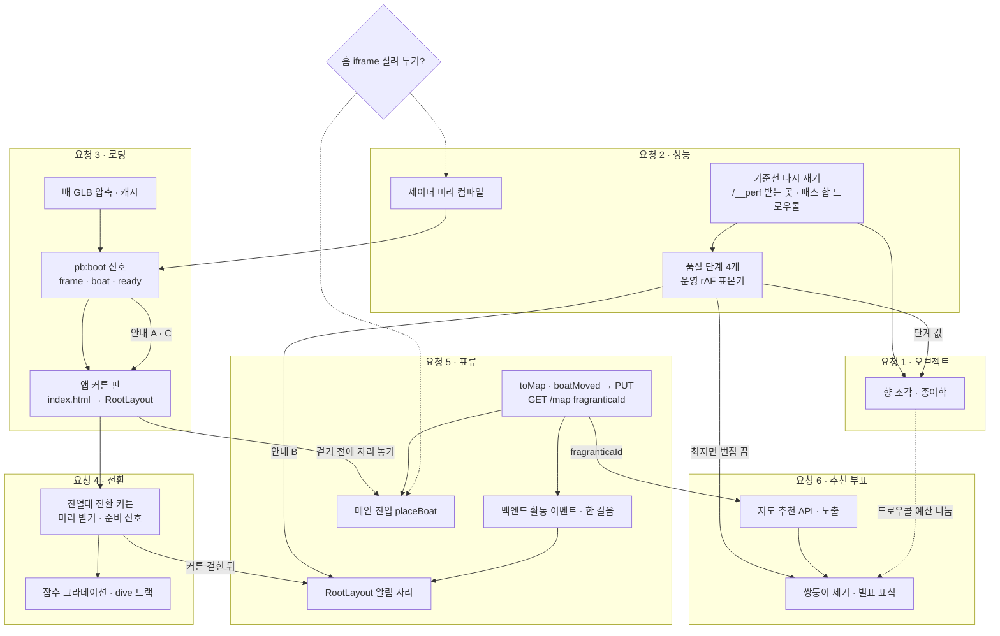

# 3D 메인 고도화 여섯 요청 — 개요

2026-09-17 · 분석 문서 (구현 전)

여섯 요청은 **측정과 부팅의 바닥(요청 2 · 3)을 먼저 깔고, 그 위에 새 층(요청 1) · 전환(요청 4) · 서버 연동(요청 5 · 6)을 얹는** 순서로 간다. 품질 단계 · 부팅 신호 · 앱 커튼 · 페이지를 넘는 알림 자리는 네 문서가 같이 쓰는 부품이라 한 번만 만든다. 백엔드 일(요청 5 · 6 의 서버 쪽)은 엔진 일을 기다리지 않고 바로 시작할 수 있다.

용어 : iframe = 앱 화면 안에 끼운 엔진 페이지 · 드로우콜(draw call) = GPU 에 "이 묶음을 그려라" 보내는 명령 한 번 · rAF p95 = 화면 갱신 간격 중 느린 쪽 5% 의 경계값 · 커튼 = 화면 전체를 덮는 판 · GLB = 3D 모델 파일 · 월드 = 3D 장면의 길이 단위(지도 좌표 1 = 320 월드).

---

## 1. 요청별 결론

여섯 모두 새 후처리 · 새 렌더 패스 없이 풀 수 있고, 서버 로직이 필요한 것은 요청 5 · 6 뿐이다. 요청 이름은 원문을 못 찾아 문서 내용으로 적었다 (열린 질문 1).

| # | 요청 | 결론 | 문서 |
|---|---|---|---|
| 1 | 바다 밀도를 채울 오브젝트 | 1순위 향 조각(87점) · 2순위 종이학 떼(83점). 사용자 후보만 보면 새 떼 77 > 향수병 71(부표와 뜻이 겹쳐 거부) > 돌고래 51. 둘을 합쳐도 드로우콜 +2 · 삼각형 약 900 · 추가 패스 0 | [01 §5](01-오브젝트-선택.md#5-추천) · [§4-2](01-오브젝트-선택.md#4-2-점수) |
| 2 | 노트북 크롬이 GPU 를 안 쓰는 문제 | 가속은 기본으로 켜져 있다. 끊김은 차단 목록 · 내장 GPU 고정 · 에너지 절약 · 무거운 장면에서 오고, 사이트는 감지 → 4단계 품질(높음 · 보통 · 낮음 · 최저) → 한 번만 뜨는 안내로 대응한다 | [02 §1](02-노트북-크롬-GPU.md#1-전제-바로잡기) · [§4](02-노트북-크롬-GPU.md#4-설계-구현-전) |
| 3 | 첫 진입 로딩 화면 | 앱 `index.html` 의 `#root` 옆 정적 커튼을 React 가 이어받고, 엔진은 `pb:boot` 신호로 진행률을 댄다. 가장 긴 기다림은 압축 안 된 배 GLB 8.3MB 다 | [03 §1](03-로딩-전환-수중.md#1-첫-진입-로딩-사슬) · [§2](03-로딩-전환-수중.md#2-로딩-화면-명세) |
| 4 | 진열대 전환 · 바다 밑 연출 | 경로가 바뀌어도 사는 `RootLayout` 커튼으로 덮고 이동한다. 바다는 위에서만 그리는 판이라 카메라를 물에 넣지 않고, 화면 아래에서 차오르는 DOM 그라데이션(드로우콜 0)으로 잠수를 보인다 | [03 §3-1](03-로딩-전환-수중.md#3-1-피하는-법) · [§4-2](03-로딩-전환-수중.md#4-2-추천-조합과-진열대로-잇기) |
| 5 | 사이트 활동으로 배가 흘러가기 | 표류 계산은 백엔드 한 곳에 둔다(활동 커밋 뒤 이벤트 → 향수 쪽으로 k = 1 − e^(−w/3) 한 걸음 · 8 월드 앞에서 멈춤). 그보다 먼저 직접 몬 이동을 `PUT` 으로 남기는 바닥이 필요하다 | [04 §3-3](04-향해일지-추천부표.md#3-3-목표-좌표) · [§3-5](04-향해일지-추천부표.md#3-5-메인-진입-연출) |
| 6 | 추천 부표가 점점 빛나기 | 지도 200개로 좁힌 추천 API 를 새로 두고, 3D 는 기존 발광 쌍둥이의 세기만 부표별로 올린다(그리기 +0). 38 월드 밖 추천은 미니맵 · 해도의 별표와 후광이 맡는다 | [04 §4-1](04-향해일지-추천부표.md#4-1-추천-출처) · [§4-2](04-향해일지-추천부표.md#4-2-빛-세기-모델) |

## 2. 요청 4 답 — 경로가 바뀌면 흰 페이지가 보이나

**예, 지금 코드로는 보인다** — 청크(화면별 JS 파일)를 받는 동안은 react-router 의 `startTransition` 덕에 3D 홈이 남지만, `MyShelfPage` 가 진열대 데이터를 기다리며 `PageFallback` 을 그리는 순간(`MyShelfPage.tsx:240`) iframe 이 사라지고 아이보리 바탕 스피너가 API 왕복 시간만큼 보인다. 10분 안에 다시 가면 쿼리 캐시로 거의 안 보인다. 없애려면 경로를 넘어 사는 커튼 · 미리 받기 · 진열대 준비 신호를 같이 쓴다 ([03 §3-1](03-로딩-전환-수중.md#3-1-피하는-법)).

---

## 3. 맞물리는 점

요청 2 · 3 의 부품(품질 단계 · 미리 컴파일 · 부팅 신호 · 커튼)이 나머지 넷의 바닥이고, 요청 5 의 `PUT` · fragranticaId 가 요청 6 의 바닥이다. 점선은 결정이나 예산을 나눠 쓰는 관계다.

### 3-1. 같이 쓰는 부품 — 한 번만 만든다

| 부품 | 쓰는 곳 | 기준 문서 |
|---|---|---|
| 운영 rAF 표본기 + 품질 단계 | 요청 2 전환 · 요청 1 폴백 · 요청 6 빛기둥 | 02 §4-1 (새 층은 제 문턱을 두지 않는다 — 01 §5-5) |
| 드로우콜 예산 +2 (상한 +3) | 요청 1 조각 · 학 · 요청 6 빛기둥 | [01 §2-1](01-오브젝트-선택.md#2-1-새-오브젝트-층의-예산-두-추천안-합) |
| 셰이더 미리 컴파일 순서 | 요청 2 첫 끊김 · 요청 3 `frame` · `boat` | [02 §4-2 그림](02-노트북-크롬-GPU.md#4-2-첫-진입-셰이더-미리-컴파일) |
| `pb:boot` 메시지 (`window.PB` 가 열리기 전) | 요청 3 진행률 · 요청 2 안내 A · C | 03 §2-4 |
| 앱 커튼 판 (`#boot` → `RootLayout`) | 요청 3 로딩 · 요청 4 전환 · 요청 5 진입 자리 놓기 | 03 §2-1 · §3-1 |
| 페이지를 넘는 알림 자리 (`RootLayout`) | 요청 5 표류 토스트 · 요청 2 안내 A · B | [04 §3-6](04-향해일지-추천부표.md#3-6-다른-페이지-토스트) |
| 흰 안개 곡선 (inOutCubic · 덮기 0.6초 · 걷기 0.9초) | 요청 4 커튼 곡선 · 요청 5 먼 진입 · 요청 1 조각 다시 뿌리기 | `landing/src/travel.js` · 03 §3-1 |
| 지도 좌표 ↔ 월드 (`toWorld` · 새 `toMap`) | 요청 5 배 자리 · 요청 6 추천 좌표 | `landing/src/scentmap.js` 한 곳 (불변식 21) |
| 해역 판정 | 토스트 · 도착 연출 = 서버 폴리곤 · 조각 색 = 엔진 보로노이 | 04 §1-4 · 01 §5-2 (열린 질문 5) |

### 3-2. `host.js` 경계에 더할 문

엔진 ↔ 앱 문은 `landing/src/host.js` 하나라는 규칙(불변식 32)을 지킨다. 네 문서가 더하자는 문을 모으면 아래와 같다.

| 방향 | 문 | 요청 |
|---|---|---|
| 엔진 → 앱 (PB 이전) | `pb:boot` postMessage · `PB.boot()` 로 마지막 상태 읽기 | 3 · 2 |
| 엔진 → 앱 | 성능 안내 B · `boatMoved` · `recommendationStage` (알림이라 입력을 잠그지 않는다) | 2 · 5 · 6 |
| 앱 → 엔진 | `PB.placeBoat` · `PB.boatPosition` · `PB.setRecommendations` · 잠수 값 k | 5 · 6 · 4 |
| 앱 → 엔진 | 앱 UI 상자(향해 일지 판) — 지금 넘기는 것은 `hostTop` 하나뿐 | 1 (01 §1-2) |

---

## 4. 작업 순서

앞 단계가 없으면 뒤를 눈으로 확인할 수 없는 순서다. 규모는 S = 한 갈래 · 파일 몇 개, M = 한 갈래의 여러 모듈 또는 엔진 + 앱, L = 백엔드 · 여러 담당이 같이 움직임이다 (날짜 추정 아님).

| 단계 | 할 것 | 선행 조건 | 규모 | 요청 · 문서 |
|---|---|---|---|---|
| 0 측정 바닥 | `/__perf` 받는 곳 · `renderer.info.autoReset = false` 패스 합 · 이 노트북 기준선(보이는 창 · 전원 연결 · 에너지 절약 끔) · 손잡이별 몫 표 | 없음 | M | 2 · 1 — 02 §5 · 01 §5-6 의 0 |
| 1 조용한 실패 없애기 | WebGL 생성 예외 잡기 · 대체 화면 · `pb:boot` 의 `error` · ScentScene 메시지 받기 · 폴링 줄이기 | 없음 | S | 2 · 3 — 02 §3-1 · 03 §2-6 |
| 2 로딩 커튼 + 미리 컴파일 | `#boot` 커튼 · 진행률 · 컴포저 먼저 만들기 → `compileAsync` → 화면 밖 한 장 · GLB 진행 콜백 · 종이배 폴백 · 예열 | 1 | M | 3 · 2 — 03 §2 · 02 §4-2 |
| 2′ (병행) 기다림 줄이기 | `boat_v2.glb` weld + meshopt 압축 · 서버 압축 · 캐시 헤더 | 없음 (디자인 · 인프라) | S | 3 — 03 §2-8 |
| 3 품질 단계 | 시험 컨텍스트 · 렌더러 문자열 · 4단계 값 묶음 · 전환 기준 · 안내 A · B · C | 0 (손잡이 순서) · 2 (신호 통로 · 컴파일) | L | 2 — 02 §4-1 · §4-3 |
| 4 새 오브젝트 층 | 회색 자리 → 비용 A/B → 종이 · 향조 색 → 레퍼런스 있는 존 먼저 → 폴백 연결 | 0 · 재질 판본 결정(§5 의 2) · 폴백은 3 | M | 1 — [01 §5-6](01-오브젝트-선택.md#5-6-검증용-최소-실험) |
| 5 진열대 전환 + 잠수 | `RootLayout` 커튼 · 미리 받기 · 진열대 준비 신호 · 엔진 dive 트랙 · 그라데이션 A | 2 (같은 커튼 판) | M | 4 — 03 §3-1 · §4-2 |
| 6 향해 일지 바닥 | 백엔드 : 보안 규칙 · `GET /map` fragranticaId · 로그 `source` · 해역 번호(V21). 엔진 · 앱 : `toMap` · `boatMoved` → `PUT` · 진입 때 서버 자리에 놓기(연출 없이) | 백엔드 쪽은 없음 · 엔진 · 앱 쪽은 2 | M | 5 — 04 §3-0 · §5 의 1~2 |
| 7 활동 표류 | 백엔드 이벤트 · 한 걸음 · `GET exploration/me` 확장 → 앱 표류 알림 · 진입 연출 · 상세 keepalive → 진열대 · 후기 · 커뮤니티 이벤트 발행 | 6 · 알림은 5 (커튼과 안 겹치게) | L | 5 — 04 §3 · §5 의 3~5 |
| 8 추천 부표 | 백엔드 지도 추천 · 노출 API → 엔진 쌍둥이 세기 · 단계 · 미니맵 · 해도 별표 → 앱 연결 · 유입 경로 | 6 (fragranticaId) · 3 (최저 단계 모양) · ② 빛기둥은 4 뒤 (예산) | L | 6 — 04 §4 · §5 의 6~7 |
| 9 화면 확인 | 1920×1080 · 1440×900 × 낮 · 저녁 · 밤 × 품질 단계, 가중치 · 상수 다듬기 | 3~8 | S | 전부 |

- 0 · 1 · 2′ 와 백엔드의 6 · 7 · 8 서버 쪽은 서로 기다리지 않는다. 먼저 시작할 수 있다.
- 엔진 쪽 일은 워크트리 갈래(A 바다·배 · B 부표 · C 연출·UI · D 앱 연결)로 나눈다. 갈래별 파일 주인은 `frontend/landing/docs/워크트리-분할.md` 를 따르고, 로딩 일의 갈래 배정은 03 §2-8 표에 있다.

---

## 5. 사용자가 정할 것

먼저 정해야 작업이 막히지 않는 것은 2 · 8 · 13 이다 — 각각 단계 4 의 색 입히기, 단계 2 · 5 의 iframe 수명, 단계 7 의 서버 계산을 정한다. "제안" 은 근거가 코드 · 문서 대조뿐이고 화면으로 확인하지 않은 권장이다.

| # | 정할 것 | 선택지 | 권장 | 문서 |
|---|---|---|---|---|
| 1 | 오브젝트 순위 | 향 조각 · 종이학 / 다른 조합 · 돌고래 되살리기 | 1 향 조각 · 2 종이학. 돌고래는 AQUATIC 도착 이벤트로 보류 | 01 §5-1 |
| 2 | 조각 재질 판본 | 조각을 09-10 사실적 암석에 맞춤 · 윙을 향조별 종이 틀로 · 섞인 채 둠 | 정하기 전에 실험 1~2단계(회색 자리 · 비용)만 먼저 한다 — 재질과 무관하다 | 01 열린 질문 7 |
| 3 | 향수병을 부표 모양으로 | 구 유지 · 병 실루엣 | 이번 범위 밖 — 부표 쪽 결정으로 따로 | 01 열린 질문 1 |
| 4 | GOURMAND · MUSK 조각 모양 | 시안 받기 · 임시 모양 | 레퍼런스가 있는 FLORAL · CITRUS · WOODY · GREEN 먼저, 둘은 시안 | 01 §5-6 |
| 5 | 첫 방문 시작 품질 | 보통 · 높음 | 보통. 발표 때는 `?quality=high` 고정 | 02 열린 질문 1 |
| 6 | 최저 단계에서 시뮬 640 · 게이트 30/30 낮추기 | 낮춤 · 그대로 | 그대로 (물결 크기가 바뀌고 게이트는 불변식 20) | 02 열린 질문 2 |
| 7 | 낮음 단계 부표 번짐 | 남김 · 끔 | 남김 — 저녁 부표의 빛이고 추천 부표 빛(요청 6)도 여기에 기댄다 | 02 열린 질문 3 · 04 §4-3 |
| 8 | 홈 iframe 을 다른 화면에서도 살려 두기 | 살림 · 매번 새로 | 우선 매번 새로 두고 커튼 · 미리 컴파일로 재진입 비용부터 줄인다 (제안 — `mountPaperboat` 미결). 살리면 `display:none` 금지 | 02 열린 질문 5 · 03 열린 질문 6 |
| 9 | 로딩 커튼 바탕 · 글자 | 순백 · 앱 아이보리 / 웹폰트 두 글자 · SVG 워드마크 · 퍼센트 숫자 | 권장 없음 (디자인). 03 시안값은 순백 · 두 글자 서브셋 | 03 열린 질문 1 · 2 |
| 10 | 배 GLB 가 늦을 때 | 끝까지 종이배 · 도착하면 교체 | 압축(단계 2′)으로 먼저 줄이고, 12초를 넘으면 그 세션은 종이배로 둔다 — 교체는 또 튀어나온다 (제안) | 03 열린 질문 3 |
| 11 | 예열 1.5초를 로딩에 더하기 | 더함 · 거품 없이 먼저 | 더함 (상한 2초) | 03 §2-5 |
| 12 | 잠수 방식 | A 그라데이션만 · A + B 색 램프 | A 먼저. B 는 A 갈래 파일 여럿이라 나중 | 03 §4-2 |
| 13 | 활동 한 걸음 크기 · 가중치 | 곧장 한 걸음 · 걸음마다 상한(16 월드) / w 표 | 곧장 한 걸음. w 는 첫 제안값으로 시작 | 04 §3-2 · §3-3 · 열린 질문 1 |
| 14 | 약한 활동 · 지도 밖 향수 | 좋아요 · 적합도도 끌기 / 지도 200개 밖도 끌기 | v1 은 상세 조회 · 체류 · 진열대 · 후기만, 지도 밖은 안 움직인다 (제안) | 04 열린 질문 1 · 8 |
| 15 | 메인 진입 연출 | 가까우면 부스트 · 멀면 흰 안개 / 첫 진입의 먼 이동 처리 | 첫 진입(로딩 커튼)에서는 먼 이동을 커튼 뒤에서 바로 놓는다 — 흰 화면이 두 번 보이지 않게 (제안) | 04 §3-5 |
| 16 | 표류 토스트 | 해역 이름만 · 향수 이름 포함 / 빈도 | 해역 이름만 · 해역이 바뀔 때만 · 60초에 한 번 | 04 §3-6 · §3-8 |
| 17 | 추천 출처 · 갱신 | 지도 추천 신설 · 개인화 추천 재사용 / 하루 한 번 · 해역이 바뀔 때 | 신설 · 최대 3개. 갱신 주기는 권장 없음 | 04 §4-1 · 열린 질문 5 |
| 18 | 추천 빛기둥(②) | 넣음 · 안 넣음 | 먼저 ① 쌍둥이 세기만. ② 는 요청 1 과 드로우콜 예산을 나눠 본 뒤 | 04 §4-3 |
| 19 | 추천 부표 유입 경로 | `PERSONALIZED_RECOMMENDATION` · `SCENT_MAP` | `PERSONALIZED_RECOMMENDATION` (04 제안) | 04 열린 질문 4 |
| 20 | 보관 기간 · 끄기 설정 | 기간 값 · 설정 유무 | 표류 줄 180일 · 지도 줄 1년 · 조회 180일 · 계정 설정에 끄기 한 줄 (04 제안) | 04 §3-8 |

---

## 6. 다른 담당자에게 요청할 것

프론트는 `frontend/` 밖을 고치지 않으므로 아래는 요청으로 넘긴다.

| 담당 | 요청 | 문서 |
|---|---|---|
| 백엔드 · 지도 | ① `SecurityConfig` 가 `exploration/**` 전체에 인증을 걸어 비회원 `PUT` 이 401 — 컨트롤러 주석과 어느 쪽이 맞는지 정리 ② `GET /map` 에 fragranticaId ③ V21 로그 `source` · `scent_region_id` · SQL 로 묶기 ④ 활동 이벤트 수신 · 한 걸음 계산 · 두 인자 advisory lock · `GET exploration/me` 에 region · lastMove ⑤ `{perfumeId}` 이동이 자리를 향수 좌표로 덮는 문제 | 04 §1-4 · §3-0 · §3-7 · §5 |
| 백엔드 · 추천 | `GET /map/recommendations/me` 신설 · 노출 `POST` 분리 (진열대 모달의 3일 제외와 안 섞이게) | 04 §4-1 · §4-7 |
| 백엔드 · 진열대 | 진열대 목록 API 왕복 시간 — 전환 커튼 상한 1.5초의 기준 · 저장 · 분류 · 적합도 뒤 활동 이벤트 발행 | 03 §3-1 · 04 §3-2 |
| 커뮤니티 · 후기 | 후기 작성 · 게시글 향수 태그 · 좋아요 성공 뒤 활동 이벤트 발행 | 04 §3-2 |
| AI | 이번 범위는 요청 없음. 추천 v1 은 SQL 점수이고, 체류 · 활동 기반 점수 모델은 나중에 협의 | 04 §4-1 |
| 인프라 | `.glb` gzip/br · `/assets/*` 긴 캐시 · GLB 캐시 정책 · `X-File-Size` 헤더 · HTTPS 유지 · Permissions-Policy 에서 `battery` 안 막기 · 보관 기간 정리 배치 | 03 §2-8 · 02 §2 · 04 §3-8 |
| 인프라 · QA (시연) | 시연 PC 의 GPU 모델 · 화면 크기 · 배율 알려 주기(예산 기준 기기) · 전날 · 당일 체크리스트 실행 · 백업 녹화 | 01 §2-1 · 02 §4-4 |
| 디자인 · 3D 모델 | `boat_v2.glb` weld + meshopt(또는 Draco) 압축 · 조각 모양 확인 · GOURMAND · MUSK 시안 · 로딩 커튼 시안 | 03 §2-8 · 01 §5-2 |
| 프론트 (앱 다른 담당) | 향수 상세 `usePerfumeViewLog` 가 탭을 닫으면 exit 을 못 보냄 → `pagehide` 에 `fetch` keepalive · `mock/api.ts` 에 exploration GET · PUT · 지도 추천 응답 | 04 §1-2 · §5 |
| 기획 · 법무 | 행동 기반 개인화 고지 문구 · 동의 필요 여부 | 04 §3-8 |

---

## 7. 문서끼리 맞춘 곳

네 문서를 따로 쓰면서 갈린 값을 아래처럼 하나로 맞췄다. 기준 문서는 §3-1 표를 따른다.

| 어긋남 | 맞춘 값 | 고친 곳 |
|---|---|---|
| 새 층 폴백이 제 문턱(p95 20 · 33ms) ↔ 품질 단계 전환(3초 창 p95 25ms 두 번) | 품질 단계 하나에 묶고 단계 표에 새 층 줄을 더함 | 01 §5-5 · 02 §4-1 |
| 미리 컴파일 그림이 "배 모델 준비 → 컴파일 → 준비됨" ↔ 로딩의 `frame` · `boat` · `ready` 와 GLB 병렬 · 12초 폴백 | 02 그림을 03 신호로 다시 그림 · 컴포저가 첫 render 에서 생긴다는 점(`bloom.js:204`) | 02 §4-2 · 03 §2-3 · §2-4 · §2-5 · §2-8 |
| 안내 A · C 를 `host.js` 처리기로 ↔ 그때는 `window.PB` 가 없음 | A · C 는 `pb:boot`, B 는 처리기 · 앱 자리는 04 알림 자리와 공유 | 02 §4-3 |
| WebGL 실패 단추 "향수 검색으로" ↔ "향수 목록으로" | 다시 시도 · 설정 방법 · 향수 목록으로 | 02 §4-3 · 03 §2-6 |
| 폴링 60초 뒤 포기 ↔ iframe load 때 횟수를 되돌림 | load 뒤 다시 60초 (`ScentScene.tsx:168-171`) | 02 §3-1 |
| v0.60.0 HUD 값 한 줄 · "창 크기 없음" ↔ 01 은 두 줄을 인용 | 두 줄(`CHANGELOG.md:946` · `:966`) · 표 머리의 900×628 | 02 §3-3 |
| HUD 드로우콜로 손잡이 비용을 잼 ↔ 패스 합이 아님 | `autoReset = false` 로 잰다는 주석 | 02 §3-3 |
| 측정 창 1440×900 ↔ 1440×780 · 에너지 절약 조건 없음 | 화면 1440×900 · 창 안 1440×780 · 전원 연결 · 에너지 절약 끔 | 01 §2-1 · §5-6 |
| 품질 측정 제외가 첫 5초뿐 ↔ GLB 는 12초까지 늦게 붙어 컴파일로 튄다 | 로딩 커튼 동안 · `boat` 뒤 2초도 뺀다 | 02 §4-1 |
| 빛기둥 "추천 수만큼 최대 3" ↔ 새 층 드로우콜 상한 +3 | 인스턴싱 1 · 예산을 나눔 | 04 §4-3 · 01 §2-1 |
| 추천 부표 빛 ↔ 최저 단계 `markBloom` 0 | 최저에서는 모양 · 글자 표현만 | 04 §4-3 |
| 추천 표식 "고리 + 점" ↔ 미니맵 '가는 곳' 고리(`minimap.js:299-304`) · 3D 바다 누르기 고리 | 별표 | 04 §4-2 · §4-4 · §4-5 |
| 메인 진입 "ready 전까지 투명" ↔ 로딩 커튼이 투명 처리를 대신 · 흰 커튼 뒤 흰 안개 | 커튼 걷기 전에 놓기 · 첫 진입의 먼 이동은 커튼 뒤 (제안) | 04 §3-5 |
| 표류 토스트 ↔ 전환 커튼(z-100)에 가림 | 커튼이 걷힌 뒤 띄움 | 04 §3-6 |
| 조각 색 해역(엔진 보로노이) ↔ 알림 해역(서버 폴리곤) | 갈릴 수 있음을 적고 요청 5 때 정함 | 01 §5-2 |
| iframe 유지 결정이 두 문서에 따로 | 서로 참조 · `display:none` 금지 | 02 §4-5 · 열린 질문 5 · 03 §3-1 · 열린 질문 6 |
| 늘 까는 아래 그라데이션 ↔ 향 조각의 근경 띠 | 같이 덮인다는 점을 적음 | 03 §4-2 |
| GlowPass 원천 타깃이 half float 인지 (04 남은 의문) | `bloom.js:84` · 컴포저 `bloom.js:181` 로 확인 | 04 §4-3 |

확정되면 §4 순서와 §5 결정을 `frontend/landing/docs/작업계획.md` 로 옮긴다 (지금은 그 파일을 고치지 않는다).

## 열린 질문

1. 여섯 요청의 사용자 원문을 저장소 · 인계 문서에서 찾지 못했다. 네 문서는 작성자 요약을 기준으로 썼다 — 빠진 요구가 있는지 확인이 필요하다.
2. 시연 PC(GPU · 화면 크기 · 배율)가 정해지지 않아 예산의 기준 기기가 없다. 기준 창은 1920×1080 인가, 이 노트북 1440×900 인가 (09-13 부터 1920 규약 보류).
3. 단계 0 의 기준선을 다시 재기 전에는 새 층 · 품질 단계의 숫자가 전부 목표치다.
4. 부모 문서의 커튼에 가려진 같은 출처 iframe 이 rAF 를 계속 도는지 (미확인). 안 돌면 예열 · 커튼 뒤 자리 놓기 설계가 바뀐다.
5. 해역의 기준을 하나로 모을지. 서버는 계열 폴리곤(향수 44개가 옆 계열 영역 · 3개는 영역 밖 — 04 §1-4), 엔진의 조각 색 · 미니맵 누르기는 가장 가까운 향수(보로노이 — `scentmap.js:115-119`), 해도는 지형 데이터 폴리곤(48개가 영역 밖 — `chart.js:40`)을 쓴다. 요청 5 의 알림과 3D 가 다른 이름을 말할 수 있다.
