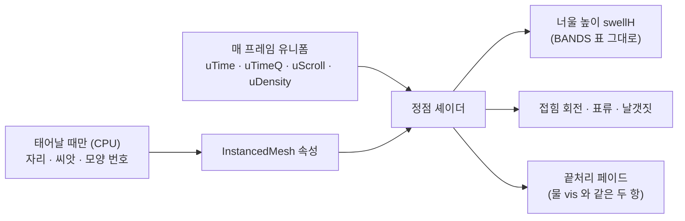
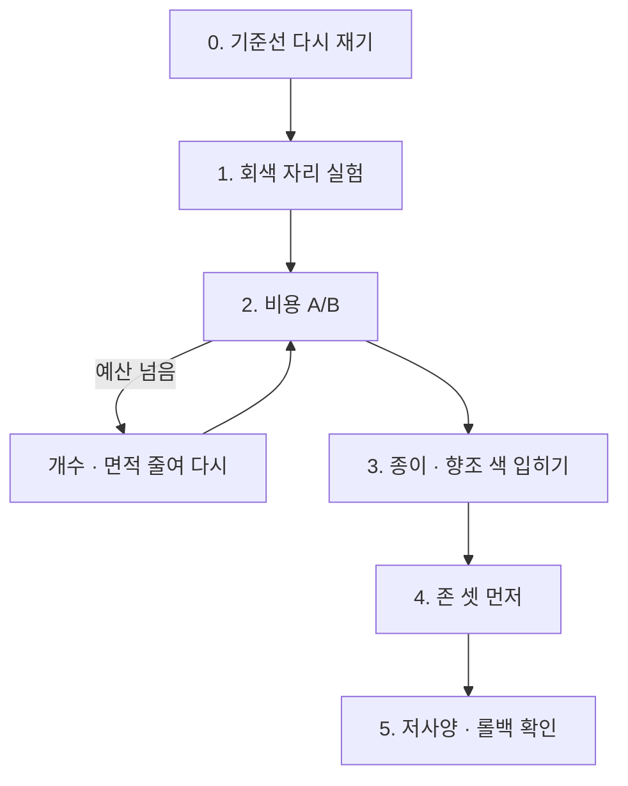

# 바다의 밀도를 채울 오브젝트 고르기

2026-09-17 · 분석 문서 (구현 전)

1순위는 **향 조각**(종이로 오린 꽃잎 · 잎 · 호박 방울이 수면과 공중에 떠 있는 것), 2순위는 **종이학 떼**다. 사용자가 든 세 후보만 놓고 보면 새(떼) 77점 > 향수병 71점 > 돌고래 51점이고, 새는 종이학으로 바꿔 2순위에 흡수한다. 향수병은 부표(= 향수)와 뜻이 겹쳐 장식으로 쓰지 않고, 돌고래는 탈락시킨다.

두 추천안을 합쳐도 드로우콜(draw call — GPU 에 "이 묶음을 그려라" 보내는 명령 한 번) +2, 삼각형 1천 개 안팎, 추가 렌더 패스 0 이다. 노트북 내장 GPU(iGPU)에서도 예산 안에 든다는 계산이지만, 지금 기준선 자체가 낡아서 **실험 0단계(기준선 다시 재기)부터** 한다.

---

## 1. 지금 장면 — 비어 있는 곳은 "수평선 아래 원경 띠"와 "근경 수면"이다

평상시(항해) 화면에서 가장 빈 곳은 수평선(화면 위 15%)부터 부표가 사라지는 선(약 30%)까지의 띠다. 문서도 이미 "원경 띠는 비어 있다"(`docs/무대와-존-연출.md:1791`), "평상시 화면은 여전히 비어 있다"(`docs/무대와-존-연출.md:1793`)고 적어 뒀다. 원경 산은 "사방이 산이면 바다가 아니다"로 걷어냈다(`docs/무대와-존-연출.md:1749`).

### 1-1. 지금 있는 층

| 층 | 파일 | 언제 보이나 | 밀도에 주는 몫 |
|---|---|---|---|
| 하늘 구 (반지름 300) | `src/stage.js:37`, 색은 `src/sky.js` | 늘 | 색면. 형태 없음 |
| 수면 (512² = 52만 삼각형) | `src/water.js`, 파동 `src/sim.js` · 너울 `src/swell.js` | 늘 | 화면의 73.1% (`CLAUDE.md:1130` — 09-06 · camDist 3.24 · 하늘이 생기기 전 실측. 지금 구도에서는 미확인) |
| 돛단배 GLB `boat_v2.glb` (8.3MB · 선실 외벽만 6.9만 삼각형 · 종이 질감) | `src/boat.js:224`, `src/boat.js:388` · 기본 `boatModel 1` (`src/params.js:1998`) | 늘, 화면 가운데 | 주인공 |
| 향수 부표 (구 · 높이 1.95 공중) | `src/marks.js`, `src/params.js:1685` | 배에서 22 월드부터 옅어져 38 에서 사라진다 (`src/config.js:303`, `src/marks.js:700`) | 화면 안 약 24개 × 3패스 |
| 수면 타이포 · 좌우 암석 윙 | `src/title.js` · `src/gate.js:23` | **존 연출 때만** | 존 화면의 틀 |
| 물보라 (탄도 입자 120개) | `src/spray.js:12`, `src/config.js:289` | **기본 꺼짐** (`src/params.js:536`) | 0 |
| 바다 누르기 표시 | `src/seamark.js` | 누른 순간 — 줄기 약 0.54초 · 고리 0.9초 (`src/params.js:1274`, `:1283`) | 순간 |
| 존(향조 아홉) | `src/areas.js:14`, `src/zones.js:6` | 화면에 안 그림 — 자동 조타 목표뿐 | 0 |
| 종이 질감 | `src/paper.js:7` — 파일 없이 함수로 512² 두 장 | 배에만 | 재질 |

### 1-2. 화면 세로 띠 — 무엇이 차지하나 (항해 · 1920×1080)

아래 %는 `docs/무대와-존-연출.md:487` 의 식(수평선 NDC = tan(pitch)/tan(fov/2))에 카메라 높이 10.30 · 카메라~배 약 37 월드를 넣은 **(추정)** 값이다. 수평선 15%와 물끝 27%(185 ÷ 682)만 실측이다 — 09-09 · 캔버스 792×682 · **정지** (`docs/무대와-존-연출.md:607`, `:611`, `:612`).

⚠ 이 띠는 **정지 구도** 값이다. 속도가 오르면 fov 가 43 → 54 로 커져(`src/main.js:472`, `src/config.js:251`) 수평선이 부스트에서 약 23% 까지 내려간다 (위 식으로 계산).

| 띠 | 화면 y | 지금 있는 것 | 상태 |
|---|---|---|---|
| A. 앱 헤더 · 검색창 | 0~16% | 헤더 90px(`frontend/src/pages/HomePage.tsx:90`) · 검색창(위 30 + 헤더 90 = 120 · 높이 50px — `landing/index.html:210-215`) · 왼쪽 향해 일지 판의 윗변(`HomePage.tsx:139`, `:159`) | UI 로 참 |
| **B. 원경 띠** | **15~30%** | 안개로 녹는 먼 물뿐. 부표는 배 뒤 38 월드에서 사라진다(약 30%). ⚠ 왼쪽 30~270px 는 향해 일지 판이 덮는다 — 넓은 창에서는 펼친 채 뜨고 목록이 최대 480px 까지 내려온다 (`VoyageLog.tsx:105`, `:136`, `:228`) | **가운데 · 오른쪽이 비었다** |
| C. 부표 띠 | 30~85% | 부표 · 이름표 · 말풍선 카드 · 12개 연결선 | 정보로 참. 더 넣으면 방해 |
| **D. 근경 수면 · 좌우 아래 모서리** | 60~100% 좌우 | 물결뿐. 부표는 카메라에서 14 월드 안쪽부터 옅어져 6.3 월드에서 사라진다(`src/params.js:1695`, `src/marks.js:707-710`) | **비었다** (오른쪽 아래는 미니맵) |

⚠ 향해 일지 판은 **앱(호스트)의 UI** 라 엔진이 그 상자를 모른다 (`CLAUDE.md:662`). 새 층이 그 판을 피하게 하려면 앱이 상자를 넘기는 문이 따로 필요하고, 겹침 측정도 `/landing/index.html` 단독이 아니라 메인 `/` 에서 해야 한다.

존 구도(`zonePitch` 9 · `src/params.js:327`)에서는 수평선이 30%로 내려가 B 띠를 **수면 타이포와 존 정보 블록**이 차지하고, D 띠 좌우를 **암석 윙**이 덮는다. 그래서 존 화면은 이미 빽빽하고, 비는 것은 **항해 화면**이다.

### 1-3. 새 층이 밟을 규칙

- 후처리는 블룸 하나만, `Reflector` 같은 씬 전체 재렌더는 넣지 않는다 (`CLAUDE.md:935`, `CLAUDE.md:960`). 다만 레이어로 고른 물체만 그리는 패스는 이미 있다 — 반사(레이어 2 · 절반 해상도 타깃, `src/reflect.js:6`, `:37`) · 발광 원천(레이어 3, `src/bloom.js:41`).
- 부표가 물결을 타면 "배가 가는지 표지가 떠내려오는지" 구분이 안 된다 (`CLAUDE.md:490`). 새로 띄우는 것은 부표와 **다른 높이대 · 다른 뜻**이어야 한다.
- 먼 물체는 `sim.sampler()` 를 못 쓴다 — 창이 배 둘레 ±1.4 월드뿐이다 (`CLAUDE.md:499`). 해석적 너울(`swellCPU` · GLSL `SWELL` — `src/swell.js:274`, `:510`)만 본다.
- 선체 말고도 sim 에 파를 **더하면** 누적 발산 위험이 있다 (`CLAUDE.md:371`). 파문은 시뮬이 아니라 그림으로 낸다.
- 반응하는 배경은 "누를 수 있다"는 힌트가 되고, 눌러도 아무 일 없으면 버그로 읽힌다 (`docs/무대와-존-연출.md:234`).
- 밝은 새 층은 블룸 문턱에 걸려 의도 없이 빛난다 (`docs/무대와-존-연출.md:407`).
- 시간대 색은 `timeNow()` 한 곳에서 받는다 (불변식 25). 끝에서 값이 남으면 안 된다 (불변식 19). 가로 위치(scroll 보정)는 매 프레임 민다 (`CLAUDE.md:496`).

---

## 2. 성능 예산 — 유일하게 믿을 수 있는 iGPU 실측은 09-01 것이다

기준선은 2026-09-01 Intel Arc 내장 그래픽 · 120Hz · 1440×731 · dpr 2 실측이다 (`docs/작업계획.md:1199`). 그때 게이트는 물 12 / 배 8 이었고 지금 기본은 30/30 이다 (`docs/작업계획.md:1209-1210`, `CLAUDE.md` 불변식 20). 그 뒤로 블룸 · 부표 발광 패스 · 반사 패스 · 그림자 맵 · 부표 200개가 들어왔는데, 09-01 과 견줄 수 있게 다시 잰 적이 없다. 09-14 에 보이는 창 HUD 값은 남겼지만 견줄 기준값이 없어 "판정 불가"로 적었다 (`docs/다음-세션.md:43`, `CHANGELOG.md:946`).

| 항목 | 값 | 출처 · 믿을 수 있나 |
|---|---|---|
| rAF p95 (프레임 간격 상위 5%) | 13.5ms | `docs/작업계획.md:1207` · 09-01 · 120Hz 창 · 게이트 12/8, 지금과 다름 |
| GPU 시간 평시 · 최대 | 3.66ms · 12.85ms (시뮬 스텝 버스트) | `docs/작업계획.md:1217` |
| 드로우콜 | 13, 예산은 **기준선 +20%** | `docs/작업계획.md:1211` · `:1259` |
| 블룸 비용 | 1600×900 에서 3.05ms — 가장 비싼 단일 항목 | `CLAUDE.md:966` (기기 미확인) |
| 부표 삼각형 | 화면 안 24개 × 3패스 ≈ 24만 | `CHANGELOG.md:2600` |
| 최근 HUD (v0.60.0 · 09-14) | GPU 1.1~1.8ms · rAF p95 19.5~20.7ms | `CHANGELOG.md:946`, `:966` — "판정 불가"로 적힘 |
| 지금 HUD 의 draw 값 | 컴포저 마지막 패스만 센다 | `CHANGELOG.md:4217` — 믿지 않는다 |

⚠ 지금 `perf.js` 의 draw · tri 는 여러 패스의 합이 아니다. `renderer.info.render` 를 그대로 읽고(`src/perf.js:138`) `autoReset` 을 만지는 곳이 `src/` 에 없다. three r160 은 `render()` 를 부를 때마다 info 를 지운다 (`frontend/node_modules/three/src/renderers/WebGLRenderer.js:1207`). three.js 문서대로 `renderer.info.autoReset = false` 로 두고 프레임 끝에 `reset()` 해야 패스 합이 나온다 ([WebGLRenderer 문서](https://threejs.org/docs/pages/WebGLRenderer.html)).

이 씬의 병목은 정점이 아니라 **물 전체에서 도는 프래그먼트**(fragment — 픽셀마다 도는 계산)와 블룸이다 (`CLAUDE.md:1135` — "진짜는 물 전체에서 도는 바닥", `CLAUDE.md:966` — 블룸). 09-03 에 부표로 드로우콜 +20 · 삼각형 +540 이 늘었을 때도 "영향이 없다"고 판단했다 — 잰 값이 아니라 판단이고, 그 줄은 이유를 "정점이 병목인 씬"이라고 적었다 (`CHANGELOG.md:7000-7003`). 09-06 비용 지도 이전의 판단이라 병목의 근거로는 쓰지 않는다. 그래서 새 층은 **삼각형보다 화면 면적과 추가 패스를 먼저 막는다.** MDN 도 드로우콜을 묶고, 일을 프래그먼트보다 정점 셰이더(vertex shader — 꼭짓점마다 도는 계산)에 두라고 권한다 ([MDN WebGL best practices](https://developer.mozilla.org/en-US/docs/Web/API/WebGL_API/WebGL_best_practices)).

### 2-1. 새 오브젝트 층의 예산 (두 추천안 합)

| 항목 | 예산 | 근거 |
|---|---|---|
| 드로우콜 | **+2** (상한 +3) | 09-01 기준선 13 의 +20% = 2.6. 13 은 블룸(09-02)이 들어오기 전 본 화면 패스 값이다. 지금 본 패스는 부표 · 선 등으로 더 많을 것이라 +2 는 보수적인 상한이다 (추정). ⚠ 요청 6 의 추천 빛기둥(`04-향해일지-추천부표.md` §4-3 ②)을 넣으면 이 상한을 같이 나눠 쓴다 |
| 삼각형 | **2,000 이하** | 물 52만 · 부표 24만 대비 0.3% 미만 |
| 추가 렌더 패스 · 렌더타깃 · 후처리 | **0** | 반사(레이어 2) · 발광(레이어 3) · 그림자에 넣지 않는다 (`CLAUDE.md:604`) |
| 텍스처 | 새 파일 **0** · VRAM +1MB 이하 | `paper.js` 노멀맵은 clone 해도 VRAM 이 그대로다 (`src/paper.js:126`). three r160 의 GPU 텍스처 캐시 키에 repeat · offset · rotation 이 없어서다 (`frontend/node_modules/three/src/renderers/webgl/WebGLTextures.js:440-459`) |
| 화면 면적 | 항해 **1% 이하** · 존 **3% 이하** | 반투명 섞기 대신 알파 컷(discard)으로 겹침 그리기를 줄인다 |
| CPU (프레임당) | 유니폼 몇 개만 갱신 | 버퍼는 태어날 때만 쓴다 (`src/spray.js:22` 과 같은 규율) |
| GPU 리드백 | **0** | `sim.sampler()` 금지 |
| GPU 시간 증가 | 켬/끔 차 **0.3ms 이하** (보이는 창 · 화면 1440×900 · 창 안 1440×780 · dpr 2 · 전원 연결 · 에너지 절약 끔) | 목표치 (미측정). 기기 조건은 `02-노트북-크롬-GPU.md` §5 의 측정표와 같게 둔다 |
| 번들 | 코드만, 에셋 0 | 이미지 에셋 총량 500KB 지침 (`docs/작업계획.md:1191`) |

---

## 3. 판단 지표

먼저 **거부권 셋**으로 거르고, 남은 것을 **가중치 9개 · 1~5점**으로 채점한다. 점수 합 = Σ(가중 × 점수) ÷ 5, 만점 100.

### 3-1. 거부권 — 하나라도 걸리면 점수와 무관하게 보류

| # | 조건 | 근거 |
|---|---|---|
| G1 | 새 렌더 패스 · 렌더타깃 · 후처리가 필요하다 (GPGPU 새 떼 계산 포함) | `CLAUDE.md:935-936`, `:960` — CLAUDE.md 가 막는 것은 씬 재렌더 · 거울 렌더타깃 · 새 후처리다. GPGPU 떼 계산까지 막는 것은 이 문서의 판단이다 |
| G2 | 부표(= 향수)와 뜻이 겹쳐 누를 수 있어 보인다 | `docs/무대와-존-연출.md:234`, `CLAUDE.md:490` |
| G3 | 먼 물체가 `sim.sampler()` 에 기대거나 sim 에 파를 더한다 | `CLAUDE.md:499`, `:371` |

### 3-2. 가중 지표

| # | 지표 | 가중 | 무엇으로 재나 | 1점 | 5점 |
|---|---|---:|---|---|---|
| 1 | 서비스 정체성 | 20 | 향(원료 · 향조)과 항해(동행 · 표지) 두 축 중 직접 닿는 수 · 부표와 뜻이 안 겹치나 | 둘 다 무관 | 향조 자체이거나 두 축 모두 |
| 2 | 화면 밀도 기여 | 15 | §1-2 의 빈 띠(B · D) 중 채우는 띠 수 × 화면에 있는 시간 비율 (프레임 표본) | 한 띠 · 시간 10% 미만 | 두 띠 · 상시 |
| 3 | UI 가독성 방해 (적을수록 높다) | 15 | 투영 상자와 UI 상자(검색창 · 정보 블록 · 카드 · 이름표 · 미니맵 · 향해 일지)가 겹친 프레임 비율 + 부표 높이대(약 1.1~2.8 월드 — 높이 1.95 ± 0.15 · 반지름 0.34~0.68) 점유 | 겹침 20% 이상 또는 부표와 혼동 | 겹침 5% 미만 · 부표 높이대 밖 |
| 4 | 렌더 비용 | 15 | 추가 드로우콜 · 개당 삼각형 × 개수 · 추가 패스 · 애니메이션 방식 | 패스 추가 또는 스키닝(skinning — 뼈 행렬로 정점을 움직임) 여러 개 · draw +5 | draw +1 · 삼각형 1천 미만 · 인스턴싱 + 정점 셰이더 |
| 5 | 물 상호작용 재사용 | 5 | 새 코드 없이 쓰는 것 수 : `swellH`/`swellCPU` 너울 · `spray.js` 물보라 · `seamark.js` 고리 | 0 | 3 |
| 6 | 존(향조)별 변주 | 10 | `CONFIG.families` 한 줄로 바뀌는 속성 수 (모양 · 색 · 수 · 움직임) | 0~1 | 4 |
| 7 | 제작 비용 | 10 | 모델링 · 리깅(rigging — 뼈대 심기) · 애니메이션 사람-일 + 외부 에셋 라이선스 위험 | 3일 이상 · 라이선스 확인 필요 | 코드로 생성 · 1일 이내 · 에셋 0 |
| 8 | 저사양 폴백 쉬움 | 5 | 개수 · 면적을 연속으로 줄일 수 있나 · 0 이면 원본과 비트 단위로 같은가 | 켜고 끄기만 | 연속 조절 + 0 이 원본 |
| 9 | 종이 질감 일관성 | 5 | `paper.js` 결을 공유하나 · 존 레퍼런스(`docs/레퍼런스/존0*.webp` — **09-02~03 판본**, `docs/무대와-존-연출.md:2015`)에 같은 재질이 있나 | 사실적 · 유리 | 레퍼런스에 그대로 있다 |

인스턴싱(instancing)은 같은 모양 여러 개를 드로우콜 하나로 그리는 방식이다. three.js 의 `InstancedMesh` 가 이것이고 문서는 "드로우콜 수를 줄여 렌더 성능을 높인다"고 적는다 ([InstancedMesh 문서](https://threejs.org/docs/pages/InstancedMesh.html)). 다만 `InstancedMesh` 는 스키닝을 기본 지원하지 않아 뼈대 애니메이션 모델을 여러 개 그리려면 셰이더를 직접 고쳐야 한다 ([three.js 포럼, 2022-08](https://discourse.threejs.org/t/animated-instanced-skinned-meshes-gltf/41958)). 이 프로젝트의 three r160 에서도 `InstancedMesh` 와 `SkinnedMesh` 는 `Mesh` 를 따로 잇는 별개 클래스다 (`frontend/node_modules/three/src/objects/InstancedMesh.js:17`, `SkinnedMesh.js:23`).

---

## 4. 후보 점수표

`docs/레퍼런스/` 의 존 이미지 넷(`존01-green` · `존02-floral` · `존03-citrus` · `존04-woody`)에는 모두 **수면과 공중에 흩날리는 종이 조각**이 있다. 그래서 추가 후보로 "향 조각"을, 새의 종이 판본으로 "종이학 떼"를 넣었다.

⚠ 이 넷은 **09-02~03 판본**이다 — 종이배 · 하늘 없음 (`docs/무대와-존-연출.md:2015`). 같은 폴더의 `항해-초록프레임` 은 초점 밖의 흐린 잎 틀과 작은 초록 점이라 종이인지 불분명하고, `항해-부표카드` 와 09-10 판본 `존-woody-연출-0910` 에는 떠다니는 조각이 없다. 지금 존 연출은 09-10 판본을 따라 **사실적 암석 윙**(`public/landing/gate-left.webp` · 아홉 존 공통 — `src/gate.js:23`)을 쓴다.

### 4-1. 후보의 기술 모양

| 후보 | 개당 삼각형 | 동시 개수 | 드로우콜 | 애니메이션 |
|---|---:|---:|---:|---|
| 새 떼 (로우폴리 갈매기) | 6~12 (추정) | 5~20 | 1 | 인스턴싱 + 정점 셰이더 날갯짓. three.js 새 떼 예제는 마리당 **3 삼각형** · 날개 끝 정점만 정점 셰이더에서 사인으로 올리고 내린다. 예제는 `InstancedMesh` 가 아니라 1,024마리를 `BufferGeometry` 하나에 합쳐 그린다 ([예제 소스](https://raw.githubusercontent.com/mrdoob/three.js/dev/examples/webgl_gpgpu_birds.html)) |
| 돌고래 (수면 위로 뛰기) | 300~1,500 (추정) — 무료 모델 예 922 ([Poly Pizza · Quaternius](https://poly.pizza/m/3LzFgI3GLO)) | 1~3 | 1 + 물보라 1 | 몸통 포물선 + 몸 굽힘 정점 셰이더. GLB 뼈대(스키닝)면 기본 인스턴싱이 안 된다 |
| 떠다니는 향수병 | 60~300 (회전체, 추정) | 10~30 | 1~2 | 인스턴싱 + 너울 까닥임 |
| **추가 · 향 조각** | 2~4 | 80~200 | 1 | 인스턴싱 + 정점 셰이더 회전 · 표류 · 너울 |
| **추가 · 종이학 떼** | 14~18 (추정) | 5~7 | 1 | 인스턴싱 + 정점 셰이더 날갯짓 |

⚠ 새 떼 예제는 떼 계산에 `GPUComputationRenderer`(렌더타깃 계산)를 쓴다 (같은 소스). 날갯짓 위상도 그 위치 셰이더가 민다. 그 방식은 G1 에 걸리므로 **날갯짓 식만 가져오고, 위상은 유니폼 · 떼 경로는 CPU 경로 하나로 대신한다.**

### 4-2. 점수

| 지표 (가중) | 새 떼 | 돌고래 | 향수병 | 향 조각 | 종이학 떼 |
|---|---:|---:|---:|---:|---:|
| 1 정체성 (20) | 3 | 3 | 5 | 5 | 4 |
| 2 밀도 기여 (15) | 4 | 2 | 3 | 4 | 4 |
| 3 가독성 방해 (15) | 4 | 2 | 1 | 3 | 4 |
| 4 렌더 비용 (15) | 5 | 3 | 4 | 5 | 5 |
| 5 물 상호작용 (5) | 2 | 4 | 4 | 3 | 2 |
| 6 존별 변주 (10) | 3 | 2 | 4 | 5 | 4 |
| 7 제작 비용 (10) | 5 | 2 | 4 | 4 | 4 |
| 8 저사양 폴백 (5) | 5 | 4 | 4 | 5 | 5 |
| 9 종이 질감 (5) | 3 | 2 | 3 | 5 | 5 |
| 거부권 | 통과 | 조건부 (파문을 sim 에 넣으면 G3) | **G2 걸림** | 통과 | 통과 |
| **합 (100)** | **77** | **51** | **71** | **87** | **83** |

### 4-3. 점수의 이유

| 후보 | 올린 것 | 깎은 것 |
|---|---|---|
| 새 떼 | 빈 띠 B 를 상시 채운다 · 비용이 가장 싸다 · 에셋 없이 코드로 만든다 | 향과 무관하다 · 흰/회색 새는 종이 질감 세계에서 중립 |
| 돌고래 | 물보라(`src/spray.js:110` 의 탄도 입자)와 퍼지는 고리 그림(`seamark.js`)을 가져다 쓸 수 있다. 다만 물보라의 `emit` 은 모듈 안에 갇혀 있고, `seamark` 는 `show(x, z)` 가 고리 · 줄기 넷 · 점을 한꺼번에 띄워서 고리만 따로 못 부른다 (`src/spray.js:131`, `src/seamark.js:220`) | 가끔 뛰는 **이벤트**라 대부분 시간 비어 있다 · 부표 띠(C)에서 크게 움직여 카드 · 이름표를 가린다 · 사실적 형태가 종이와 충돌 · AQUATIC 말고 존 변주가 없다 · 라이선스는 검색 목록이 아니라 모델 페이지에 있다 — Quaternius 돌고래는 CC0 · 922 삼각형, Poly by Google 돌고래는 CC-BY 3.0(출처 표기 필요)이고 둘 다 애니메이션 여부는 페이지에 없다 (미확인) · 물보라는 기본 꺼짐이다 (`src/params.js:536`). "흰 알갱이는 안 보인다"(`src/spray.js:49-50`)는 흰 종이 시절 실측이라 지금 저녁 기본 화면에서는 미확인 |
| 향수병 | 서비스와 가장 직접 닿는다 · 병 모양 · 색을 향조별로 바꾸기 쉽다 | **부표가 이미 향수다.** 누를 수 없는 병이 물에 떠 있으면 누르고 싶어지고, 아무 일 없으면 버그로 읽힌다 · 물결 타는 병은 불변식 17 의 혼동을 되살린다 · 유리 하이라이트는 블룸에 걸린다 |
| 향 조각 | 향조의 원료 자체다 · 09-02~03 판본 존 레퍼런스 넷 모두에 있다 · `families` 한 줄로 모양 · 색 · 수 · 움직임이 바뀐다 · 조각당 2~4 삼각형 | 화면 전역에 퍼지면 부표 · 이름표와 겹친다 → §5-2 의 높이대 규칙으로 막는다 |
| 종이학 떼 | 종이 질감 배와 같은 "종이" 세계의 동행 · 빈 띠 B 를 채운다 · 새 떼와 비용이 같다 | 향과는 간접적이다 · 정점 좌표를 손으로 설계해야 한다 · 지금 기본 배는 접은 종이배가 아니라 종이 결을 입힌 돛단배 GLB 라 "접은 종이" 연결은 약하다 (`src/params.js:1998`) |

### 4-4. 가중치를 흔들어도 1 · 2위는 그대로다

| 가중치 세트 | 향 조각 | 종이학 | 새 떼 | 향수병 | 돌고래 |
|---|---:|---:|---:|---:|---:|
| 기본 (§3-2) | 87 | 83 | 77 | 71 | 51 |
| 정체성 우선 (정체성 30 · 렌더 10 · 제작 5 · 나머지 그대로) | 88 | 82 | 73 | 73 | 52 |
| 성능 · 가독성 우선 (정체성 15 · 밀도 10 · 가독성 20 · 렌더 25 · 폴백 10 · 물 0 · 스타일 0) | 88 | 87 | 84 | 69 | 52 |
| 기본 가중 + 지표 9 를 09-10 판본(사실적 암석)으로 다시 매김 (향 조각 · 종이학 5→3 · 새 떼 3→4 · 돌고래 2→3) | 85 | 81 | 78 | 71 | 52 |
| 기본 가중 + 돌고래 제작 비용 2→3 (CC0 모델이 있다) | 87 | 83 | 77 | 71 | 53 |

위 표의 처음 세 줄은 다시 계산해 맞았다. 마지막 두 줄은 반박 검증에서 더한 것이고, 그래도 순위는 같다.

---

## 5. 추천

### 5-1. 1순위 향 조각 · 2순위 종이학 떼 — 둘은 맡는 띠가 다르다

향 조각은 **근경 수면(D)과 존 화면의 좌우**를, 종이학은 **원경 띠(B)**를 맡는다. 겹치는 자리가 없어 같이 넣어도 서로 가리지 않는다. 돌고래는 AQUATIC 존 도착 이벤트로 **3순위 보류**, 향수병은 "부표의 모양을 병으로 바꿀 것인가"라는 **별도 결정**으로 넘긴다.

### 5-2. 배치안

| 상태 | 향 조각 · 수면 | 향 조각 · 공중 | 종이학 떼 |
|---|---|---|---|
| 항해 | 80개 · 배 둘레 반경 6~45 월드 · 높이 0.1~0.6 (너울 위) · 색 = 지금 해역(`scentmap.regionAt`) 향조 색 30% + 종이색 70% | 0 | 35~60초마다 한 무리 5~7마리 · 카메라에서 수평 70~110 월드 · 고도 4~8 → 화면 y 약 18~27% (정지 구도 · 추정) · 한 번 14~20초 가로지름 |
| 존 진입 · 머묾 | `cue.dim` 을 따라 160개로 · 그 향조 모양 | 윙(`cue.openL/openR`)을 따라 0 → 40개 · 화면 좌우 18% 띠 · 카메라 앞 8~16 | 새 무리를 안 띄운다. 날던 무리는 제 길을 마치고 사라진다 (타이포와 다투지 않게). ⚠ 한 번이 14~20초라 진입(2초) 뒤에도 최대 약 18초 타이포 띠를 지날 수 있다 — `cue.rise` 에 맞춰 옅게 거두는 편이 맞다 (추정) |
| 향수 고르기 (12개) | 60% 로 옅게 | 0 | 안 띄운다 (연결선 · 이름표 우선) |
| 먼 곳 이동 (흰 안개) | 안개가 덮은 동안 새 해역 색으로 다시 뿌린다 | 0 | 안 띄운다 |

- **수면 조각은 부표를 구조적으로 못 가린다.** 카메라(높이 10.3)에서 부표(몸통 아래 끝 약 1.1 이상)로 가는 시선은 그 앞에서 늘 1.1 보다 높다 — 수면 위 0.6 안의 조각은 그 선 위에 설 수 없다 (너울이 조각을 들어 올리는 몫과 조각 자체의 크기는 실험 1단계에서 확인). ⚠ 향수 고르기에서 부표가 물속으로 잠기고 솟는 동안은 예외다.
- **종이학은 부표보다 멀리 난다.** 부표는 배에서 22 월드부터 옅어져 38 에서 사라지므로, 배 바로 뒤 방향이면 카메라에서 약 58 월드부터 옅어지고 약 74 월드에서 사라진다. 학은 70~110 월드라 화면에서 부표 띠(30% 아래) 위에 뜬다 (추정).
- 조각은 배 둘레 상자 안에서 셰이더가 좌표를 감아(mod) 되살린다 — CPU 가 매 프레임 다시 뿌리지 않는다. ⚠ 존 연출 동안 배는 씬 원점을 벗어난다 (`boat.pivot.position` — `CLAUDE.md:175-177`). "배 둘레"는 그 오프셋을 같이 받아야 한다.
- `scentmap.regionAt` 은 향수 200개를 도는 함수라 "클릭 · 호버에서만 부른다"고 적혀 있다 (`src/scentmap.js:114-115`). 같은 200개 순회인 `navDist` 는 배 한 점이라 프레임당 한 번 부른다 (`src/scentmap.js:138`). 그래서 배 자리로 몇 프레임에 한 번 부르고, 해역이 바뀔 때만 색을 바꾼다.
- ⚠ `regionAt` 은 엔진의 보로노이 해역이다. 요청 5 의 표류 토스트 · 도착 연출은 서버의 폴리곤 해역을 믿는다 (`04-향해일지-추천부표.md` §1-4 · §3-5). 두 판정이 갈리는 자리에서는 조각 색과 알림의 해역 이름이 다를 수 있다. 조각도 서버 해역을 받을지는 요청 5 가 붙을 때 정한다.
- 공중 조각은 윙이 있을 때만 화면 좌우 띠에 둔다. 레퍼런스(`존02` · `존03` · `존04`)도 큰 조각은 네 귀퉁이 틀에 모여 있다. 다만 작은 조각(꽃잎 · 물방울 · 부스러기)은 화면 가운데 높이까지 흩어져 있고, 그 판본은 존에 들어가도 카메라가 안 움직이고 틀만 들어오는 구성이다 (`docs/무대와-존-연출.md:2031-2034`).
- `phase.js` 는 안 고친다. 이미 있는 `cue.dim`(0.15~1.00초) · `cue.openL/openR` 을 읽는다 (`src/phase.js:54-56` 진입 표 · `:119` cue 필드).

| 향조 | 조각 모양 | 레퍼런스 |
|---|---|---|
| FLORAL | 꽃잎 (한 번 접힘) | `존02-floral` |
| FRUITY | 둥근 과육 조각 · 작은 베리 점 | `존02-floral` (배 · 열매) |
| WOODY | 나뭇결 삼각 부스러기 | `존04-woody` |
| GREEN | 잎사귀 (잎맥 접힘) | `존01-green` (종이 잎이 수면 · 공중에 떠 있다) · `항해-초록프레임` (흐린 잎) |
| CITRUS | 껍질 리본 (길고 비틀림) | `존03-citrus` |
| AQUATIC | 물방울 · 작은 종이 물결 | `존03-citrus` |
| AMBER | 호박 방울 (물방울형) | `존04-woody` |
| GOURMAND | 바닐라 꼬투리 조각 | 없음 — 시안 필요 |
| MUSK | 둥근 솜털 조각 (옅게) | 없음 — 시안 필요 |

색은 `CONFIG.families[].color` 에서 받는다 (`src/config.js:369`) — 부표와 같은 출처라야 같은 향조로 읽힌다. 시간대별 밝기 조정은 `timeNow()` 표에 한 칸을 더한다. 지금 기본 시간대는 **저녁**이다 (`sceneTime 1` — `src/params.js:429`). 낮(흰 종이)으로 바꾸면 상아색 학이 안 보이므로 `seamark.js` 처럼 낮 색을 따로 둔다 (`src/seamark.js:38`).

### 5-3. 애니메이션 방식 — 인스턴싱 + 정점 셰이더, 스키닝 없음

| 무엇 | 방식 | 시계 |
|---|---|---|
| 수면 조각 높이 | GLSL `SWELL` 을 가져와 정점에서 계산 (`src/swell.js:274`) — CPU 사본과 갈라질 수 없다. ⚠ Gerstner 가로 변위가 켜져 있어(`gerstner 0.45` — `src/params.js:484`) 수면 정점은 `p + D(p)` 에 선다. 조각 자리 X 에서 높이를 그대로 읽으면 조금 뜨거나 잠긴다 — `swellCPU` 가 역변환을 한 번 푸는 이유와 같다 (`CLAUDE.md:368`) | `uTimeQ` (물의 시계, 불변식 1) |
| 조각 회전 · 표류 | 씨앗별 사인 두세 개. 접힌 쿼드 두 면이 서로 다른 밝기 = 종이 접힘 | 게이트 시계 (배와 같은 `boatFps` — `src/boat.js:15` 의 컷아웃 질감. 그 줄의 "물 12 / 배 8" 은 옛 값이고 지금은 30/30). ⚠ 가장 가까운 선례인 돛 바람 모션은 물의 시계(`sim.qT`)로 위상을 적분하고 `boatFps` 게이트 **밖**에서 갱신한다 — "게이트에 걸면 천이 덜덜 떤다" (`src/boat.js:634-635`) |
| 학 날갯짓 | 날개 끝 정점에 표시 속성, 사인으로 위아래 — 새 떼 예제는 날개 끝 두 정점의 y 만 `sin(위상)` 으로 민다 | 게이트 시계 (위 돛 선례 참고) |
| 학 무리 경로 | 스폰 때 CPU 가 곡선 하나를 정하고 무리 진행값 유니폼 하나만 민다 | 실시간 dt |
| 가로 위치 (배가 나아간 양) | `uScroll`(가칭) 로 매 프레임. 존 연출 중 배 오프셋도 같이 | 매 프레임 (`CLAUDE.md:496`) |

- 재질은 배와 같은 빛을 받게 `MeshStandardMaterial` 에 `onBeforeCompile` 로 정점 코드를 끼운다 — 돛 모션과 같은 방식이다 (`src/boat.js:234`).
- 종이 결은 `paperVariant()` 로 clone 해 쓴다 (VRAM 그대로). 저사양 단계에서는 결을 끄고 두 톤 음영만 남긴다.
- 반사(레이어 2) · 발광(레이어 3) · 그림자에 넣지 않는다. 블룸 문턱(1.40 — `src/params.js:1084`) 아래 색만 쓴다.
- 정점 셰이더가 자리를 옮기므로 CPU 경계구로 잘리지 않게 `frustumCulled = false` 로 둔다 — 물보라 · 바다 누르기와 같다 (`src/spray.js:102`, `src/seamark.js:149`).
- 씬에 `scene.fog` 가 없다 (`src/` 에 `THREE.Fog` 없음). 원경을 녹이는 것은 물 셰이더의 거리 페이드뿐이라, 70~110 월드의 학은 제 거리 페이드를 따로 가져야 안개 속에 녹는다 (불변식 19).
- 새 모듈 둘(가칭 `src/flakes.js` · `src/cranes.js`)은 `dispose()` 를 같이 만들고 `disposeAll()` 에 등록한다 (`CLAUDE.md:384`). 값은 `params.js` + `PARAM_RANGES` 둘 다 채운다.

### 5-4. 오브젝트별 성능 수치

| | 향 조각 | 종이학 떼 | 합 |
|---|---:|---:|---:|
| 인스턴스 최대 | 200 (수면 160 + 공중 40) | 7 | 207 |
| 삼각형 | 4 × 200 = 800 | 16 × 7 = 112 (추정) | 약 900 |
| 드로우콜 | 1 | 1 | **+2** |
| 화면 면적 (1080p · 추정) | 항해 0.6% · 존 2.5% | 0.1% 미만 (학 한 마리 폭 약 25px) | 예산 안 |
| 추가 패스 · 텍스처 파일 | 0 · 0 | 0 · 0 | 0 · 0 |

### 5-5. 저사양 폴백 — 세 단계, 0 은 원본 · 요청 2 의 품질 단계에 묶는다

이 층은 따로 프레임 시간을 재지 않는다. 요청 2 의 품질 단계(`02-노트북-크롬-GPU.md` §4-1)가 정한 값을 받는다.

| 단계 | 언제 | 무엇 |
|---|---|---|
| 2 기본 | 품질 단계 높음 · 보통 | §5-2 그대로 |
| 1 줄임 | 품질 단계 낮음 · 또는 `prefers-reduced-motion: reduce` | 수면 조각 40% · 공중 조각 0 · 학 무리 간격 2배 · 날갯짓 12Hz · 종이 결 끔 |
| 0 끔 | 품질 단계 최저 · 사용자 설정 | `flakeAmount 0` · `craneAmount 0` → 씬에 안 넣는다 (`stageAmount` 와 같은 롤백 패턴, `src/stage.js:18`) |

- ⚠ 첫 초안은 이 층만의 문턱(rAF p95 20ms 5초 · 33ms)을 따로 뒀다. 요청 2 의 전환 기준(3초 창 p95 25ms 두 창 연속 · 30Hz 상한 구분)과 두 판정기가 따로 움직이면 한 번의 느려짐에 두 번 줄어들어서 하나로 합쳤다.
- `prefers-reduced-motion` 은 사용자가 기기에서 "불필요한 움직임 줄이기"를 켰는지 알려 주는 미디어 기능이다 ([MDN](https://developer.mozilla.org/en-US/docs/Web/CSS/@media/prefers-reduced-motion)).
- ⚠ `perf.js` 는 개발 빌드 전용이다 (`src/main.js:358-359`). 프로덕션에서 단계를 바꾸는 rAF 표본기는 요청 2 가 만든다 — 이 층은 그 단계 값만 읽는다.
- dpr 은 이미 2 로 묶여 있다 (`src/main.js:91`).

### 5-6. 검증용 최소 실험

| 단계 | 할 것 | 통과 기준 |
|---|---|---|
| 0 | 보이는 창 · 화면 1440×900(창 안 1440×780) · dpr 2 · 전원 연결 · 에너지 절약 끔(`02-노트북-크롬-GPU.md` §4-4)에서 60초 HUD + `?perf` 리포트. 요청 2 의 손잡이별 몫 표(`02` §5)와 같은 세션에서 잰다. ⚠ `?perf` 는 개발 서버의 `/__perf` 로 POST 하는데(`src/perf.js:154`) 지금 `frontend/vite.config.ts` 에는 받는 곳이 없다 — 받는 곳을 먼저 만들거나 HUD 값을 손으로 적는다. `renderer.info.autoReset = false` 로 패스 합 draw · tri 를 따로 적는다. `compare.js` `BASELINES` 에 한 줄 먼저 (`README.md:68`) | 숫자가 남았다 (숨은 프레임 0 · 평균 fps 55 이상) |
| 1 | 단색 쿼드 조각 150개 · 삼각형 3개짜리 새 7마리로 **자리만** 본다. 항해 정지 · 부스트 · 존 · 12개 고르기 네 상태 × 뱃머리 0° · ±90°. 향해 일지 판은 앱 UI 라 메인 `/` 에서 잰다 | UI 상자와 겹친 프레임 5% 이하 · 부표를 가린 프레임 0 · 학이 화면 y 17~30% 안 (부스트는 수평선이 내려가므로 따로 본다) |
| 2 | 켬/끔을 30초씩 3번 번갈아. 검증 보기 12(비용 지도)로 새 층 면적, `readRenderTargetPixels` 로 픽셀 차 (기본 프레임버퍼에서 안 읽는다) | draw +2 · GPU 차 0.3ms 이하 · rAF p95 차 1ms 이하 · 면적 §2-1 이하 |
| 3 | 종이 결 · 향조 색 · 시간대(낮 · 저녁 · 밤) | 사용자가 10초 이상 보고 판정 · 블룸 문턱을 넘는 조각 픽셀 0 |
| 4 | 레퍼런스가 있는 FLORAL · CITRUS · WOODY 셋만 먼저 (GREEN 도 `존01-green` 이 있다), 비교 패널 [원본] ↔ 켬 | 사용자 판정 뒤 나머지 여섯 |
| 5 | 단계 1 · 0 을 켠다. dpr 1 로도 본다 | 단계 0 이 비교 패널 '전부 원본'과 비트 단위로 같다 |

---

## 열린 질문

1. 향수병을 **부표의 모양**으로 쓸 것인가 (지금 구 → 병 실루엣). 쓴다면 이 문서의 향수병 점수는 무의미해지고 부표 쪽 결정이 된다.
2. GOURMAND · MUSK 조각 모양은 레퍼런스가 없다 — 시안을 받을 것인가, 임시 모양으로 갈 것인가.
3. 항해 중 수면 조각이 **지금 해역 색**을 띠는 것(§5-2)이 지도 읽기에 도움인가, 부표 색과 섞여 혼란인가. 실험 3단계에서 판정한다.
4. 학이 날갯짓을 게이트 시계(30Hz 끊김)로 할지 실시간으로 할지 — 배의 컷아웃 질감을 공중까지 넓힐지의 문제다. 같은 종류인 돛 바람 모션은 게이트 밖에서 갱신한다 (§5-3, `src/boat.js:634-635`).
5. 돌고래를 AQUATIC 도착 이벤트로 나중에 되살릴 것인가.
6. 외부 에셋을 쓸 경우 : Kenney 는 CC0(상업 사용 · 출처 표기 불필요)이고, Quaternius 누리집의 라이선스는 상업 사용 가능 · 출처 표기 불필요 · 에셋 자체 재배포 금지다(CC0 아님). 그런데 같은 Quaternius 돌고래가 Poly Pizza 에는 CC0 로 올라 있다 — 받은 곳마다 표기가 다르므로 받은 곳의 라이선스를 같이 적어 둔다. 이 문서의 추천안은 둘 다 코드 생성이라 에셋이 필요 없다.
7. **조각의 재질을 어느 판본에 맞출 것인가.** 종이 조각 레퍼런스는 09-02~03 판본이고, 지금 존 연출은 09-10 판본의 사실적 암석 윙이다 (§4 머리). 종이 꽃잎이 사실적 암석 곁에 뜨면 두 세계가 섞인다. 조각을 암석 판본에 맞춰 바꿀지, 윙을 향조별 종이 틀로 바꿀지 사용자 결정이 필요하다.
8. 요청 1 의 원문을 저장소 · 인계 문서에서 찾지 못했다. 이 문서가 다룬 것(세 후보 비교 · 판단 지표 · 성능 예산 · 애니메이션 방식 · 폴백 · 검증 실험) 밖에 요구가 있었는지 사용자에게 확인한다.

## 출처

- three.js InstancedMesh 문서 — https://threejs.org/docs/pages/InstancedMesh.html
- three.js WebGLRenderer 문서 (`info.autoReset`) — https://threejs.org/docs/pages/WebGLRenderer.html
- three.js 새 떼 예제 소스 (`webgl_gpgpu_birds.html`) — https://raw.githubusercontent.com/mrdoob/three.js/dev/examples/webgl_gpgpu_birds.html
- three.js 포럼, Animated Instanced Skinned Meshes — https://discourse.threejs.org/t/animated-instanced-skinned-meshes-gltf/41958
- MDN, WebGL best practices — https://developer.mozilla.org/en-US/docs/Web/API/WebGL_API/WebGL_best_practices
- MDN, prefers-reduced-motion — https://developer.mozilla.org/en-US/docs/Web/CSS/@media/prefers-reduced-motion
- Kenney 라이선스 안내 — https://kenney.nl/support
- Quaternius Asset License — https://quaternius.com/license.html
- Poly Pizza 돌고래 검색 (목록에는 라이선스 표시 없음) — https://poly.pizza/search/dolphin
- Poly Pizza, Dolphin · Quaternius (CC0 · 922 삼각형) — https://poly.pizza/m/3LzFgI3GLO
- Poly Pizza, Dolphin · Poly by Google (CC-BY 3.0) — https://poly.pizza/m/4Gkg2wLGJ_p
