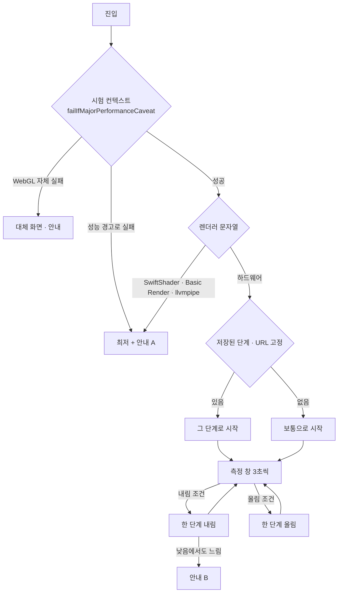
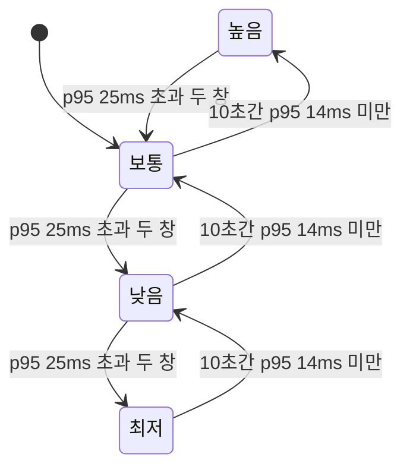
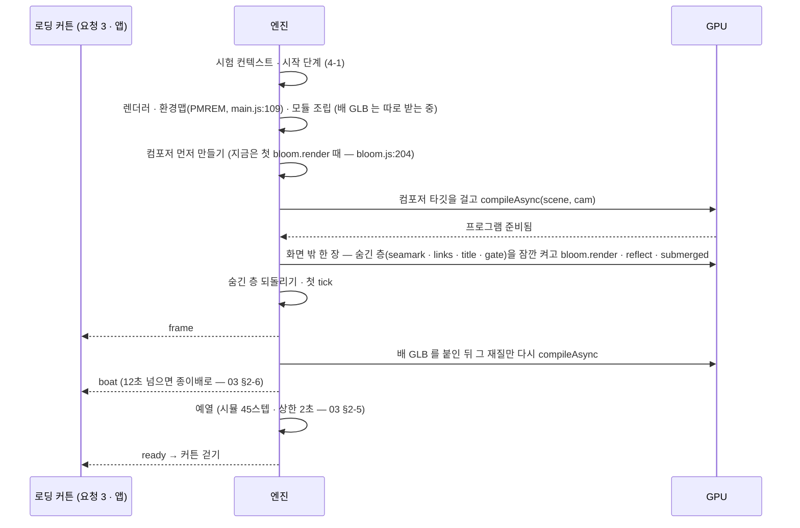

# 노트북 크롬에서 3D 지도가 끊기는 문제 — GPU 경로와 품질 단계

2026-09-17 · 분석 문서 (구현 전)

사이트가 크롬의 GPU(그래픽 처리 장치) 가속을 켤 수는 없다. 사이트가 할 수 있는 일은 세 가지다. 어떤 경로로 그리고 있는지 알아내기, 그에 맞춰 스스로 가벼워지기, 사람이 바꿔야 하는 설정을 한 번만 짧게 알려 주기.
지금 엔진은 기기와 상관없이 늘 가장 무거운 설정으로 그린다. 저성능 감지, 셰이더(GPU 에서 도는 그리기 프로그램) 미리 컴파일, WebGL 실패 안내는 아무것도 없다.

---

## 1. 전제 바로잡기

"노트북 크롬은 설정하지 않으면 GPU 를 안 쓴다"는 틀렸다. 가속은 기본으로 켜져 있다.
대신 노트북에서는 GPU 를 **덜** 쓰거나 **못** 쓰는 경우가 네 가지 있고, 끊김은 대부분 여기서 나온다.

| 구분 | 실제로 일어나는 일 | 사이트가 바꿀 수 있나 | 근거 |
|---|---|---|---|
| (a) 가속 설정 | 기본 켜짐. 정책을 안 정하면 "가능하면 가속"이다 | 없음 | [정책 정의][pol] · [How-To Geek][htg] |
| (b) 차단 목록 · 드라이버 | 문제 있는 GPU · 드라이버에서 WebGL2 · WebGL · GPU 기능 전체 중 일부가 꺼진다. 꺼진 만큼 소프트웨어(CPU)로 그리거나 실패한다 | 감지만 된다 | [software_rendering_list][srl] |
| (c) 하이브리드 그래픽 | Windows 의 내장 + 외장 노트북에서 크롬은 보통 **내장 GPU** 로 돈다 | 없음 | [Chrome WebGPU 문제 해결][gputs] (Windows 한정 절) |
| (d) 에너지 절약 | 전원을 뽑거나 배터리가 적으면 화면 갱신 빈도를 낮춘다 | 감지도 못 한다 | [Chrome 도움말][es-help] · [Chrome 블로그][es-blog] |
| (e) `powerPreference` | 힌트일 뿐이다. Windows 크롬에서는 GPU 를 바꾸지 못했다 | 요청만 된다 | [webgl-dev-list 2022][which] |

### 1-1. (a) 가속 설정은 기본 켜짐

크롬 정책 정의는 "켜거나 **정하지 않으면** 가능할 때 가속을 쓴다"고 적는다 ([정책 정의][pol]).
자리는 설정 → 시스템 → "Use graphic acceleration when available"(한국어 표기 "가능한 경우 그래픽 가속 사용"은 미확인)이고, 바꾸면 크롬을 다시 시작해야 한다 ([Google Meet 도움말][meet-help] · [How-To Geek][htg]).
사용자가 예전에 문제 해결로 껐다면 꺼진 채 남는다. 이때 `chrome://gpu` 의 항목 대부분이 "Software only, hardware acceleration disabled" 로 뜬다 ([How-To Geek][htg]).

### 1-2. (b) 차단 목록과 소프트웨어 렌더링

크롬은 문제가 알려진 GPU · 드라이버 조합에서 WebGL 가속을 끈다.
목록 파일의 항목은 OS · 제조사 · 드라이버 버전과 끌 기능(`accelerated_webgl` 등)으로 되어 있다. 오래된 NVIDIA · AMD · Intel 드라이버에서 D3D11/WebGL2 만 끄는 항목(142 · 144 · 145), WebGL 을 끄는 항목(163 등), 모든 GPU 기능을 끄는 항목(3 등)이 섞여 있다 ([software_rendering_list][srl]).
WebGL2 만 막히면 three r160 은 WebGL1 로 다시 시도한다(`WebGLRenderer.js:261`). 그때 컴포저 MSAA 는 무시되고(`WebGLTextures.js:1718`), 엔진이 WebGL1 에서 제대로 도는지는 (미확인)이다.

가속이 꺼졌을 때 무엇으로 떨어지는지가 최근 바뀌었다.

| 시기 · OS | 가속이 없을 때 WebGL | 근거 |
|---|---|---|
| 예전 | SwiftShader(구글의 CPU 렌더러)로 자동 대체 | [swiftshader.md][ss] |
| 제거 계획 (데스크톱 137 목표) | 자동 대체를 없애고 WebGL 생성이 **실패**한다. 이유는 보안(JIT 코드)과 나쁜 체감. 130 부터 콘솔 경고 | [blink-dev Intent][ss-intent] |
| Windows | SwiftShader 대신 **WARP**(Windows 내장 CPU 래스터라이저)로 대체한다. 137 에서 시험 지원, 139 부터 Finch(일부 사용자 배포)로 실험. SwiftShader 가 꺼지는 사용자는 동시에 WARP 로 옮긴다 | [blink-dev 답글][warp] |
| macOS · Linux | 139 부터 SwiftShader 제거를 실험한다. 적용되면 GPU 없이는 WebGL 생성이 실패한다 | [blink-dev 답글][warp] · [blink-dev Intent][ss-intent] |

Windows 8 부터 WARP 는 "Microsoft Basic Render Adapter" 라는 어댑터로 DXGI 어댑터 목록에 나타난다. 마이크로소프트 문서도 WARP 에서는 "품질 설정과 해상도를 최대한 낮추라"고 권한다 ([WARP 안내][warp-ms]).
즉 Windows 노트북은 가속이 꺼져도 화면은 뜨지만 CPU 로 그려 몇 fps 로 떨어진다(추정 — 이 엔진으로 재지 않았다). 설정으로 가속을 끈 경우도 WARP 로 가는지는 (미확인)이다.
게다가 엔진은 `dt` 를 0.05초로 자른다(`main.js:1289`). 20fps 아래에서는 파도 · 배의 시간이 실제 시간보다 느리게 간다.
단계 배포가 몇 버전에서 모든 사용자에게 끝났는지는 Windows · macOS · Linux 모두 (미확인)이다.

### 1-3. (c) 하이브리드 그래픽 — 절전 GPU 에 묶인다

Windows 크롬은 GPU 를 동시에 여러 개 쓰지 않는다. 다른 크롬 작업이 받은 어댑터를 그대로 쓰고, 노트북에서는 보통 내장 그래픽이다 ([Chrome WebGPU 문제 해결][gputs] — WebGPU 문서의 "Windows-specific limitations" 절).
바꾸는 길은 둘이고, 둘 다 **그 PC 에서만** 효과가 있다 ([webgl-dev-list 2022][which]). macOS · Linux 의 어댑터 선택은 이 문서들에 없다 (미확인).

1. Windows 설정 → 시스템 → 디스플레이 → 그래픽 → 앱별 사용자 지정 옵션에서 앱 고르기 → 옵션 → "고성능"(High performance). 선택지는 Let Windows decide (Power saving) · Power saving · High performance 셋이다 ([Microsoft 지원][ms-gfx])
2. `chrome://flags/#force-high-performance-gpu` 켜고 크롬 다시 시작 ([Chrome WebGPU 문제 해결][gputs]). 명령줄 `--force_high_performance_gpu` 도 같은 길이다 ([webgl-dev-list 2022][which])

외장 GPU 가 없는 노트북에는 바꿀 GPU 자체가 없다(추정). 작업계획 6-2e 의 "Intel Arc iGPU · 1440×731 · 배율 2" 가 이 노트북이라면 여기에 든다(추정).

### 1-4. (d) 에너지 절약 모드

전원이 뽑혔거나 배터리가 적을 때 자동으로 켜지고, 전원에 연결되면 켜지지 않는다 ([Chrome 도움말][es-help]).
화면 갱신 빈도를 낮추고, `requestAnimationFrame`(rAF — 브라우저가 화면을 그릴 때마다 부르는 콜백)도 따라 느려진다. 블로그는 16.67ms 간격을 가정한 애니메이션이 "두 배 느려진다"고 적는다 ([Chrome 블로그][es-blog]). 곧 30Hz 안팎이다(추정).
화면 갱신 빈도를 재는 전용 웹 API 는 없고, rAF 를 계속 돌려 알아내려는 시도도 권하지 않는다(절전 목적을 깎는다) ([Chrome 블로그][es-blog]). 에너지 절약이 켜졌는지 알려 주는 API 도 문서에 없다. 끄는 자리는 설정 → 성능 → 에너지 절약이다 ([Chrome 도움말][es-help]).

엔진은 시간을 `dt` 로 흘리므로(`frontend/landing/src/main.js:1289`) 30Hz 에서도 느려지지 않고 덜 부드러울 뿐이다. 문제는 4-1 의 저성능 판정이 이 30Hz 상한을 "느린 GPU"로 오판하는 것이다.

### 1-5. (e) `powerPreference` 는 플랫폼마다 다르다

스펙상 힌트이고, `high-performance` 를 요청하는 앱은 컨텍스트 소실(그리기 판을 잃는 것)을 견고하게 처리해야 한다 ([WebGL 스펙][spec]).

| 플랫폼 | `'high-performance'` 의 실제 효과 | 근거 |
|---|---|---|
| Windows 크롬 (D3D11) | GPU 를 안 바꾼다 — OS 가 크롬에 준 GPU 그대로다 | [webgl-dev-list 2022][which] · WebGPU 는 [현재 문서][gputs]도 같다 |
| 외장 GPU 달린 맥 (크롬 · 사파리) | 외장 GPU 로 바꾼다. 바뀔 때 약 1초 멈칫하고 컨텍스트 소실이 잦아진다 | [webgl-dev-list 2019][pp80] · 사파리는 [2022][which] |
| 크롬 80 이후 `'default'` | `'low-power'` 로 취급한다. 발표 당시(2019-12) 듀얼 GPU 맥북 프로에만 해당했다 | [webgl-dev-list 2019][pp80] |

2022 년 이후 Windows 크롬의 WebGL 에서 이 힌트가 먹게 바뀌었는지는 (미확인)이다.

---

## 2. 사이트가 할 수 있는 것 / 없는 것

사이트는 설정을 바꾸지 못하고, 감지 · 가벼워지기 · 안내만 할 수 있다.

| 할 일 | 가능 | 방법 | 한계 |
|---|---|---|---|
| 크롬 하드웨어 가속 켜기 | 불가 | — | 설정 변경 + 재시작은 사용자 몫 ([How-To Geek][htg]) |
| Windows 에서 외장 GPU 쓰게 하기 | 불가 | — | OS 설정 · 크롬 플래그뿐 ([which][which]) |
| 에너지 절약 끄기 · 감지 | 불가 | — | 감지 API 없음 ([es-blog][es-blog]) |
| `powerPreference: 'high-performance'` 요청 | 가능 | 렌더러 생성 옵션 ([three r160 문서][three-doc]) | 맥 외장 GPU 에서만 효과 · 컨텍스트 소실 처리 선행 |
| 소프트웨어 렌더링 감지 ① | 가능 | `failIfMajorPerformanceCaveat: true` 로 시험 컨텍스트 | 스펙은 "성능이 극히 낮으면 생성 실패" ([스펙][spec]). 크롬은 SwiftShader 대체를 겨냥해 넣었다 ([blink-dev 2013][fimpc]). WARP 에서 실제로 실패하는지는 (미확인) |
| 소프트웨어 렌더링 감지 ② | 대체로 가능 | `WEBGL_debug_renderer_info` 의 렌더러 문자열에서 SwiftShader · "Microsoft Basic Render" · llvmpipe 찾기 | 개인정보 설정에 따라 막힌다 ([MDN][mdn-dbg]). 예시 문자열 `ANGLE (Microsoft, Microsoft Basic Render Driver Direct3D11 vs_5_0 ps_5_0)` · `ANGLE (Google, Vulkan 1.3.0 (SwiftShader Device (Subzero) …` 은 제3자 수집 ([deviceandbrowserinfo][dbi]). 크롬 139+ WARP 대체에서 같은 문자열인지는 (미확인) |
| 실행 중 저성능 감지 | 가능 | rAF 간격의 p95(95번째로 느린 값) | 에너지 절약 30Hz 와 구별해야 한다 |
| 전원 연결 여부 | 크롬 · 엣지만 | `navigator.getBattery().charging` | HTTPS 전용, Permissions-Policy `battery` 로 막힐 수 있다 ([MDN][mdn-bat]). 파이어폭스 · 사파리 없음 ([caniuse][caniuse-bat]) |
| 안내 표시 | 가능 | 한 번 뜨는 토스트 (4-3) | — |
| WebGL 실패 시 대체 화면 | 가능 | 생성 예외를 잡아 안내 | 지금 없음 (3장) |

---

## 3. 지금 엔진 상태

엔진은 성능 경로를 하나도 가르지 않는다. 가장 비싼 것은 픽셀 수에 비례하는 수면 셰이더 · MSAA 컴포저 · 블룸 두 겹이다.
경로 줄임 : 엔진 파일 이름만 적은 것은 `frontend/landing/src/`, `CLAUDE.md` 는 `frontend/landing/CLAUDE.md`, three 파일(`WebGLRenderer.js` 등)은 `frontend/node_modules/three/` 아래 r160.1 이다.

### 3-1. 렌더러와 화면 크기

| 항목 | 지금 | 근거 | 저사양에서의 뜻 |
|---|---|---|---|
| 컨텍스트 옵션 | `antialias: true` 뿐 | `main.js:86` | `powerPreference` · `failIfMajorPerformanceCaveat` 는 three 기본값(`'default'` · `false`) — `src/renderers/WebGLRenderer.js:79-80` |
| 픽셀 배율 상한 | `min(devicePixelRatio, 2)` | `main.js:91` · `:1857` | 이 노트북(화면 1440×900 · 창 안 1440×780 · 배율 2)은 2880×1560 = **449만 px**. 배율 1 이면 112만 px(25%) |
| 컴포저 타깃 | HalfFloat · MSAA 4 · 화면 × 배율 | `bloom.js:181` | 복제본도 MSAA 4 다 (`examples/jsm/postprocessing/EffectComposer.js:38` · `src/core/RenderTarget.js:117`). 깊이도 MSAA 렌더버퍼 `DEPTH_COMPONENT24` 로 잡힌다 (`src/renderers/webgl/WebGLTextures.js:1402` · `:1430`) |
| 컴포저 메모리 (계산) | 타깃 하나 ≈ 색 144MB(449만 × 4표본 × 8바이트) + 해석 텍스처 36MB + 깊이 약 54~72MB(449만 × 4표본 × 3~4바이트) | 위 둘 | 두 개면 수백 MB 급(추정 — 드라이버마다 다르다). 해석 텍스처 둘(72MB)만으로 작업계획 6-4 예산 "GPU 텍스처 ≤ 64MB"(`docs/작업계획.md:1260`)를 넘는다. MSAA 표본은 텍스처가 아니라 렌더버퍼라 그 예산 밖에 따로 잡힌다 |
| 기본 프레임버퍼 MSAA | `antialias: true` 라 화면 버퍼도 MSAA 다 | `main.js:86` | 컴포저를 타는 동안 화면에는 전체 화면 사각형 한 장(OutputPass)만 그려 이 MSAA 는 할 일이 거의 없다(추정). 블룸을 끈 경로(`bloom.js:203`)에서만 쓰인다 |
| 컨텍스트 소실 처리 | 없음 | `frontend/landing/src` · `index.html` 에 `webglcontextlost` 검색 0건 | three 는 자기 처리기에서 `preventDefault` 를 불러 복구를 받아 준다(`WebGLRenderer.js:255` · `:697-705`). 그래도 GPU 에만 있던 시뮬 텍스처 내용은 사라지고 엔진이 다시 채우지 않는다(추정) |
| WebGL 생성 실패 처리 | 없음 | three 가 예외를 던진다 (`WebGLRenderer.js:275` · `:279`) | `window.PB`(`main.js:2103`)가 안 생기고, `ScentScene` 이 100ms × 600회 = 60초 다시 찾다 멈춘다. iframe `load` 때 횟수를 0 으로 되돌리므로 실제로는 load 뒤 다시 60초다 (`ScentScene.tsx:168-171`). 그 뒤로도 iframe 은 계속 투명하다 (`frontend/src/features/map/components/ScentScene.tsx:72-73` · `:129-131` · `:191`). 사용자는 남색 바탕(`frontend/src/pages/HomePage.tsx:84`)과 앱 헤더 · 향해 일지만 본다. `index.html` 에도 오류 대체 화면이 없다 |

### 3-2. 무거운 층

| 층 | 지금 값 | 근거 | 비용 메모 |
|---|---|---|---|
| 수면 셰이더 | 물이 화면의 73.1% · 픽셀당 해시 16.85 (09-06 · camDist 3.24 실측) | `CLAUDE.md:1130` | 픽셀 수에 정비례 — 배율이 첫 손잡이다 |
| 수면 메시 | 512 분할 ≈ 52만 삼각형 | `config.js:187` · `CLAUDE.md:506` | 384 이면 오차 0.273 · 2.317ms, 512 는 0.142 · 2.721ms (`config.js:183-186` 실측) |
| 파동 시뮬 | 640² HalfFloat 핑퐁 · 30Hz 게이트 · 고정 스텝 1/120 | `config.js:177` · `:208` · `sim.js:140-146` · `params.js:443` | 게이트 한 번에 640² 패스 4번 (계산 1/30 ÷ 1/120) — `sim.js:282-347` |
| 부력 리드백(GPU → CPU 읽기) | 16×16 동기 읽기 · 30Hz | `sim.js:366` · `boat.js:680` · `params.js:557` | 60/60 에서 최대 프레임 0.5ms → 150~235ms 로 튄 전례 (`CLAUDE.md:322`). 지금 30/30 에서의 최대 프레임은 재지 않았다 (미확인). r160 에는 비동기 읽기가 없다 |
| 전역 블룸 | `bloomAmount` 0.90 · 문턱 1.40 | `params.js:1066` · `:1084` · `bloom.js:184` | 1600×900 에서 3.05ms, 물 전체 4.35ms (`CLAUDE.md:966`) |
| 부표 번짐 (GlowPass) | `markBloom` 1.25 · 반쪽 해상도 원천 + 블룸 한 번 더 | `params.js:1611` · `bloom.js:84-105` | 둘 다 0 이면 컴포저를 아예 안 탄다 (`bloom.js:203`) |
| 평면 반사 | `boatReflect` 1.30 · 반쪽 해상도 · 배 게이트마다 | `params.js:1809` · `reflect.js:112` · `:129-134` | 부표 24개 × 세 패스 ≈ 24만 삼각형 (CHANGELOG v0.36.1, `CHANGELOG.md:2600`) |
| 잠긴 선체 | `subAmount` 0.95 · 반쪽 해상도 | `params.js:1020` · `submerged.js:71` · `:82` | 0 이면 패스가 안 돈다 |
| 배 그림자 | 켬 · 1024² | `main.js:131-132` · `params.js:2082` | — |
| 물보라 | 120알 · `sprayAmount` 0 | `config.js:289` · `params.js:536` · `spray.js:144` | 이미 꺼져 있어 손잡이가 아니다 |
| 화면 위 흐림(backdrop-filter) | 앱 헤더 · 향해 일지 6px · 엔진 검색창 7px · 카드 · 미니맵 6px | `frontend/src/app/layouts/GlobalHeader.tsx:33` · `frontend/src/features/map/components/VoyageLog.tsx:136` · `frontend/landing/index.html:330` · `:399` · `:445` | 매 프레임 바뀌는 캔버스 위라 합성 비용이 매 프레임 든다(추정) |

### 3-3. 실측과 계측

실측은 오래됐다. 09-01 Intel Arc 내장 GPU · 120Hz · 배율 2 · 1440×731 에서 rAF p95 13.5ms, GPU 평균 3.66ms · 최대 12.85ms 였다 (`docs/작업계획.md:1199-1220`).
그때는 게이트 12/8 이었고 블룸 · 부표 번짐 · 반사 · 30/30 이 없었다. v0.60.0 기록은 HUD GPU 1.8ms · rAF p95 19.5ms(`CHANGELOG.md:946`)와 GPU 1.1~1.5ms · rAF p95 19.7~20.7ms(`CHANGELOG.md:966`) 두 줄이다. 두 측정표 머리에 900×628 창이 적혀 있지만(`CHANGELOG.md:929` · `:952`) HUD 줄이 같은 창인지 · 어느 기기인지는 안 적혀 있다.

| 도구 | 있는 곳 | 운영 빌드 |
|---|---|---|
| 계측 HUD (GPU ms · rAF p50/p95 · 드로우콜 · LoAF) | `perf.js`, 개발 빌드만 (`main.js:358-359`). ⚠ 드로우콜 · 삼각형은 마지막 `render()` 한 번 값이라 패스 합이 아니다 — 합은 `renderer.info.autoReset = false` 로 잰다 (`01-오브젝트-선택.md` §2) | 없음 |
| GPU 이름 읽기 | `perf.js:84-85` (`WEBGL_debug_renderer_info`) | 없음 |
| 워밍업 5초 제외 · LoAF(긴 애니메이션 프레임 기록) | `perf.js:61` · `:63-73` | 없음 |
| 측정치 회수 `?perf` | `perf.js:154` 가 `/__perf` 로 보내지만 **받는 쪽이 없다** — `frontend/vite.config.ts` 에 그 플러그인이 없고, `README.md:190-192` 의 `perfReport()` 는 paperboat 시절 설명이다 | 없음 |
| 비용 지도 (검증 보기 12) | `CLAUDE.md:1118-1139` — 숨긴 창의 GPU 타이머는 거짓이다 | 없음 |

### 3-4. 첫 상호작용 끊김의 원인

미리 컴파일하는 코드가 없다(`renderer.compile` · `compileAsync` 검색 0건). 처음부터 숨겨 둔 층은 처음 보일 때 셰이더를 만든다.
누른 자리 표시(`seamark.js:168`) · 유사 연결선(`links.js:171` · `:185`) · 수면 타이포(`title.js:148`) · 암석(`gate.js:61`)이 그렇다. 첫 바다 누르기 · 첫 부표 누르기 · 첫 존 도착에서 한 번씩 멈칫한다(추정 — LoAF 로 확인할 것).

---

## 4. 설계 (구현 전)

### 4-1. 감지 → 품질 단계

시작할 때 경로를 가르고, 실행 중에는 프레임 시간으로 한 단계씩만 움직인다.

시험 컨텍스트는 작은 캔버스로 만들고 바로 `WEBGL_lose_context` 로 버린다(추정 — 컨텍스트 수 한도를 아끼는 관례). 실제 렌더러에는 `failIfMajorPerformanceCaveat` 를 넣지 않는다. 느려도 그리는 것이 안 그리는 것보다 낫다.

단계마다 바꾸는 손잡이는 아래와 같다. "높음"이 지금 값이다.

| 손잡이 | 높음 | 보통 | 낮음 | 최저 (소프트웨어) | 근거 · 주의 |
|---|---|---|---|---|---|
| 픽셀 배율 상한 | 2 | 1.5 | 1 | 0.75 | `main.js:91`. 배율 2 기기 기준 픽셀 100 · 56 · 25 · 14% |
| 컴포저 MSAA(계단 줄이기 표본 수) | 4 | 4 | 0 | 0 | `bloom.js:181`. 바꾸면 컴포저를 새로 만든다 |
| 전역 블룸 `bloomAmount` | 0.90 | 0.90 | 0 | 0 | `bloom.js:207` |
| 부표 번짐 `markBloom` | 1.25 | 1.25 | 1.25 | 0 | 저녁 부표의 정체성이라 낮음까지 남긴다 (열린 질문 3) |
| 평면 반사 `boatReflect` | 1.30 | 1.30 | 0 | 0 | `reflect.js:134` |
| 잠긴 선체 `subAmount` | 0.95 | 0.95 | 0 | 0 | `submerged.js:82` |
| 배 그림자 | 1024² | 512² | 끔 | 끔 | `main.js:132` |
| 수면 메시 분할 | 512 | 512 | 384 | 256 | `config.js:183-187`. 지오메트리를 다시 만든다 |
| 셰이더 비용 스위치 | 기본 | 기본 | `glitterOct2` 0 · `microWarp` 0 | + `sparkCull` · `foamCull` 올림 | `CLAUDE.md:1138-1139` |
| 화면 흐림 | 켬 | 켬 | 끄고 바탕 불투명도 올림 | 끔 | 효과는 (추정) — 5장에서 잰다 |
| 새 층 (요청 1 향 조각 · 종이학 · 요청 6 추천 빛기둥) | 기본 | 기본 | 줄임 | 끔 | 새 층은 제 문턱을 두지 않고 이 단계만 읽는다 (`01-오브젝트-선택.md` §5-5 · `04-향해일지-추천부표.md` §4-3) |
| 시뮬 640² · 게이트 30/30 | 그대로 | 그대로 | 그대로 | 그대로 | 해상도는 물결 크기 · 속도를 바꾸고 게이트는 불변식 20 이다 — 사용자 확인 전에는 안 건드린다 (열린 질문 2) |

`antialias` 는 컨텍스트를 만들 때만 정해진다. 단계가 바뀌어도 기본 프레임버퍼의 MSAA 는 못 바꾸므로, 시작 경로가 최저로 정해지면 `antialias: false` 로 만든다.
최저에서 `bloomAmount` · `markBloom` 이 둘 다 0 이면 컴포저를 건너뛰고 화면에 바로 그린다(`bloom.js:203`). 프로그램 키의 출력 색공간이 타깃 유무로 갈리므로(`WebGLPrograms.js:202`) 그 전환 순간 셰이더를 다시 만든다(추정). 컴포저 타깃 메모리도 `dispose()` 전까지 남는다(`bloom.js:226-232`).

전환 기준은 아래와 같다.

| 항목 | 값 | 이유 |
|---|---|---|
| 측정 창 | 3초 (60Hz 에서 180프레임) | `perf.js` 의 600프레임 링버퍼를 그대로 쓰기엔 반응이 늦다 |
| 내림 | 창 p95 > 25ms 가 **두 창 연속** | 60Hz 한 프레임(16.7ms)의 1.5배 · 한 번의 튐으로 안 내린다 |
| 올림 | 10초 동안 p95 < 14ms | 올린 단계의 비용 증가분만큼 여유가 있어야 한다 |
| 되돌림 방지 | 올린 뒤 20초 안에 다시 내리면, 그 세션에서는 올림 금지 | 오르내림 진동을 막는다 |
| 30Hz 상한 구분 | 간격 중앙값이 33ms ±3 이고 p95 < 중앙값 × 1.3 이면 "상한에 묶임"으로 보고 내리지 않는다 | 에너지 절약은 감지 못 하므로 모양으로 가른다 (추정 휴리스틱). 이미 도는 렌더 루프의 간격만 읽는다 — 블로그가 말린 것은 갱신 빈도를 알아내려고 rAF 를 따로 계속 돌리는 것이다 ([es-blog][es-blog]) |
| 30Hz 상한에서의 내림 | p95 > 50ms 가 두 창 연속 | 상한 아래로도 밀릴 때만 내린다 |
| 측정 제외 | 첫 5초 · 로딩 커튼이 덮은 동안 · 배 GLB 를 붙인 뒤 2초(`03-로딩-전환-수중.md` §2-4 의 `boat` — 도착이 5초보다 늦을 수 있다) · 이동 안개 · 창 크기 변경 뒤 2초 · 탭 복귀 뒤 2초 · 단계 전환 뒤 2초 · 앱 모달 동안(`hostHold`, `main.js:56`) | 워밍업(`perf.js:61`) · 재질 컴파일 · 백버퍼 재할당(`main.js:1851-1858`)의 한 번짜리 튐 |
| 기억 | `localStorage` 에 렌더러 문자열 + 화면 크기별 마지막 단계 (try/catch) | 다음 방문에 처음부터 헤매지 않는다 |
| 수동 고정 | `?quality=high` (또는 mid · low) 면 자동 전환을 끈다 | 발표 · 비교용 |

손잡이는 `params.js` 값이므로 단계는 "값 묶음을 넣고 `apply()`" 로 만든다 (`PB.apply()` 규약, README '값 튜닝'). 단계 판정 코드는 계측이 아니라 씬을 바꾸므로 `perf.js` 에 넣지 않는다 (`perf.js:16`).

### 4-2. 첫 진입 셰이더 미리 컴파일

로딩 커튼(요청 3)이 걷히기 전에 모든 셰이더를 만든다. 신호 이름은 `03-로딩-전환-수중.md` §2-4 를 따른다 — 컴파일과 화면 밖 한 장이 끝나면 `frame`, 배 GLB 를 붙이고 다시 컴파일하면 `boat`, 예열까지 끝나면 `ready` 다.
three r160 의 `compileAsync` 는 숨긴 물체의 재질까지 모으고(`scene.traverse` — `WebGLRenderer.js:999`), `KHR_parallel_shader_compile`(컴파일 완료를 막지 않고 묻는 확장)이 있으면 바로 확인한다(`:1076`) ([three r160 문서][three-doc] · [MDN][mdn-khr]).

함정이 하나 있다. 프로그램 키에 **렌더 타깃이 있는지**가 들어간다 (`WebGLPrograms.js:108` · `:202` — 타깃이면 선형 색공간).
엔진은 화면이 아니라 컴포저 타깃에 그리므로, 타깃 없이 `compileAsync` 만 부르면 첫 그림에서 다시 컴파일할 수 있다. 그런데 컴포저는 첫 `bloom.render` 에서야 만들어진다(`bloom.js:204`). 타깃을 걸려면 컴포저를 먼저 만들어 두어야 한다. 반사 · 잠긴 선체 · 발광 원천은 레이어와 타깃이 달라 따로 데워야 한다.
광원도 카메라 레이어로 걸러 모은다(`WebGLRenderer.js:959`). 반사 패스에는 레이어 2 에만 켠 보조광이 하나 더 있어(`reflect.js:79-81`) 같은 재질도 광원 수가 달라 프로그램이 따로 생긴다(추정).

`compileAsync` 는 숨긴 물체도 모으므로(`WebGLRenderer.js:999`) 숨긴 층을 켜는 것은 화면 밖 한 장 렌더 때문이다. 배 GLB 는 병렬로 오므로 `frame` 은 GLB 를 기다리지 않는다.

확인은 LoAF 로 한다. 워밍업 이후 최대 · 첫 부표 누르기 · 첫 존 도착의 긴 프레임이 줄어야 한다 (5장).

### 4-3. 저성능 · 소프트웨어 렌더링 안내

안내는 원인이 확실할 때만, 세션에 한 번, 작게 띄운다.

| 경우 | 조건 | 모양 |
|---|---|---|
| A 소프트웨어 렌더링 | 시험 컨텍스트가 성능 경고로 실패하거나 렌더러 문자열이 소프트웨어 | 진입 3초 뒤 토스트 |
| B 저성능 | 낮음 이하로 내려간 뒤에도 10초 p95 > 33ms | 토스트 |
| C WebGL 실패 | 컨텍스트 생성 예외 | 토스트가 아니라 대체 화면 (지금은 남색 빈 화면 — 3-1) |

귀찮게 하지 않는 규칙:

- 세션당 한 번. "다시 보지 않기"를 누르면 7일간 안 띄운다 (`localStorage`, try/catch).
- `?quality=` 고정(발표 모드)이면 안 띄운다.
- 존 연출 · 카드 · 앱 모달 · 해도가 열려 있으면 닫힐 때까지 기다린다. 앱 모달이 열렸는지를 전역에서 아는 자리는 아직 없다 (`04-향해일지-추천부표.md` §3-6).
- 자동으로 사라지지 않지만 화면 아래 작게 둔다. 3D 조작을 막지 않는다.
- 띄우는 쪽은 앱이다. A · C 는 `window.PB` 가 열리기 전에 정해지므로 `03-로딩-전환-수중.md` §2-4 의 `pb:boot` 메시지(`frame` 의 `tier` · `error`)로 보낸다. B 는 실행 중에 생기므로 `host.js` 처리기로 종류만 넘긴다. 단독 실행이면 `ui.warn`(`ui.js:382`)으로 한 줄 띄운다 (불변식 32 와 같은 경계).
- 앱의 자리는 페이지를 넘는 알림 자리(`04` §3-6 의 `RootLayout`)와 같이 쓴다. 토스트를 따로 두 벌 만들지 않는다.

문구 초안:

| 경우 | 제목 | 본문 | 단추 |
|---|---|---|---|
| A | 그래픽 가속 없이 그리고 있어요 | 브라우저가 그래픽 카드를 쓰지 못해 화면이 느릴 수 있어요. 가벼운 화면으로 바꿨어요. | 설정 방법 · 닫기 |
| B | 화면이 버벅이면 전원을 연결해 보세요 | 노트북 절전 설정 때문에 느려질 수 있어요. 가벼운 화면으로 바꿨어요. | 설정 방법 · 다시 보지 않기 |
| C | 이 브라우저에서는 3D 지도를 열 수 없어요 | 그래픽 가속이 꺼져 있거나 지원되지 않는 환경이에요. | 다시 시도 · 설정 방법 · 향수 목록으로 (`ROUTES.PERFUMES` — `03` §2-6 과 같은 단추) |

B 는 `navigator.getBattery()` 가 되고 충전 중이면 첫 문장을 "노트북 성능 설정 때문에 느려질 수 있어요"로 바꾼다 ([MDN][mdn-bat]).

"설정 방법" 펼침 내용 (크롬 · Windows 한국어 메뉴 이름은 영문 이름과 대조해 확정할 것 — 아래 한국어 표기는 전부 미확인):

1. **크롬 그래픽 가속** — 설정 → 시스템(주소 `chrome://settings/system` 은 추정) → "Use graphic acceleration when available" 켜기 → 다시 시작 ([Google Meet 도움말][meet-help]). 웹 페이지 링크로는 `chrome://` 주소가 안 열리므로(미확인) 복사 단추를 둔다.
2. **에너지 절약 끄기** — 전원 연결, 또는 설정 → 성능 → 에너지 절약 끄기 ([Chrome 도움말][es-help]).
3. **Windows 고성능 GPU** (외장 그래픽이 있는 노트북만) — 설정 → 시스템 → 디스플레이 → 그래픽 → Chrome → 옵션 → "High performance" → 저장 ([Microsoft 지원][ms-gfx]) → 크롬을 완전히 닫고 다시 열기(추정).
4. **Windows 전원 모드** — 설정 → 시스템 → 전원 및 배터리 → 전원 모드 "Best performance", 전원 연결 · 배터리 따로 ([Microsoft 지원][ms-power]).
5. **확인** — 주소창에 `chrome://gpu` → Graphics Feature Status 의 WebGL 줄이 "Hardware accelerated" 인지 본다. 꺼져 있으면 대부분 "Software only, hardware acceleration disabled" 다 ([How-To Geek][htg]). "Hardware accelerated" 표기는 WebGPU 줄에 대해서만 확인했다 ([gputs][gputs]) — WebGL 줄의 표기는 (추정).

### 4-4. 발표 · 시연 체크리스트

| 언제 | 할 일 | 볼 것 |
|---|---|---|
| 전날 | 발표 PC 의 크롬에서 `chrome://gpu` 를 연다 | Graphics Feature Status 의 WebGL · WebGL2 가 "Hardware accelerated" (WebGPU 줄 표기에서 추정 — [gputs][gputs]) · "Software only" 가 없다 ([How-To Geek][htg]) |
| 전날 | 같은 페이지의 드라이버 · GL 정보 | 렌더러 이름이 외장 GPU(있다면)이고 SwiftShader · "Basic Render" 가 없다. 항목 이름 · 위치는 (추정) |
| 전날 | 같은 페이지의 "Problems Detected"(항목 이름 추정) | WebGL 관련 비활성 항목이 없다. 있으면 드라이버 갱신. `#ignore-gpu-blocklist` 는 발표 PC 에서만 최후 수단 ([gputs][gputs]) |
| 전날 | 외장 GPU 가 있으면 Windows 그래픽 설정에서 크롬 "고성능" | 다시 연 뒤 `chrome://gpu` 렌더러 이름이 바뀌었는지 |
| 전날 | 크롬 확대 100% · 발표 해상도 · 외부 모니터 연결 상태로 확인 | 모니터를 옮기면 배율이 바뀐다 (`main.js:1852-1857`) |
| 당일 | 전원 연결 · Windows 전원 모드 Best performance · 크롬 에너지 절약 끄기 | 주소창 옆 에너지 절약 아이콘이 없다 ([Chrome 도움말][es-help]) |
| 당일 | 다른 탭 · 화면 녹화 외 프로그램 닫기 | 작업 관리자 GPU 사용량(추정) |
| 발표 직전 | 한 번 들어가 바다 누르기 · 부표 누르기 · 존 도착 · 해도까지 한 바퀴 | 셰이더를 한 번 만들어 둔다. 크롬의 셰이더 디스크 캐시가 새로 고침 뒤에도 남는지는 (미확인) |
| 발표 직전 | (구현 뒤) `?quality=high` 로 고정 | 자동 내림 · 안내가 발표 중에 안 뜬다 |
| 대비 | 같은 동선 녹화 영상 | 현장 PC 가 소프트웨어 렌더링일 때 |

### 4-5. 화면 밖 · 다른 페이지일 때 렌더 멈춤

탭 숨김과 페이지 이동은 이미 멈춘다. 멈추지 않는 것은 3D 를 가리는 앱 모달 · 해도다.

| 상황 | 지금 | 제안 |
|---|---|---|
| 탭 숨김 | rAF 해제 · 복귀 때 `getDelta` 버림 (`main.js:1870-1878`) | 그대로 |
| 창 최소화 · 가려짐 | 브라우저가 rAF 를 안 준다 (`CLAUDE.md` 'rAF 가 안 도는 환경') | 그대로 |
| 다른 라우트로 이동 | `HomePage` 가 내려가며 iframe 이 사라진다 (`frontend/src/app/router/index.tsx:69` · `frontend/src/pages/HomePage.tsx:87`) | 멈추지만 돌아오면 모델 · 셰이더 · 시뮬을 처음부터 다시 한다. 유지할지는 열린 질문 5. 유지하면 `display:none` 으로 숨기면 안 된다 — 캔버스가 1×1 이 된다 (`03-로딩-전환-수중.md` §3-1 의 6) |
| 진열대 저장 모달 | 3D 는 계속 그린다 (입력만 잠금, `main.js:1249-1253`) | 모달 동안 한 단계 낮추거나 게이트만 돌리기 |
| 해도(전체 화면 SVG) | 3D 는 계속 그린다 (`index.html:469` · z-index 40) | 해도가 3D 를 얼마나 가리는지 보고 같은 처리 (추정) |
| 창이 포커스만 잃음 | 계속 그린다 | 그대로 (옆 창에서 보는 시연이 있다) |

---

## 5. 확인 방법 (측정 계획 — 실행하지 않음)

보이는 창에서만 잰다. 숨긴 창의 시간 값은 전부 거짓이다 (`CLAUDE.md:1120` · README '계측 HUD').

| 무엇 | 어떻게 | 통과 기준 |
|---|---|---|
| 기기 × 상태 표 | 이 노트북(1440×900 · 배율 2 · 내장 GPU 로 추정) · 1920×1080 배율 1.25 내장 GPU 노트북 · 외장 GPU 노트북(그래픽 설정 전/후) × 전원 연결/배터리 × 에너지 절약 켬/끔 | 칸마다 아래 지표를 채운다 |
| 소프트웨어 강제 | `--use-gl=angle --use-angle=swiftshader-webgl --enable-unsafe-swiftshader` ([swiftshader.md][ss] — 작업계획 `docs/작업계획.md:1289` 의 `--use-angle=swiftshader` 와 값이 다르다). Windows WARP 는 `--use-angle` 에 WARP 값이 있다([chromium 커밋 c39b098][warp-flag] 의 `D3D11WarpForWebGL`) · 정확한 문자열은 (미확인) · 작업계획은 `--disable-gpu` 가 조용히 소프트웨어로 간다고 적었다 (`docs/작업계획.md:1289`) | 감지 100% · 최저 단계 · 안내 A |
| 프레임 시간 | 운영 빌드 + 측정 훅(`?perf` 를 미리보기 빌드에서도 켜는 길 — 미구현. 개발 서버에도 받는 쪽이 없다, 3-3)으로 rAF p50 · p95 · p99 600프레임 | 60Hz 전원 연결: p95 ≤ 20ms (`docs/작업계획.md:1257`) · 에너지 절약: p95 ≤ 40ms (추정 기준) |
| 긴 프레임 | LoAF 워밍업 이후 최대 (`perf.js:69`) | 0ms (`docs/작업계획.md:1258`) · 미리 컴파일 전/후로 첫 누르기 · 첫 존 도착 비교 |
| 동선 | 대기 30초 · 부스트 항해 30초 · 바다 누르기 · 부표 12개 · 존 도착 · 해도 · 먼 곳 이동 | 동선마다 p95 · 긴 프레임 |
| 단계 전환 | 전환 로그 (시각 · 이유 · p95) | 한 세션 3회 이하 · 올림↔내림 진동 0 |
| 손잡이별 몫 | 한 손잡이씩 끄고 A/B — HUD GPU ms(보이는 창) + 검증 보기 12 비용 지도 (`CLAUDE.md:1118-1139`) | 아래 빈 표를 채워 단계 표의 순서를 정한다 |
| 메모리 | [webgl-memory](https://github.com/greggman/webgl-memory) (작업계획 6-4 도구) 로 컴포저 MSAA 켬/끔 | 3-1 의 계산값 확인 |
| 안내 규칙 | 새 세션 · "다시 보지 않기" 뒤 · `?quality=` 고정 · 모달 중 | 규칙표대로만 뜬다 |
| WebGL 실패 | 가속 끈 macOS/Linux 크롬 (SwiftShader 제거가 적용된 버전 — 139 실험부터, 전면 적용 버전은 미확인). 버전에 기대지 않으려면 시험 빌드에서 `getContext` 가 null 을 돌려주게 막는다(추정) | 남색 빈 화면이 아니라 대체 화면 |

손잡이별 몫 표 (측정 후 채움, 이 노트북 · 1440×780 · 배율 2):

| 손잡이 끔 | rAF p95 (ms) | GPU (ms) | 메모리 (MB) | 화면 차이 (사람 판정) |
|---|---|---|---|---|
| 기준 (높음) | | | | — |
| 배율 2 → 1 | | | | |
| 컴포저 MSAA 4 → 0 | | | | |
| 전역 블룸 | | | | |
| 부표 번짐 | | | | |
| 평면 반사 | | | | |
| 잠긴 선체 | | | | |
| 그림자 | | | | |
| 메시 512 → 384 | | | | |
| 비용 스위치 | | | | |
| 화면 흐림 | | | | |

---

## 열린 질문

1. 처음 온 기기의 시작 단계를 "보통"으로 할지 "높음"으로 할지. 보통은 첫 인상 끊김을 줄이고, 높음은 첫 화면이 기준 그림이다.
2. 시뮬 해상도(640)와 게이트(30/30)를 최저 단계 손잡이로 쓸지. 해상도는 물결의 월드 크기 · 속도를 바꾸고(칸 = 110/640 월드), 게이트는 불변식 20 의 사용자 결정이다.
3. 낮음 단계에서 부표 번짐을 남길지. 저녁 화면에서 부표가 빛으로 읽히는 근거가 번짐이다 (불변식 22).
4. `powerPreference: 'high-performance'` 를 넣을지. 맥 외장 GPU 에서만 이득이고 전환 1초 멈칫 · 컨텍스트 소실 처리가 먼저 필요하다.
5. 다른 페이지로 갔다 올 때 iframe 을 유지할지. 재진입 로딩 · 컴파일이 사라지는 대신 GPU 메모리를 계속 쥔다. `03-로딩-전환-수중.md` 열린 질문 6 과 같은 결정이다.
6. WebGL 실패 대체 화면에 무엇을 둘지. 해도는 SVG 라 WebGL 없이 그릴 수 있을지도 모른다(추정 — `chart.js` 가 3D 상태에 얼마나 기대는지 확인 필요).
7. 부력 리드백을 비동기(PBO + fenceSync)로 바꿀지, three 를 올려 비동기 읽기를 쓸지. r160 에는 없고(`WebGLRenderer.js` 검색 0건), 지금 three 문서에는 `readRenderTargetPixelsAsync` 가 있다 ([three.js 문서][three-now]). 몇 버전에 들어왔는지는 (미확인)이다.
8. `?perf` 회수 경로를 `frontend/vite.config.ts` 에 다시 붙일지. 지금은 `perf.js` 가 없는 주소로 보낸다 (3-3).

## 출처

- [Chromium 정책 정의 — HardwareAccelerationModeEnabled][pol]
- [How-To Geek — 크롬 하드웨어 가속 켜고 끄기][htg]
- [Chromium — GPU 차단 목록 software_rendering_list.json][srl]
- [Chromium 문서 — Using Chromium with SwiftShader][ss]
- [blink-dev — Intent to Remove: SwiftShader Fallback][ss-intent]
- [blink-dev 답글 — Windows 는 WARP 로 대체 (2025-08)][warp]
- [Microsoft Learn — WARP 안내][warp-ms]
- [Chrome for Developers — WebGPU 문제 해결][gputs]
- [webgl-dev-list — Which GPU is WebGL using? (2022-11)][which]
- [webgl-dev-list — Default powerPreference in Chrome (2019-12)][pp80]
- [Chrome 도움말 — 에너지 절약][es-help]
- [Chrome for Developers 블로그 — Memory and Energy Saver modes][es-blog]
- [Khronos — WebGL 1.0 스펙 WebGLContextAttributes][spec]
- [MDN — HTMLCanvasElement.getContext 옵션][mdn-ctx]
- [MDN — WEBGL_debug_renderer_info][mdn-dbg]
- [MDN — KHR_parallel_shader_compile][mdn-khr]
- [MDN — Navigator.getBattery][mdn-bat]
- [three.js r160 문서 — WebGLRenderer][three-doc]
- [Microsoft 지원 — Windows 11 앱별 그래픽 설정][ms-gfx]
- [Microsoft 지원 — 전원 모드 바꾸기][ms-power]
- [Google Meet 도움말 — 크롬 그래픽 가속 켜기][meet-help]
- [blink-dev — Intent to Implement and Ship: failIfMajorPerformanceCaveat (2013-11)][fimpc]
- [deviceandbrowserinfo — UNMASKED_RENDERER_WEBGL 값 모음 (제3자)][dbi]
- [caniuse — Battery Status API][caniuse-bat]
- [Chromium 커밋 c39b098 — D3D11 WARP for WebGL 플래그 판정 (2025-04)][warp-flag]
- [three.js 문서 (현재판) — WebGLRenderer.readRenderTargetPixelsAsync][three-now]

[pol]: https://chromium.googlesource.com/chromium/src/+/main/components/policy/resources/templates/policy_definitions/Miscellaneous/HardwareAccelerationModeEnabled.yaml
[htg]: https://www.howtogeek.com/412738/how-to-turn-hardware-acceleration-on-and-off-in-chrome/
[srl]: https://chromium.googlesource.com/chromium/src/gpu/+/refs/heads/main/config/software_rendering_list.json
[ss]: https://chromium.googlesource.com/chromium/src/+/refs/heads/main/docs/gpu/swiftshader.md
[ss-intent]: https://groups.google.com/a/chromium.org/g/blink-dev/c/yhFguWS_3pM
[warp]: http://www.mail-archive.com/blink-dev@chromium.org/msg14458.html
[warp-ms]: https://learn.microsoft.com/en-us/windows/win32/direct3darticles/directx-warp
[gputs]: https://developer.chrome.com/docs/web-platform/webgpu/troubleshooting-tips
[which]: https://groups.google.com/g/webgl-dev-list/c/gf0NHCFQkMM
[pp80]: https://groups.google.com/g/webgl-dev-list/c/ZDms8ZQGl3o
[es-help]: https://support.google.com/chrome/answer/12929150?hl=en
[es-blog]: https://developer.chrome.com/en/blog/memory-and-energy-saver-mode
[spec]: https://registry.khronos.org/webgl/specs/latest/1.0/
[mdn-ctx]: https://developer.mozilla.org/en-US/docs/Web/API/HTMLCanvasElement/getContext
[mdn-dbg]: https://developer.mozilla.org/en-US/docs/Web/API/WEBGL_debug_renderer_info
[mdn-khr]: https://developer.mozilla.org/en-US/docs/Web/API/KHR_parallel_shader_compile
[mdn-bat]: https://developer.mozilla.org/en-US/docs/Web/API/Navigator/getBattery
[three-doc]: https://raw.githubusercontent.com/mrdoob/three.js/r160/docs/api/en/renderers/WebGLRenderer.html
[ms-gfx]: https://support.microsoft.com/en-us/windows/optimizations-for-windowed-games-in-windows-11-3f006843-2c7e-4ed0-9a5e-f9389e535952
[ms-power]: https://support.microsoft.com/en-us/windows/change-the-power-mode-for-your-windows-pc-c2aff038-22c9-f46d-5ca0-78696fdf2de8
[meet-help]: https://support.google.com/meet/answer/9302964?hl=en
[fimpc]: https://groups.google.com/a/chromium.org/g/blink-dev/c/Ty_y2WqA8z0
[dbi]: https://deviceandbrowserinfo.com/learning_zone/articles/webgl_renderer_values
[caniuse-bat]: https://caniuse.com/battery-status
[warp-flag]: https://chromium.googlesource.com/chromium/src/+/c39b098884cbb710d0db4ce6c1300b70ad1891e2%5E!/
[three-now]: https://threejs.org/docs/pages/WebGLRenderer.html
