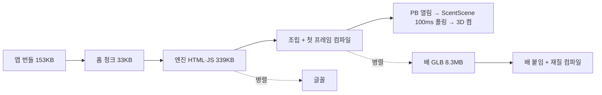
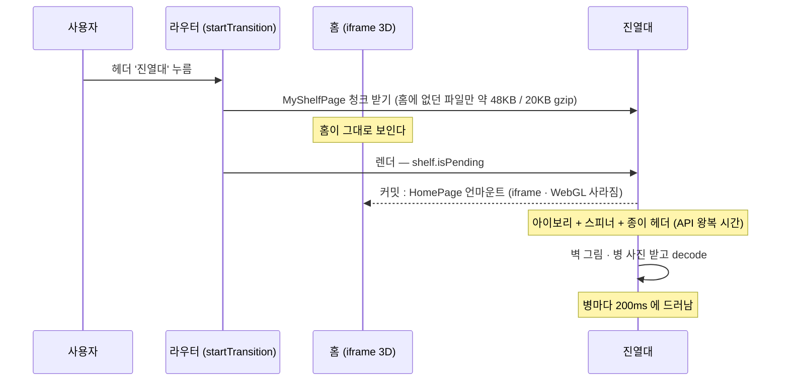
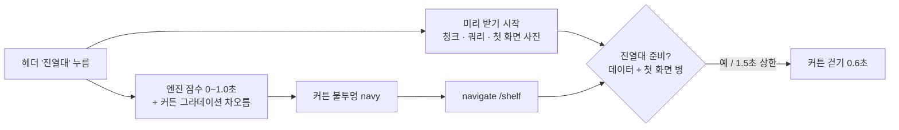

# 첫 진입 로딩 · 진열대 전환 · 바다 밑

2026-09-17 · 분석 문서 (구현 전)

첫 진입의 끊김은 네 번의 화면 바뀜(아이보리 → 스피너 → 남색 → 3D)과 두 번의 멈춤(첫 프레임 셰이더 컴파일 · 배 모델이 뒤늦게 튀어나옴)에서 생긴다. 로딩 화면은 앱 `index.html` 에 **#root 바깥 정적 커튼**으로 두고 React 와 엔진이 이어받아야 번들 받는 시간까지 가린다. 진열대로 넘어갈 때는 **예, 흰(아이보리) 화면이 보인다** — 청크를 받는 동안은 아니고, 진열대 데이터를 받는 동안이다. 지금 바다는 위에서만 보이는 얇은 판이라 카메라를 물속에 넣지 말고, 화면 아래에서 차오르는 그라데이션으로 잠수를 연출해 진열대 커튼에 넘기는 것이 가장 싸다.

용어 : 청크(chunk) = 화면별로 나뉜 JS 파일 · 커튼(curtain) = 화면 전체를 덮는 판 · 컴파일 = GPU 가 그리기 프로그램(셰이더)을 만드는 일 · 예열 = 보이기 전에 미리 몇 프레임 돌려 두는 일.

---

## 1. 첫 진입 로딩 사슬

지금은 8단계가 차례로 이어지고, 가장 무거운 것은 배 모델(8.3MB)이다. 크기는 `frontend/dist`(09-17 14:26 빌드)를 `ls` 로 재고 `gzip -9` 로 압축 크기를 낸 값이다 — 실제 전송 크기는 서버 압축 설정에 달렸다(미확인).

| # | 무엇 | 크기 (원본 / gzip) | 코드 | 그동안 화면 |
|---|---|---|---|---|
| 1 | 앱 번들 (main · routes · useQuery · preload-helper · CSS) | 504KB / 153KB | `frontend/index.html` · `src/main.tsx` | 아이보리 빈 화면 (`src/styles/index.css:191-192`). 첫 칠은 head 의 CSS 둘(Google Fonts · `main-*.css`)이 온 뒤다 (`dist/index.html`) |
| 2 | 홈 청크 (HomePage · map · Toast 등, 전이 의존 · CSS 포함) | 약 94KB / 33KB | `src/app/router/index.tsx:42-44,69` | 유리판 헤더 + 스피너 (`shared/ui/PageFallback.tsx`). 하늘 기본값이 dark 라(`sceneSkyStore.ts:21`) 헤더가 상아색 글자인데 바탕도 아이보리라 흐리다 (`GlobalHeader.tsx:60-72`) |
| 3 | 엔진 HTML | 57KB / 19KB | `ScentScene.tsx:70` iframe | 남색 바탕 (`pages/HomePage.tsx:84`) · iframe 은 투명 (`ScentScene.tsx:191`) |
| 4 | 엔진 JS (three.js 포함) | 1,057KB / 320KB | `landing/index.html:513` | 남색 |
| 5 | 엔진 조립 + 첫 프레임 | — | `main.js:86` 렌더러 → `:112` 환경맵 굽기 → `:171-193` 모듈 생성 → `:1849` 첫 `tick()` → `:2103` `window.PB` | 남색 (메인 스레드 멈춤) |
| 6 | 배 GLB (+ GLTFLoader 청크 45KB) | 8,297,672B / 4.5MB | `boat.js:503-504` (5 도중 `main.js:175` 에서 시작) | 3D 는 켜졌는데 **배가 없다** |
| 7 | 글꼴 (Pretendard CDN · Noto Serif KR · Cormorant) | (미확인) | `landing/index.html:7,18,23` (외부 CSS 셋 — iframe 첫 칠을 막는다. 모듈 실행까지 늦추는지는 (미확인)) · `title.js:243-247` | 검색창 글자가 바뀐다 |
| 8 | 파동 시뮬 차오름 | — | `sim.js:194` (0 으로 비우고 시작) | 항적 · 거품이 아직 없다 |

배 GLB 는 메시 24 · 재질 23 · 정점 192,048 · 삼각형 279,226 · 텍스처 0 · **압축 없음**이다 (GLB 머리 JSON 을 읽어 셌다). 받는 시간은 크기에서 계산만 했다 : 10Mbps 에서 gzip 3.6초 / 원본 6.6초, 50Mbps 에서 0.7 / 1.3초.



### 1-1. 끊김 · 튀어나옴이 생기는 자리

1. **화면이 네 번 바뀐다.** 아이보리 → 헤더 · 스피너 → 남색 → 3D. 3D 는 `opacity-0` 에서 `opacity-100` 으로 전환 없이 한 프레임에 켜진다 (`ScentScene.tsx:164,191`).
2. **첫 프레임이 셰이더를 동기로 컴파일한다.** `tick()`(`main.js:1849`)이 `window.PB`(`main.js:2103`)보다 먼저 돌고, `compileAsync` 호출은 엔진에 0건이다. 같은 출처 iframe 은 부모와 메인 스레드를 나눠 써서, 이 긴 작업 동안 앱의 JS 도 같이 멈춘다 ([webperf.tips](https://webperf.tips/tip/iframe-multi-process/)).
3. **배가 없다가 튀어나온다.** 기본값이 GLB(`params.js:1998` `boatModel: 1`)라 종이배를 숨기고 빈 `glbRoot` 를 켠다 (`boat.js:227,606-607`). 8.3MB 가 도착한 뒤에야 붙고, 그 프레임에 새 재질 컴파일이 한 번 더 걸린다(추정).
4. **바다가 갓 켜진 상태로 보인다.** 시뮬 텍스처를 0 으로 비우고 시작해(`sim.js:194`) 항적 · 거품 채널이 차오르는 동안 비어 있다 (CLAUDE.md 'rAF 가 안 도는 환경에서 검증하기' 절의 "시간이 지나야 차오르므로").
5. **첫 도착 연출에서 한 번 더 걸린다(추정).** 게이트 사진 2장(215KB)은 부팅 때 받지만 판이 숨어 있어(`gate.js:61`) GPU 업로드가 첫 존 진입 프레임으로 밀린다.
6. **실패하면 조용하다.** WebGL 생성이 실패하면(`main.js:86` 에서 예외) `PB` 가 안 생기고, 앱은 100ms × 600회 = 60초 폴링 뒤 포기한다(`ScentScene.tsx:72-73,130`). iframe `load` 때 횟수를 0 으로 되돌리므로(`ScentScene.tsx:168-171`) 실제로는 load 뒤 다시 60초다. 화면은 남색으로 남는다.

---

## 2. 로딩 화면 명세

> ✅ **2026-09-17 첫 판 구현됨** — `frontend/index.html` 의 `#boot`(정적 첫 칠) → `features/map/components/SceneBootCurtain.tsx`(이어받기) · 진행률 모델 `features/map/lib/bootProgress.ts` · 엔진 신호 `landing/src/host.js` `bootReport`(CHANGELOG v0.75.0).
> 이 절과 다른 점 : 막대 · '향해' 글자 대신 **진행률만큼 번져 화면을 채우는 향 원 세 개(대 왼쪽 = 마스크 안 세 색 · 중 오른쪽 위 = 금빛 · 소 오른쪽 아래 = 물빛) + 왼쪽 아래 굵은 퍼센트(Noto Serif KR 900 · 글자 전체가 남색 → 주황)** (사용자 : *"향수 향이 퍼지듯이 퍼센트 표현"* → 같은 날 레퍼런스 이미지로 구성 변경) · 진행률은 실제 진행과 **3초 페이스 곡선 중 작은 값** · 걷힘 1.4초 · `fonts` · `ready`(예열) 단계는 아직 없음 · 셰이더 미리 컴파일(2-8)도 아직.

### 2-1. 자리 — 앱 `index.html` 의 정적 커튼을 React 가 이어받는다

엔진 안에 두면 안 보인다. 앱이 엔진 준비 전까지 iframe 을 투명하게 두기 때문이다(`ScentScene.tsx:191`).

| 안 | 가리는 구간 | 문제 |
|---|---|---|
| 엔진 `landing/index.html` 안 | 3 이후 | iframe 이 투명이라 커튼도 안 보인다 · 1~2 의 아이보리 · 스피너가 그대로 남는다 |
| React 오버레이만 | 2 이후 | 1(153KB)을 받는 동안 빈 아이보리가 보인다 |
| **앱 `index.html` 정적 커튼 → React 인계 (추천)** | 첫 칠부터 | `#root` **안**에 두면 첫 `render` 가 지운다 ([react.dev createRoot](https://react.dev/reference/react-dom/client/createRoot)) → **형제 요소**로 둔다 |

- `frontend/index.html` : `<div id="boot">` 를 `#root` 옆에 두고 스타일 · 작은 스크립트를 인라인으로 넣는다. `location.pathname !== '/'` 이면 스크립트가 바로 지운다.
- React : `RootLayout` 옆 커튼 컴포넌트가 `#boot` 를 **찾아 쥔다**(새로 안 만든다). 진행 상태는 `shared/store` 의 전역 상태 하나에 둔다 — 3장 전환 커튼과 같은 판이다.
- 엔진 : 2-4 의 신호만 보낸다. 커튼이 덮는 동안 iframe 은 투명 처리를 풀고 그대로 그리게 둔다 — 예열이 실제로 돌아야 한다. Blink 의 iframe 스로틀(rAF · ResizeObserver 가 멈춤)은 **교차 출처** iframe 이 `display:none` 이거나 화면 밖일 때의 이야기다 ([Microsoft Learn](https://learn.microsoft.com/en-us/deployedge/edge-learnmore-iframe-throttling-display)). 우리 iframe 은 같은 출처이고 그 문서에 opacity 0 언급은 없다. 같은 출처 · opacity 0 에서 rAF 가 도는지는 (미확인)이라 덮고 그리는 쪽이 안전하다.
- 첫 칠 시각 : head 의 `<link rel="stylesheet">` 는 렌더를 막는다 ([Chrome for Developers](https://developer.chrome.com/docs/lighthouse/performance/render-blocking-resources)). 지금 head 에 Google Fonts CSS 와 `main-*.css` 가 있어(`frontend/dist/index.html`) 커튼도 그 둘이 온 뒤에야 칠해진다. 더 일찍 띄우려면 글꼴 CSS 를 막지 않는 방식으로 바꿔야 한다 (열린 질문 8).

### 2-2. 생김새 · 배치

흰 바탕 가운데 '향해', 아래 가는 막대 하나다. 나중에 디자인을 갈아 끼우기 쉽게 글자 자리 · 막대 자리 두 칸만 둔다.

| | 1920×1080 | 1440×900 | 폭 760 이하 |
|---|---|---|---|
| '향해' | 48px · Noto Serif KR 600 · 세로 가운데에서 위로 20 | 40px | 32px |
| 막대 (폭 × 굵기) | 240 × 2 | 200 × 2 | 160 × 2 |
| 막대 아래끝 여백 | 120 | 100 | 80 |
| 색 | 바탕 `#FFFFFF` · 글자 · 채움 `#1E2947`(앱 navy) · 바닥 선 navy 12% | 같음 | 같음 |
| 겹침 순서 | 헤더(z-20, `GlobalHeader.tsx:177`) · 토스트(z-40, `Toast.tsx:43`) 위 → z-100 | 같음 | 같음 |

- 막대는 `transform: scaleX(p)` 로만 민다. `transform` · `opacity` 로 제한하면 애니메이션이 합성 단계에 머문다 ([web.dev](https://web.dev/articles/animations-guide)). 합성 스레드는 JS 실행을 기다리지 않는다 ([Chrome for Developers](https://developer.chrome.com/blog/inside-browser-part3)). 다만 컴파일로 메인 스레드가 막히면 JS 가 `p` 를 못 바꿔 막대가 선다. 막힘 동안에도 움직여 보이려면 다음 목표값까지 CSS `transition` 을 미리 걸어 둔다 (추정).
- '향해' 글꼴은 `&text=` 두 글자 서브셋으로 따로 받는다 ([Google Fonts](https://developers.google.com/fonts/docs/getting_started) — UTF-8 글자도 된다). 엔진이 Cormorant 를 이미 이렇게 받는다(`landing/index.html:18`). 앱 head 도 Noto Serif KR 600 을 이미 받고 있다 (`frontend/index.html:22-25`). 도착 전 글자가 바뀌어 튀지 않게, 글자는 폰트가 오거나 600ms 가 지나면 300ms 에 걸쳐 드러낸다.

### 2-3. 진행률 모델

단계마다 가중치를 주고, 바이트를 알 수 있는 단계(배 GLB)만 실측하고 나머지는 시간으로 기어가게(creep) 한다.

| 단계 | 끝 신호 | 가중치 | 진행값 f |
|---|---|---:|---|
| A 앱 번들 | 커튼 컴포넌트 첫 연결 | 6 | 기어가기 τ 0.4초 |
| B 홈 청크 | HomePage 마운트 | 4 | 0 → 1 |
| C 엔진 HTML · JS | `script` | 15 | 기어가기 τ 0.8초 (B 에서 시작) |
| D 조립 · 셰이더 미리 컴파일 · 첫 프레임 | `frame` | 15 | 기어가기 τ 0.6초 |
| E 배 GLB 받기 | `boat-bytes` | 45 | `min(1, loaded / BOAT_BYTES)` |
| F 배 붙임 · 컴파일 | `boat` | 7 | 기어가기 τ 0.3초 |
| G 글꼴 | `fonts` | 3 | 0 → 1 |
| H 예열 | `ready` | 5 | 기어가기 τ 0.5초 |

```
기어가기      f(t) = 0.9 · (1 − e^(−t/τ))      t = 그 단계가 시작된 뒤 초 · 끝 신호가 오면 f = 1
목표값        P = Σ wᵢ · fᵢ                     (0~100, 단계는 병렬이어도 그냥 더한다)
표시값        D ← max(D, D + (P − D) · (1 − e^(−Δt/0.25)))    ready 전에는 D ≤ 97
ready 뒤      D 를 250ms 동안 100 으로
```

- `BOAT_BYTES` 는 빌드 때 적는 상수(지금 8,297,672)다. 서버가 GLB 를 압축해 보내면 `Content-Length` 는 압축 크기인데 읽히는 바이트는 풀린 크기라 진행이 100% 를 넘는다 ([Jake Archibald](https://jakearchibald.com/2025/fetch-streams-not-for-progress/)). three 의 `FileLoader` 는 `Content-Length` 다음에 `X-File-Size` 를 본다 (`node_modules/three/src/loaders/FileLoader.js:115`).
- GLB 를 압축(2-8)하면 E 의 가중치를 다시 잡는다. 기준은 "보통 회선에서 단계가 차지하는 시간 비율"이다.

### 2-4. 엔진 → 앱 신호 (`host.js` 초안)

`PB` 가 열리기 전(1-1 의 2 이전) 단계도 알려야 해서 `setHost` 처리기만으로는 모자라다. 같은 출처 `postMessage` 로 부모에 보내고, 늦게 붙은 호스트를 위해 마지막 상태를 `PB.boot()` 로도 읽게 한다.

```js
// landing/src/host.js — 초안 (구현 전)
let boot = { stage: 'html', t: 0 };
export function bootReport(stage, detail = {}) {
  boot = { ...boot, ...detail, stage, t: performance.now() };
  const msg = { type: 'pb:boot', stage, ...detail };
  if (window.parent !== window) window.parent.postMessage(msg, location.origin);
  if (handlers && typeof handlers.boot === 'function') handlers.boot(msg);
}
export const bootNow = () => boot;   // main.js 가 PB.boot 로 내보낸다
```

| stage | 부르는 자리 | 싣는 것 |
|---|---|---|
| `html` | `landing/index.html` 인라인 스크립트 (모듈보다 앞 — `host.js` 를 못 부르므로 `postMessage` 를 직접) · 같은 곳에서 `error` 이벤트도 잡는다 | — |
| `script` | `main.js` 맨 위 (import 평가 직후) | — |
| `frame` | 셰이더 미리 컴파일 · 화면 밖 한 장(`02-노트북-크롬-GPU.md` §4-2) 뒤 첫 `tick()` 다음 줄 — 지금 첫 `tick()` 자리는 `main.js:1849` | `ms` · `tier`(시작 품질 단계 · 소프트웨어 렌더링 여부, `02` §4-1) |
| `boat-bytes` | `boat.js:504` 의 `load()` — 셋째 인자(진행 콜백)가 지금 `undefined` (`boat.js:595`) | `loaded` · `total` |
| `boat` | `boat.js` `glbRoot.add(o)` 뒤 `renderer.compileAsync` 가 끝난 때 | `ms` |
| `fonts` | `document.fonts.ready` (3초 상한) | `ok` |
| `ready` | 예열 조건 (2-5) | `frames` · `simSteps` |
| `error` | 시험 컨텍스트 · 렌더러 생성 실패(`02` §4-1 · 안내 C) · 스크립트 오류 · GLB `onError` | `where` · `message` |

- 앱은 `ScentScene` 에서 `message` 를 받고 `e.origin === location.origin && e.source === iframe.contentWindow` 로 거른다. 폴링(`ScentScene.tsx:72-73`)은 `frame` 을 받은 뒤 한 번 확인으로 줄인다.
- `compileAsync` 는 three 0.160.1 에 있다 (`WebGLRenderer.js:1036`). `KHR_parallel_shader_compile` 이 있으면 막지 않고 완료를 확인한다(`:1076`) — 없는 브라우저도 있다 ([MDN](https://developer.mozilla.org/en-US/docs/Web/API/KHR_parallel_shader_compile)). 없으면 프로그램을 곧바로 준비됨으로 치고, 처음 쓸 때 멈출 수 있다 (`webgl/WebGLProgram.js:1040-1042`).
- ⚠ 컴파일 결과는 **그리는 대상**에 따라 갈린다. 렌더타깃에 그릴 때는 `outputColorSpace` 가 Linear 로 바뀌고(`webgl/WebGLPrograms.js:202`) 그 값이 프로그램 키에 들어간다(`:417`). 엔진은 블룸이 기본으로 켜져 있어(`params.js:1066` `bloomAmount 0.90`) 씬을 컴포저의 렌더타깃에 그린다 (`bloom.js:200-214`). 그러니 화면(렌더타깃 null)에 대고 `compileAsync` 를 부르면 첫 실제 렌더에서 다른 키의 프로그램을 또 만든다. 컴포저도 첫 렌더 때 만든다 (`bloom.js:204`). 예열은 실제 `bloom.render` 를 커튼 뒤에서 몇 번 돌리는 쪽이 확실하다.
- `compile()` 은 숨긴 물체의 재질도 모은다 (`scene.traverse`, `WebGLRenderer.js:999`). 조명만 보이는 것으로 거른다.

### 2-5. 시간 규칙

| 규칙 | 값 (시안) | 이유 |
|---|---|---|
| 예열 끝 | `frame` 뒤 시뮬 45스텝(30Hz 에서 1.5초) **그리고** rAF 간격 34ms 이하 3번 연속 · 상한 2초 | 거품 · 항적이 차오른 바다를 보여 준다 (1-1 의 4). 셰이더 컴파일은 `frame` 앞에 끝나 있다 (`02` §4-2) |
| 최소 표시 | 첫 칠부터 800ms | '향해' 가 읽히고 깜빡임으로 안 보이는 하한 (추정) |
| 사라짐 | 막대 100% → 150ms 멈춤 → 커튼 opacity 1→0 600ms `inOutCubic` | `travel.js:101` 안개 걷힘과 같은 곡선 |
| 재방문 (같은 탭 · `sessionStorage`) | 최소 300ms · 글자 없이 막대만 | 캐시가 차 있어 기다림이 짧다 |
| 앱 안에서 `/` 로 돌아옴 | 같은 커튼 · 글자 없이 | HomePage 가 다시 마운트돼 엔진이 처음부터 뜬다 (3-1 의 6) |
| 탭이 숨음 | 최소 표시 시계를 멈춘다 | 숨은 창에서는 rAF 가 안 돈다 (README '계측 HUD') |

HTTP 캐시 : `/assets/*` 는 파일명에 해시가 있지만 `/landing/boat_v2.glb` 는 없다. 서버 캐시 헤더는 저장소에 설정이 없어(`Jenkinsfile:13,143` 은 rsync 뿐) (미확인)이다.

### 2-6. 실패 · 시간 초과

| 상황 | 알아채기 | 기준 | 화면 |
|---|---|---|---|
| 앱 번들 실패 | 커튼 인라인 타이머에 React 연결이 없다 | 15초 | "불러오지 못했습니다" + [새로고침] |
| 엔진 JS · WebGL 실패 | `error` 또는 `frame` 없음 | `error` 즉시 · `frame` 없음 20초 | 3D 없이 : [다시 시도](iframe 다시 불러오기) · [설정 방법](`02-노트북-크롬-GPU.md` §4-3 안내 C) · [향수 목록으로](`ROUTES.PERFUMES`) |
| GLB 느림 | `boat-bytes` 가 8초 동안 안 늘거나 전체 12초 | 12초 | **종이배(`boatModel 0`)로 걷는다** — 코드로 만든 배라 0바이트다 |
| GLB 실패 | `onError` (`boat.js:595` — 지금은 경고 한 줄뿐) | 즉시 | 종이배로 걷는다 |
| 글꼴 | `fonts.ready` | 3초 | 폴백으로 진행 (title.js 가 도착하면 다시 굽는다) |
| 예열이 안 끝남 | `ready` 없음 | `frame` 뒤 2초 | 걷는다 |

### 2-7. 접근성

- 막대 : `role="progressbar"` · `aria-label="향 지도를 불러오는 중"` · `aria-valuemin 0` · `aria-valuemax 100` · `aria-valuenow`(정수) ([MDN progressbar](https://developer.mozilla.org/en-US/docs/Web/Accessibility/ARIA/Reference/Roles/progressbar_role)). 화면 읽기가 수다스럽지 않게 값 갱신은 10 단위로 묶는다(추정).
- 가려진 본문 : `#root` 에 `aria-busy="true"`, 걷히면 `false`. '향해' 글자는 `aria-hidden`.
- 실패 문구는 `role="alert"`, 버튼은 키보드로 닿는다. 걷힌 뒤 포커스는 지금처럼 엔진으로 넘긴다(`ScentScene.tsx:166` 의 `contentWindow.focus()`).
- `prefers-reduced-motion` : 기어가기 · 부드럽게 따라가기를 끄고 값을 계단으로 쓴다. 사라짐은 150ms. 앱 전역 규칙(`index.css:205-214`)은 CSS 애니메이션 · 전환 시간만 줄이고 JS 로 미는 기어가기는 못 막는다. 그래서 커튼 스크립트가 `matchMedia` 로 따로 본다.

### 2-8. 기다림 자체를 줄이는 것

| 항목 | 지금 | 제안 | 담당 |
|---|---|---|---|
| 배 GLB | 압축 없음 8.3MB | glTF-Transform 으로 weld + meshopt(또는 Draco) ([glTF-Transform](https://gltf-transform.dev/cli)). three 에 `MeshoptDecoder` 가 이미 있다 (`three/examples/jsm/libs/meshopt_decoder.module.js`). 줄어드는 폭은 (미측정) | 디자인(모델) · A 갈래 |
| 서버 | 압축 · 캐시 설정이 저장소에 없음 | `.glb` gzip/br · `/assets/*` 긴 캐시 · GLB 파일명에 버전 | 인프라 |
| 요청 순서 | GLB 요청이 엔진 JS 실행 → 동적 import 뒤 (`boat.js:503-504`) | 엔진 `landing/index.html` head 에 `<link rel="preload" as="fetch" crossorigin>` — `as="fetch"` 는 `crossorigin` 이 있어야 짝이 맞는다 ([MDN preload](https://developer.mozilla.org/en-US/docs/Web/HTML/Reference/Attributes/rel/preload)). GLB 를 요청하는 문서가 iframe 이므로 그 문서에 둔다. 부모 문서에 두면 HTTP 캐시 헤더에 기대게 된다 (추정) | D · C 갈래 |
| 셰이더 | 첫 `tick()` 동기 컴파일 | 커튼 뒤 `compileAsync` — 반사(레이어 2) · 발광(레이어 3) 패스 재질까지. 렌더타깃 변형 때문에 실제 `bloom.render` 예열이 같이 필요하다 (2-4). 순서는 `02-노트북-크롬-GPU.md` §4-2 의 그림 하나로 맞춘다 | A 갈래 |
| 게이트 사진 | 첫 존 진입 때 업로드(추정) | 로딩 중 `renderer.initTexture`(`WebGLRenderer.js:2510`) | C 갈래 |

---

## 3. 질문 답 — 진열대로 넘어갈 때 흰 화면이 보이나

**예, 지금 코드로는 보인다.** 다만 청크를 받는 동안이 아니라 **진열대 데이터를 받는 동안** 아이보리 바탕에 스피너가 보이고, 그 뒤 빈 벽감에 병이 하나씩 드러난다.



- **청크 동안은 안 보인다.** `RouterProvider` 는 `useTransitions` 를 안 주면 상태 갱신을 `React.startTransition` 으로 감싼다 (`node_modules/react-router/dist/development/lib/components.js:146-150`). 경로 요소는 키 없이 같은 자리의 `Suspense` 라(`hooks.js:791` · `router/index.tsx:42-44`) React 가 이미 보인 내용을 숨기지 않고 기다린다 ([react.dev Suspense](https://react.dev/reference/react/Suspense)).
- **데이터 동안은 보인다.** 청크가 오면 `MyShelfPage` 가 `if (shelf.isPending) return <PageFallback />`(`MyShelfPage.tsx:240`)로 **정상 렌더**하므로 전환이 끝나 커밋된다. 그 순간 iframe 이 사라지고 `body` 아이보리(`#f9f6ef`)가 드러난다. 헤더는 종이(`RootLayout.tsx:91,115`)인데 본문은 아이보리라 잠깐 두 장으로 갈린다(`RootLayout.tsx:81-89` 주석의 그 상태).
- **병은 늦게 찬다.** 벽이 먼저 서고, 사진은 `decode()` 가 끝난 병부터 200ms 에 드러난다 (`useBottlePreload.ts:32` · `shelf-display.css:582`).

| 조건 | 흰 화면 | 이유 |
|---|---|---|
| 처음 이동 (진열대 데이터 캐시 없음) | **보인다** (API 왕복만큼) | 위 흐름 |
| 10분 안에 다시 이동 | 거의 안 보인다 | `staleTime` 1분 · `gcTime` 10분 (`shared/lib/queryClient.ts:12-13`) — 캐시로 바로 그리고 뒤에서 다시 받는다 |
| `/shelf` 새로고침 · 직접 진입 | 스피너가 청크 → 데이터 두 구간 이어진다 (같은 `PageFallback` 이 Suspense 폴백 · `isPending` 으로 두 번 선다) | 첫 렌더는 전환이 아니다 |
| 잠수 연출 뒤 이동 | 연출 마지막 장면에서 아이보리로 **뚝 끊긴다** | 연출은 iframe 안에 있고 이동과 함께 사라진다 |

### 3-1. 피하는 법

1. **경로가 바뀌어도 사는 커튼** — `RootLayout` 수준(2-1 과 같은 판)에 둔다. 잠수 끝 색으로 덮은 **뒤에** `navigate`, 진열대가 준비됐다고 알리면 걷는다.
2. **미리 받기** — 홈에서 한가할 때 또는 '진열대' 에 마우스를 올린 순간 : `import('@/pages/MyShelfPage')`(lazy 와 같은 모듈 캐시) + `queryClient.prefetchQuery(shelfItemsQuery())` · 컬렉션 쿼리 + 첫 화면 병 사진 받기.
3. **준비 신호** — 진열대가 첫 화면 병 `data-ready` 가 다 걸리면(또는 1.5초 상한) 커튼에 알린다. 기준은 이미 있는 `useBottlePreload` 의 첫 화면 줄이다.
4. **View Transitions API 는 마지막 교차 페이드에만** — react-router 는 `navigate(to, { viewTransition: true })` 로 `document.startViewTransition` 을 감싼다 ([React Router](https://reactrouter.com/how-to/view-transitions)). 옛 화면은 **정지 스크린샷**이고 콜백 동안 페이지가 얼며 ([Chrome](https://developer.chrome.com/docs/web-platform/view-transitions/same-document)), Chrome 은 약 4초 넘으면 전환을 건너뛴다 ([vtbag](https://vtbag.dev/tips/view-transition-fails-and-fixes/)). 지원은 Chrome 111 · Firefox 144 · Safari 18 ([caniuse](https://caniuse.com/view-transitions)). iframe 속 WebGL 이 스크린샷에 담기는지는 (미확인)이다. 데이터 기다림을 못 풀어 주므로 주 수단으로 쓰지 않는다.
5. **`travel.js` 흰 안개** — 모양(DOM 판 · `inOutCubic` · 덮기 0.6초 / 걷기 0.9초 · 뒤 흐림 10px, `travel.js:28-38,96-101`)은 그대로 옮겨 쓸 만하다. 판 자체는 iframe 안(`landing/index.html:307`)이라 이동과 함께 사라지므로 **곡선과 시간만** 커튼에 가져온다. 전 화면 `backdrop-filter` 는 비싸니 전환 동안만 켠다(같은 파일 주석).
6. **엔진을 살려 두기 (선택)** — 홈 iframe 을 `RootLayout` 으로 올려 다른 화면에서는 숨기고 멈추면 `/` 복귀 때 재부팅(2-5)이 없다. 대가는 WebGL 컨텍스트 · 640² 렌더타깃 2장(`sim.js:145-146`) · 배 모델 메모리를 계속 쥐는 것이다. 숨기는 방법도 걸린다 — `display:none` 이면 엔진이 0 크기를 읽어 캔버스가 1×1 이 된다 (`main.js:83-84` 의 `clientWidth || 1` · `landing/CLAUDE.md` '먼저' 절의 실측). 그래서 크기를 둔 채 가리고 엔진 쪽에서 루프를 멈추는 입구가 필요하다 (결정 필요 — `02-노트북-크롬-GPU.md` §4-5 · 열린 질문 5 와 같은 결정). 살려 두면 요청 5 의 메인 진입 연출(`04-향해일지-추천부표.md` §3-5)도 재부팅이 아니라 돌아올 때 한 번 거는 것으로 바뀐다.



---

## 4. 바다 밑 — 지금 수면 아래에는 아무것도 없다

> ✅ **2026-09-18 — 이 절이 구현됐다** (v0.76.0 · `src/dive.js` + 앱의 `shared/ui/DiveCurtain`).
> 아래 §4-1 의 **A + B** 를 그대로 골랐다 (사용자 선택). C(진짜 물속)는 가지 않는다.
> ⚠ 열린 질문 5 도 같이 닫혔다 — 아래.
> ⚠ 아직 안 한 것 : §3-1 의 3(첫 화면 병 `data-ready` 까지 기다리기 — 지금은 **목록**이 오면 걷는다) ·
>   §3-1 의 6(엔진 살려 두기) · 진열대 → 메인 **복귀** 연출 (사용자 : 이번엔 안 함).


바다는 위에서만 그려지는 110×110 월드짜리 판 한 장이고, 아래에서 보면 판이 사라지고 하늘 구의 지평선 색만 남는다.

| 층 | 지금 | 아래에서 보면 |
|---|---|---|
| 수면 `water.js:2169-2175` | `PlaneGeometry(110, 110, 512, 512)`(`config.js:187-188`) · `ShaderMaterial` 의 `side` 를 안 줘 기본 앞면만 (`three/src/materials/Material.js:24`) · 위를 본다 | **뒷면이 잘려 안 그려진다** |
| 하늘 `stage.js:37,75,80` | 반지름 300 구 · 안쪽 면 · 맨 먼저 | 수평선 아래는 `up = clamp(d.y, 0, 1)`(`sky.js:111`)이라 **지평선 색 한 가지**에 해 쪽 무리만 더해진다(`sky.js:115-117`) — 기본 시간대가 저녁이라(`params.js:429` `sceneTime 1`) `#F0B89A` 복숭아빛 (`config.js:145`) |
| 물에 잠긴 선체 `submerged.js` | 본 카메라로 배의 수면 아래만 따로 찍어 물 셰이더가 비쳐 보이게 섞는다 | 위에서 내려다볼 때만 뜻이 있다 |
| 반사 `reflect.js` | 거울 카메라로 배 · 부표 · 타이포만 찍는다 | 해당 없음 |
| 바닥 격자 `water.js:425-453` | `floorAmount 0` 이라 꺼짐 (`params.js:1936`) | 없다 |
| 거리 페이드 `water.js:1940,2494-2506` | 카메라 XZ 에서 `waterFade0/1`(12 / 24, `params.js:67-68`) × `camDist`(3.96, `params.js:397`) = 기본 구도 약 47.5~95 월드에서 녹는다. `config.js:215` 의 20 / 40 은 params 가 없을 때의 값이다 | — |

카메라를 수면 밑(y < 0)으로 내리면 (코드로 추론 · 화면 미확인) : 물이 한 장의 종이처럼 사라지고, 복숭아빛 빈 공간에 배 선체 밑면과 **공중의 부표가 그대로** 보인다. 파도 변위가 가까운 평면(near 0.1, `main.js:113`)을 지나는 순간 줄무늬도 생긴다(추정). 잠수가 아니라 종이를 뚫은 느낌이 된다.

### 4-1. 잠수 느낌을 내는 방식

| 방식 | 하는 일 | 비용 | 규칙과의 관계 |
|---|---|---|---|
| **A 화면 그라데이션 (추천)** | 카메라는 수면 위에서 내려다보기만 하고, 화면 아래에서 짙은 물색이 차오른다. 높이 200% 판에 `투명 → 짙은 색` 을 칠하고 `translateY` 로 민다 | GPU 합성 한 층 · 드로우콜 0 | `travel.js` 와 같은 DOM 판 방식. 후처리는 블룸 하나만이라는 규칙(`CLAUDE.md:960`)을 안 건드린다 |
| B 안개 · 하늘 색 램프 | 잠수 값 k 로 물의 배경색(거리 페이드 목표) · 하늘 지평선 · `scene.background` 를 짙은 색 쪽으로 민다 | 유니폼만 · 드로우콜 0 | 시간대 표 하나(불변식 25)를 여러 소비자가 읽는 구조라 k 도 `times.js` 한 곳에서 섞어야 한다. A 갈래 파일 여럿 |
| C 수면 뒷면 · 진짜 물속 | 뒷면 전용 셰이더(스넬의 창 · 깊이 안개) · 하늘 아래 반구 교체 · 부표 숨김 | 따로 그리면 수면 메시 한 번 더 = 삼각형 약 52만. 물 전체가 1600×900 에서 4.35ms(`CLAUDE.md:966`)라 수 ms 가 는다(추정). 같은 재질을 `side: DoubleSide` 로 두고 `gl_FrontFacing` 으로 가르면 드로우콜은 그대로지만, 물 셰이더(2,500줄 파일)에 물속 갈래를 새로 짜야 한다 (추정) | "씬을 한 번 더 그리지 않는다"(`CLAUDE.md:935`)와 같은 부담. 1초 남짓한 전환에는 과하다 |
| D 빛줄기 · 물결 빛 (선택) | A 판 안에 옅은 세로 빛줄기 몇 가닥(CSS 그라데이션) · 또는 꺼진 바닥 블록 자리에 물결 빛 무늬 | A 에 붙이면 거의 0 · 셰이더면 픽셀당 해시 비용 | 셰이더 쪽은 "비용은 해시 × 면적"(CLAUDE.md 'GPU 비용') 검사부터 |

### 4-2. 추천 조합과 진열대로 잇기

A + (선택) B 다. **카메라는 수면을 뚫지 않는다** — 뚫기 전에 커튼이 덮는다.

| 시각 | 엔진 (iframe) | 앱 커튼 |
|---|---|---|
| 0.00~0.30초 | 검색창 · 미니맵 · 카드가 옅어진다 | — |
| 0.00~0.90초 | 카메라가 고개를 숙이고 수면으로 다가간다. 지금 높이는 기본 구도 약 10.3 월드(= 0.3 + 37.7 × sin 15.4°, `main.js:460-471` · `params.js:379,397`) · 존 구도 약 3.87 이다 (`CONFIG.cam.yNear` 2.30 은 배율을 곱하기 전 값). 내려갈 목표 높이는 (추정) · B 면 지평선이 짙어진다 | 0.30초부터 아래에서 그라데이션이 차오른다 |
| 1.00초 | 멈춘 채 둔다 | 화면 전체가 navy 로 덮임 → `navigate('/shelf')` |
| 준비 신호까지 (상한 1.5초) | 사라짐 (언마운트) | navy 유지 · 3-1 의 2 로 대개 이미 준비됨 |
| +0.6초 | — | navy → 진열대 종이로 걷힌다 (`inOutCubic`) |

- 카메라 움직임은 `cameraPose` 한 곳(불변식 21)에 넣고, 값은 `phase.js` 처럼 중립 트랙(`dive` 0~1)으로 민다. 시계는 앱 커튼이 쥐고 엔진에 k 를 넘긴다 — 두 판이 따로 시간을 재면 어긋난다.
- 색 시안 : 수면 바로 밑 `#2E5A6E`(청록) → `#1E3A52` → `#1E2947`(앱 navy, 인계 색). 밤 시간대면 앞 두 색을 한 단 어둡게. 전부 (추정) 값이다.
- 움직임 줄이기면 카메라 잠수를 빼고 커튼 교차 페이드 200ms 만 한다.
- 메인 화면에 **늘** 옅은 아래 그라데이션을 까는 쓰임도 가능하다. 다만 화면 아래는 배 · DRIFT 바 · 미니맵(오른쪽 아래) 자리라 그 셋을 가리는지 먼저 본다. 요청 1 의 향 조각이 서는 근경 띠(`01-오브젝트-선택.md` §1-2 의 D, 화면 아래 60~100%)도 같이 덮인다.

---

## 열린 질문

1. 커튼 바탕은 순백 `#FFFFFF` 인가, 앱 아이보리 `#F9F6EF` 인가. 진행 표시에 퍼센트 숫자를 같이 쓰나.
2. '향해' 글자는 웹폰트 서브셋(네트워크 한 번)인가, 인라인 SVG 워드마크(0바이트)인가.
3. GLB 가 12초 넘게 늦으면 종이배로 시작하고 끝까지 둘 것인가, 도착하면 바꿔 끼울 것인가(바꾸는 순간이 또 튀어나옴이다).
4. 예열 1.5초(시뮬 45스텝)를 로딩에 더해도 되나. 아니면 거품 없이 먼저 보여 주나.
5. ✅ **닫힘 (2026-09-18)** — *navy 에서 종이로 바로 걷는다.* 진열대에 어두운 첫 장면을 두려면 `shelf-display.css` 를 건드려야 하는데 그 화면의 색이 재개편 중이라, 기대면 두 번 고치게 된다. 커튼은 진열대의 색을 하나도 모른다.
6. 홈 엔진을 다른 화면에서도 살려 둘 것인가(3-1 의 6 — 복귀가 빠른 대신 메모리 · GPU 를 쥔다). `02-노트북-크롬-GPU.md` 열린 질문 5 와 같은 결정이다.
7. 배 GLB 압축(meshopt · Draco · 단순화)을 누가 하나. 모델 원본을 바꿀 수 있나.
8. 앱 head 의 Google Fonts CSS(`frontend/index.html:22-25`)를 렌더를 막지 않는 방식으로 바꿀 것인가. 안 바꾸면 커튼도 그 CSS 가 온 뒤에 뜬다 (2-1).

## 출처

- [react.dev — Suspense (이미 보인 내용 숨기지 않기)](https://react.dev/reference/react/Suspense)
- [react.dev — createRoot (첫 render 가 기존 HTML 을 지운다)](https://react.dev/reference/react-dom/client/createRoot)
- [React Router — View Transitions](https://reactrouter.com/how-to/view-transitions)
- [Chrome for Developers — Same-document view transitions](https://developer.chrome.com/docs/web-platform/view-transitions/same-document)
- [vtbag — View Transitions: What Could Possibly Go Wrong?](https://vtbag.dev/tips/view-transition-fails-and-fixes/)
- [caniuse — View Transitions API](https://caniuse.com/view-transitions)
- [webperf.tips — Iframes and Process Allocation](https://webperf.tips/tip/iframe-multi-process/)
- [Microsoft Learn — 교차 출처 iframe 스로틀 (display:none · 화면 밖)](https://learn.microsoft.com/en-us/deployedge/edge-learnmore-iframe-throttling-display)
- [web.dev — High-performance CSS animations](https://web.dev/articles/animations-guide)
- [Chrome for Developers — Inside look at modern web browser (part 3) (합성은 메인 스레드를 안 기다린다)](https://developer.chrome.com/blog/inside-browser-part3)
- [Chrome for Developers — Eliminate render-blocking resources (head 의 stylesheet)](https://developer.chrome.com/docs/lighthouse/performance/render-blocking-resources)
- [Jake Archibald — Fetch streams are not for progress](https://jakearchibald.com/2025/fetch-streams-not-for-progress/)
- [MDN — ARIA progressbar role](https://developer.mozilla.org/en-US/docs/Web/Accessibility/ARIA/Reference/Roles/progressbar_role)
- [MDN — rel=preload](https://developer.mozilla.org/en-US/docs/Web/HTML/Reference/Attributes/rel/preload)
- [MDN — KHR_parallel_shader_compile](https://developer.mozilla.org/en-US/docs/Web/API/KHR_parallel_shader_compile)
- [Google Fonts — text= 로 글자 서브셋](https://developers.google.com/fonts/docs/getting_started)
- [glTF-Transform CLI](https://gltf-transform.dev/cli)
