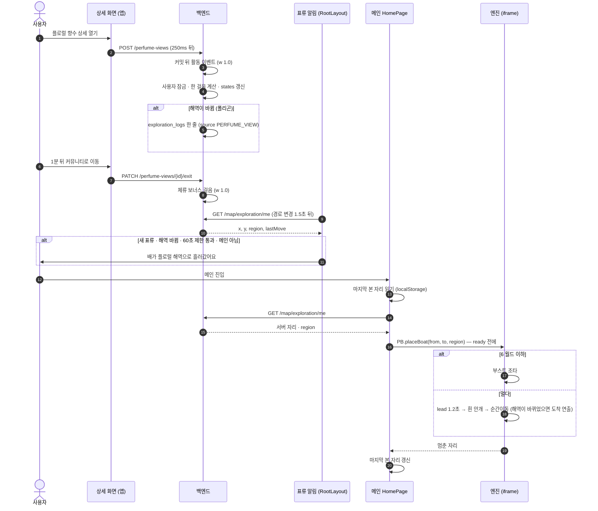

# 향해 일지 · 추천 부표 고도화

2026-09-17 · 분석 문서 (구현 전)

배가 사이트 활동으로 움직이려면 **자리 계산을 백엔드에 한 곳 두고**, 앱은 그 결과를 토스트와 메인 진입 연출로 보여 주기만 하면 된다. 백엔드는 배 자리 · 일지 표 · 폴리곤 해역 판정을 이미 갖고 있지만, 기록을 만드는 길은 지도 클릭 `PUT` 과 취향 테스트의 첫 자리뿐이고, `PUT` 은 엔진도 앱도 부르지 않는다.

추천 부표는 **지도 200개로 좁힌 추천 API 를 새로** 두고, 3D 는 기존 부표 발광(GlowPass)의 세기만 올린다. 3D 부표는 배에서 38 월드 밖이면 안 보이므로 멀리 있는 추천은 미니맵 · 해도 표식이 맡는다.

---

## 1. 지금 상태 — 백엔드

### 1-1. 배 자리와 일지

배 자리는 사용자당 한 줄이고, 일지는 "향수 클릭" 과 "해역이 바뀐 바다 클릭" 만 줄로 남는다. 해역 번호는 저장하지 않고 읽을 때마다 폴리곤으로 다시 판정한다.

| API | 요청 → 응답 | 하는 일 | 근거 |
|---|---|---|---|
| `PUT /api/v1/map/exploration/me` | `{perfumeId}` 또는 `{x, y}` → `{x, y, updatedAt}` | 향수면 그 향수의 지도 좌표로 옮기고 늘 기록 · 바다면 해역이 바뀔 때만 기록 · 자리는 매번 덮어씀 | `ExplorationController.java:55-58` · `ExplorationService.java:104-120` |
| `GET /api/v1/map/exploration/me` | → `{x, y, updatedAt}` (처음이면 셋 다 null) | 배 자리 읽기 | `ExplorationController.java:66-69` · `ExplorationStateResponse.java:15` |
| `GET /api/v1/map/exploration-logs?size=` | → `{entries:[{entryId, enteredAt, scentRegionId, region, visited:[{perfumeId,name}]}]}` | 최근 기록 200줄을 시간순으로 훑어 해역이 바뀌는 곳에서 끊음 · 최대 20개 | `ExplorationService.java:49` · `:59` · `:174-225` |
| (내부) `placeStartingPoint` | 취향 테스트 결과 향수 | 첫 자리 + 첫 일지 줄 | `ExplorationService.java:140-147` · `TasteTestService.java:77` |

- 표 두 개다. `map_exploration_states`(user_id 기본키 · x · y) · `map_exploration_logs`(user_id · perfume_id nullable · x · y · visited_at) (`V1__init_schema.sql:271-292` · `V9__allow_exploration_logs_without_perfume.sql:6-7`).
- 좌표는 지도 좌표 0~1 이다. 향수 좌표에만 0~1 CHECK 가 있고, 해역 폴리곤은 여백까지 x −0.05~1.05 · y −0.046~0.881 로 뻗는다 (`V6__align_scent_map_schema_with_delivered_data.sql:92` · `ScentRegionResponse.java:18`).
- 해역 판정은 광선 교차다. 향수 200개 중 44개는 옆 계열 폴리곤에, 3개는 어느 영역에도 안 앉는다 (`ScentRegions.java:57-72` · `:20-21` · `VoyageLogEntryResponse.java:17-19`). 백엔드 주석이 이미 "더 멀리 보려면 기록에 영역을 저장해 SQL 로 묶으라" 고 적어 뒀다 (`ExplorationController.java:78-80` · `ExplorationService.java:54-58`).

### 1-2. 활동 데이터가 쌓이는 곳

활동은 전부 다른 표에 쌓이고, 배 자리에 닿는 길은 하나도 없다.

| 활동 | API | 향수 번호 | 담당 | 근거 |
|---|---|---|---|---|
| 상세 조회 시작 · 체류 | `POST /api/v1/perfume-views` → `PATCH /{id}/exit` (서버가 초 단위로 잼) | 있음 | 향수 상세 | `PerfumeViewController.java:42-69` · `V1__init_schema.sql:360-375` |
| 유입 경로 | 9값 enum (`SCENT_MAP` · `PERSONALIZED_RECOMMENDATION` …) | — | 향수 상세 | `PerfumeViewSourceType.java:3-13` · `perfumeViewSource.ts:10-20` |
| 진열대 저장 · 분류 | `POST /users/me/shelf-items` (`OWNED · TRIED · WISH`) · `PATCH …/ownership` | 있음 | 진열대 | `ShelfItemController.java:79` · `:311` · `OwnershipStatus.java:9-14` |
| 적합도 | `PUT …/{shelfItemId}/fit-rating` | 진열대 항목 경유 | 진열대 | `ShelfItemController.java:241` |
| 후기 작성 · 좋아요 | `POST /perfumes/{id}/reviews` · `PUT /reviews/{id}/like` | 있음 | 후기 | `ReviewController.java:54` · `:253` |
| 게시글 · 좋아요 · 댓글 | `POST /posts` (`perfumeIds` · `collectionId`) · `PUT /posts/{id}/like` · 댓글 | 글에 걸린 향수 · 댓글은 없음 | 커뮤니티 | `PostCreateRequest.java:53-57` · `PostController.java:82` · `:186` |

- 상세 기록은 250ms 안에 떠나면 시작하지 않고, 탭을 닫으면 나간 기록이 없다. `sendBeacon` 이 Authorization 헤더를 못 실어서다 (`usePerfumeViewLog.ts:18` · `:26-31`). `fetch` 의 `keepalive: true` 는 페이지가 닫혀도 요청을 이어 가고 헤더를 바꿀 수 있다 · 본문 64 KiB 까지 ([MDN RequestInit](https://developer.mozilla.org/en-US/docs/Web/API/RequestInit)).
- 단 앱의 `http` 는 axios 이고(`shared/api/http.ts:1-5` · `:55`), axios 기본 어댑터 순서가 `['xhr', 'http', 'fetch']` 라 브라우저에서는 XHR 로 나간다 (`node_modules/axios/lib/defaults/index.js:42`). `keepalive` 를 실으려면 그 한 번만 `adapter: 'fetch'` + `fetchOptions` 로 보내거나 `fetch` 를 직접 쓴다.
- 이벤트 기반 코드(`@TransactionalEventListener` 등)는 없다. 비동기는 후기 분석 배치 스케줄러뿐이다 (`perfume/batch/ReviewAnalysisScheduler.java`).
- 안 쓰는 표가 있다. `user_map_interactions` · `map_interaction_types` (`V1__init_schema.sql:53` · `:345`) — MAP-12 YES/NO 응답 자리로 보인다 (추정).

### 1-3. 개인화 추천

지금 추천은 카탈로그 전체에서 가중 랜덤으로 **한 개**를 뽑고, 부를 때마다 노출을 저장한다. 그래서 지도 부표로 그대로 쓰면 빛이 호출마다 다른 향수로 옮겨 가고, 부표가 없는 향수가 나올 수 있다.

- 점수 = 취향 테스트 계열 0.35 + 적합도 어코드 0.50 + 최근 조회 어코드 0.15 (`PersonalizedRecommendationRepository.java:61` · `:131` · `:143`).
- 최근 조회는 30일 · 14일 단위 지수 감쇠이고 **`viewed_at` 만 본다. 체류 시간(`duration_seconds`)은 점수에 없다** (`…Repository.java:101-113`).
- 보유(OWNED)만 빼고, `perfume_map_points` 조인이 없다 (`…Repository.java:174-180`).
- 상위 10개 중 3일 안 노출을 빼고 점수 비례 랜덤 · 노출 저장 (`PersonalizedRecommendationService.java:20-21` · `:55-58` · `V20__add_personalized_recommendation_exposures.sql:3-12`).
- 사용자별 잠금은 `pg_advisory_xact_lock(:userId)` 한 인자 형이다 (`…Repository.java:12-14`).

### 1-4. 어긋난 점

| 무엇 | 내용 | 근거 |
|---|---|---|
| 비회원 이동 | 컨트롤러는 "로그인 없이도 배가 움직인다" 인데, 보안 설정이 `exploration/**` 전체에 인증을 건다 → 비회원 PUT 은 401 | `ExplorationController.java:48-50` · `SecurityConfig.java:61-70` · `application.yaml:18` |
| 해역 판정 두 벌 | 서버 = 계열 폴리곤 · 엔진 = 가장 가까운 향수의 계열(보로노이). 엔진 해도 주석은 48개가 영역 밖이라고 적는다 | `ScentRegions.java:57-72` · `scentmap.js:115-119` · `chart.js:40` |
| 향수 id | 엔진 id = fragrantica_id · 앱 경로 = DB perfumeId. `GET /map` 응답에 fragranticaId 가 없다 (DB 에는 이미 있다) | `host.js:13-14` · `MapPerfumeResponse.java:15-22` · `Perfume.java:40-41` |

---

## 2. 지금 상태 — 프론트 · 엔진

앱은 일지를 읽기만 하고, 엔진은 매번 지도 한가운데서 출발한다. 서버의 배 자리는 화면 어디에도 안 쓰인다.

| 항목 | 지금 | 근거 |
|---|---|---|
| 일지 | `GET exploration-logs?size=5` 만 · 주석에 "PUT 을 아직 엔진이 부르지 않는다" | `api.ts:50-67` · `types.ts:94` |
| 일지 판 | 앱 DOM · 좌상단 · '○○ 해역 진입' + 향수 링크(`SCENT_MAP`) | `HomePage.tsx:159-161` · `VoyageLog.tsx:240-255` |
| 취향 영역 | 자리표시 `{x:38, y:44, radius:16}` | `api.ts:73-75` |
| 엔진 출발 | `nav.scroll = {x:0, z:0}` — 지도 가운데 · 서버 자리 안 읽음 | `main.js:399` · `scentmap.js:23` |
| 앱↔엔진 문 | 엔진 → 앱 넷(`openDetail · saveToShelf · exploreSimilar · search`)뿐 · 앱 → 엔진은 `params` · `apply` · `solo` | `ScentScene.tsx:29-43` · `host.js:21` · `main.js:2103` |
| 좌표 변환 | 지도 → 월드 `toWorld` 하나 · 역변환 없음 · 월드 X = (mx − 중앙) × 320 · Z 는 뒤집힘 | `scentmap.js:17-23` · `:218` |
| 먼 곳 이동 · 속도 | lead 1.2초 → (그때도 10 월드 밖이면) 흰 안개 0.6초 → 목표 8 월드 앞에 순간이동 → 걷힘 0.9초 · `sea` 가 아니면 도착 연출 · 배는 순항 1.23 · 부스트 1.71 월드/초 (위상속도 2.19 × 0.562 · 0.78). `scentmap.js:29` 의 "순항 0.84" 는 09-16 이전 값이다 | `travel.js:43-64` · `:88-103` · `main.js:203` · `:575-595` · `config.js:258` · `params.js:629` · `:473` · `swell.js:82` |
| 부표 빛 | 부표마다 발광 쌍둥이(레이어 3)를 GlowPass 가 번지게 함 · 부표별 세기 = 쌍둥이 색 × 불투명도 · 블룸 세기는 패스 전체 하나 | `bloom.js:23-38` · `:139-141` · `marks.js:256-266` · `:816-822` |
| 부표 보임 | 배에서 22~38 월드 사이에 사라짐 · 순위 낮으면 옅음(0.60) · 기본(태양 부표 `markSun` · `markSunSolid` 1)은 멀어도 불투명이고, 카메라와 배 사이를 가리는 부표만 옅어짐(`markBlockAlpha` 0.22) | `config.js:303` · `config.js:428-433` · `marks.js:811` · `params.js:1631` · `:1644` · `:1652` |
| 미니맵 | 캔버스 · 정적 층 한 번 굽고 배 위치 · 목표 · 호버가 바뀔 때만 다시 그림 · 안개 기록 localStorage · 순간이동한 바다는 안 밝힘 | `minimap.js:14-15` · `:23-24` · `:384-389` |
| 해도 | SVG · 비트맵 없음 · 표시 층(점 · 경로 · 배)은 화면 좌표 · 이름은 지나온 바다에서만 | `chart.js:10-15` · `:45` · `:199-209` |
| 토스트 | 화면마다 `useToast` 지역 상태 · 3초 · 전역 자리 없음 · 글자만 받고 동작 단추 자리가 없음 | `useToast.ts:14-29` · `Toast.tsx:5-12` · `:25` |

---

## 3. 요청 5 — 활동으로 배가 흘러간다

### 3-0. 바닥 먼저 — 직접 몬 이동부터 남긴다

활동 표류보다 먼저, 사용자가 3D 에서 직접 옮긴 자리가 서버에 남아야 한다. 지금은 일지에 취향 테스트 한 줄만 쌓인다.

- 엔진에 `toMap(x, z)` 역변환을 `scentmap.js` 한 곳에 더한다 (변환식을 두 곳에 적지 않는 규칙).
- 엔진이 호스트에 `boatMoved({ perfumeId | null, nx, ny, cause })` 를 알린다. 부표 선택 · 바다 누르기 도착 · 먼 곳 이동 도착 · 방향키 조타가 1.5초 멈췄을 때.
- 엔진은 perfumeId 를 모른다 — 넘기는 것은 fragranticaId 이고 perfumeId 는 null 이다 (`host.js:13-14` · `:30`). 앱이 `GET /map` 의 fragranticaId(3-7)로 perfumeId 를 찾아 보낸다.
- 앱은 받아서 `PUT exploration/me` 를 부른다. 탭을 닫을 때는 `keepalive` 로 마지막 자리 한 번 (axios 로는 안 실린다 — 1-2).
- ⚠ `{perfumeId}` 로 보내면 서버가 자리를 **그 향수 좌표 그대로** 덮고 보낸 좌표는 버린다 (`ExplorationService.java:233-237` · `ExplorationMoveRequest.java:9-11`). 그런데 부표를 눌러도 배는 움직이던 중에만 그 향수 8 월드 곁으로 가고, 서 있으면 제자리다 (`main.js:547-560` · `params.js:1256-1257`). 그대로면 다음 진입 때 배가 부표 위, 또는 실제로 간 적 없는 자리에 놓인다. 서버가 perfumeId 와 좌표를 같이 받게 하거나, 자리는 `{x, y}` 로 한 번 더 보낸다.
- 서버가 옮긴 자리를 다시 틀 때(3-5)는 `boatMoved` 를 보내지 않는다. 같은 이동을 두 번 적게 된다.

### 3-1. 계산 위치 — 백엔드

표류 계산은 백엔드에 둔다. 해역 판정 · 활동 기록 · 배 자리가 이미 전부 서버에 있다.

| 기준 | 백엔드 계산 | 앱 계산 후 PUT |
|---|---|---|
| 여러 기기 · 탭 | 한 자리 · 잠금 하나 | 탭마다 계산이 경합 |
| 해역 판정 | `ScentRegions` 그대로 | 폴리곤을 앱이 또 구현 |
| 지도 좌표 | DB 조인 | 모든 화면이 `GET /map` 200개를 들고 있어야 함 |
| 탭을 닫음 | 활동 API 만 닿으면 됨 | 계산 · PUT 이 같이 끊김 |
| 다른 담당 영역 | 이벤트 하나만 내면 됨 | 각 화면이 지도 도메인을 알아야 함 (`features` 끼리 import 금지 — `perfumeViewSource.ts:4-6`) |

- 구현 모양: 각 도메인 서비스가 `VoyageActivity(userId, perfumeId, kind, weight)` 이벤트를 내고, 지도 도메인이 `@TransactionalEventListener` 로 받는다. 기본 단계가 커밋 뒤(AFTER_COMMIT)라 활동이 롤백되면 배도 안 움직이고, 트랜잭션이 없으면 리스너가 아예 안 불린다 (`fallbackExecution` 으로 바꿀 수 있다 — [Spring 문서](https://docs.spring.io/spring-framework/reference/data-access/transaction/event.html)).
- 커밋 뒤 리스너에서 쓰는 DB 변경은 끝난 트랜잭션에 "참여"만 하고 **커밋되지 않는다.** 배 자리 · 일지 쓰기는 `REQUIRES_NEW` 로 새 트랜잭션에서 한다 ([TransactionalEventListener Javadoc](https://docs.spring.io/spring-framework/docs/current/javadoc-api/org/springframework/transaction/event/TransactionalEventListener.html) · [TransactionSynchronization Javadoc](https://docs.spring.io/spring-framework/docs/current/javadoc-api/org/springframework/transaction/support/TransactionSynchronization.html)).
- 리스너는 기본이 동기라 활동 API 응답이 표류 계산만큼 늦어진다. `@Async` 로 떼면 예외가 호출자에게 안 올라온다 ([Spring 이벤트 문서](https://docs.spring.io/spring-framework/reference/core/beans/context-introduction.html)).
- 잠금은 두 인자형 `pg_advisory_xact_lock(키1, 키2)` 를 쓴다. 한 인자형(bigint)과 키 공간이 겹치지 않아 추천 잠금과 부딪히지 않는다. 두 인자는 32비트 integer 라 userId(Long)를 int 로 넣어야 한다 ([PostgreSQL 문서](https://www.postgresql.org/docs/current/functions-admin.html)).

### 3-2. 활동 종류와 가중치 (제안)

가중치 `w` 는 "이 향수 쪽으로 얼마나 끌리나" 다. 값은 첫 제안이고 사용자가 정한다.

| 활동 | w | 조건 · 비고 | 담당 |
|---|---|---|---|
| 상세 조회 시작 | 1.0 | 250ms 넘게 머문 것만 (이미 그렇게 기록됨) | 향수 상세 |
| 상세 체류 보너스 | 체류초 ÷ 60, 최대 1.0 | 나가기(exit) 때 한 번 · 같은 조회의 두 번째 걸음 | 향수 상세 |
| 진열대 WISH · TRIED · OWNED | 2.0 · 2.5 · 3.0 | 분류를 바꾸면 차이만큼 | 진열대 |
| 적합도 4 · 5점 | 1.0 · 2.0 | 3점 이하는 끌지 않음 (밀어내기는 안 함) · 값은 1.0~5.0 소수라 4.5 같은 사이값의 w 도 정해야 함 (`FitRatingRequest.java:12-14`) | 진열대 |
| 후기 작성 | 3.0 | | 후기 |
| 게시글에 향수 걸기 | 1.5 × 향수 수, 최대 3개 | 컬렉션 첨부도 같음 | 커뮤니티 |
| 게시글 · 후기 좋아요 | 0.5 | 글에 걸린 향수 쪽 | 커뮤니티 · 후기 |
| 댓글 | 0 | 향수가 없음 | — |
| 지도에서 직접 누름 | 끌림 아님 | `PUT` 이 곧장 옮김 (3-0) | 지도 |

- 같은 사용자 · 같은 향수 · 같은 종류는 10초 안에 한 번으로 친다 (새로 고침 · 뒤로 가기 연타).
- 지도 200개 밖 향수는 움직이지 않는다. 대안은 대표 계열의 가장 가까운 지도 향수로 w × 0.5.
- ⚠ 이 경우가 대부분일 수 있다. 백엔드는 자연어 추천용 원본 **13만 건**을 향수 표에 넣으려 하고(`V14__extend_brand_and_perfume_catalog.sql:65`), 지도는 200개다. 실제 적재 수는 DB 를 못 띄워 미확인이다. 지도 밖 향수는 좌표가 없으므로 "가장 가까운" 의 잣대(계열 비중 유사도 등)를 따로 정해야 한다.

### 3-3. 목표 좌표

활동 하나가 배를 그 향수 쪽으로 **한 걸음** 옮긴다. 가깝게 가되 향수 위에 올라타지는 않는다.

```
거리 D = |T − P|                       P = 지금 자리, T = 활동 향수의 지도 좌표
걸음 k = 1 − e^(−w / 3)                w 1 → 28% · 2 → 49% · 3 → 63%
새 자리 = P + (T − P) × min(k, (D − 0.025) / D)     0.025 = 8 월드 (travelStandoff 와 같은 거리)
```

| 안 | 식 | 장점 | 단점 |
|---|---|---|---|
| A 한 걸음 (권장) | 위 식 · 이벤트마다 | MAP-21 "탐색 행동이 생기면 즉시 이동" 과 맞음 · 설명이 쉬움 · 기록을 훑지 않음 | 순서를 탐 · 여러 계열을 번갈아 보면 지그재그 |
| B 가중 중심 | 최근 14일 활동의 w × 감쇠 가중 중심 | 흔들리지 않음 · MAP-23 "누적 행동으로 스스로 갱신" 과 맞음 | 계열이 흩어지면 중심이 빈 바다에 떨어짐 (엔진이 무게중심 대신 메도이드를 쓴 이유 — `scentmap.js:84-95`) |

- 예: 우디 해역의 배가 0.3(96 월드) 떨어진 플로럴 향수를 열고 1분 머물면 두 걸음으로 약 49%, 47 월드를 간다.
- 새 자리가 갈 수 있는 바다(어느 향수에서든 45 월드 = 0.1406 안) 밖이면 T 쪽으로 더 밀어 안에 넣는다 (`scentmap.js:135` · `:147`). 이 45 는 엔진 값의 사본이라 서버 상수로 둘 때 한 곳에 적는다.
- 엔진은 이 거리를 원본 좌표가 아니라 **겹침 풀기 뒤 자리**로 잰다 — 최소 간격 3 월드 · 출항점 둘레 4.5 월드를 비운 자리다 (`scentmap.js:42` · `:59-82`). 서버가 map_x · map_y 로 재면 경계에서 수 월드 어긋날 수 있다 (추정).
- B 의 중심은 배 자리 대신 **취향 영역**(MAP-08 · `api.ts:73-75` 자리표시자)과 추천(4-1)에 쓴다.

### 3-4. 일지 줄 규칙

표류도 일지에 줄을 남기되, 어디서 온 줄인지 적는다. 그래야 200줄 상한 안에서 클릭 기록이 밀려나지 않게 SQL 로 묶을 수 있다.

- `map_exploration_logs` 에 `source VARCHAR(30)` (MAP_CLICK · MAP_SEA · TASTE_TEST · PERFUME_VIEW · SHELF · REVIEW · POST) 와 `scent_region_id` 를 더한다 (V21 제안).
- 표류는 두 경우만 줄을 남긴다. 해역이 바뀌었을 때, 또는 w ≥ 2 인 활동(체류 1분 · 진열대 · 후기)일 때. 단 3-2 표에서 체류 보너스는 최대 1.0 이라 단독으로는 w ≥ 2 에 안 든다 — 조회 시작 1.0 과 합친 한 조회로 볼지 정해야 한다.
- 해역 번호를 넣을 때 저장하면 일지를 `GROUP BY` 로 묶을 수 있고 `MAX_SCANNED_LOGS 200` 이 필요 없어진다. 하루 30개를 보는 사용자면 200줄이 약 7일에 찬다 (추정).
- 일지 향수 항목에 `source` 를 실어 앱이 작은 표시(예: 상세 · 진열대)를 달 수 있게 한다.

### 3-5. 메인 진입 연출

메인에 들어오면 **마지막으로 본 자리에서 출발해 서버 자리로 간다.** 비교는 앱이 하고, 움직임은 엔진의 기존 두 길(부스트 항해 · 흰 안개 이동)을 쓴다.

| 경우 | 판단 | 엔진 동작 |
|---|---|---|
| 서버 자리 없음 | `x == null` | 지금처럼 가운데 (취향 테스트를 했으면 이미 자리가 있음) |
| 처음 이 기기 | 마지막 본 자리 없음 | 서버 자리로 바로 놓음 · 연출 없음 |
| 같은 자리 | 거리 < 1 월드 | 아무것도 안 함 |
| 가깝다 | ≤ 6 월드 (부스트 약 3.5초) | 마지막 자리에 놓고 부스트 조타 |
| 멀다 · 같은 해역 | > 6 월드 | `travel.start({ custom, sea })` — 안개만, 도착 연출 없음 (약 2.7초) |
| 멀다 · 해역이 바뀜 | 서버 `region` ≠ 마지막 해역 | `travel.start({ key: region, custom })` — 안개 뒤 그 해역 도착 연출 (`main.js:203`) |

- 엔진에 `PB.placeBoat({ from, to, region, mode })` 와 `PB.boatPosition()` 을 더한다. 좌표는 지도 좌표로 주고 엔진이 `toWorld` 로 옮긴다. 해역 이름은 엔진 보로노이가 아니라 서버 `region` 을 믿는다 (1-4).
- ⚠ 기존 두 길은 목표에 **딱 닿지 않는다.** 그대로 쓰면 표의 문턱이 어긋난다.
  - 부스트 조타(`seaGo` 식)는 도착 반경이 max(3, 선회 반경 2.6 × 1.3) ≈ 3.4 월드다 (`main.js:644-646` · `params.js:641`). 1~3.4 월드는 안 움직이고, 그 밖도 3.4 월드 앞에서 선다.
  - `travel.start` 는 반경(`travelArrive` 10) 안이면 곧바로 도착으로 끝난다 (`zones.js:81-82` · `travel.js:94`). 그래서 6~10 월드는 안개도 이동도 없다.
  - 안개 뒤에는 목표 **8 월드 앞**에 세운다 (`travel.js:52-54`). 서버 자리는 이미 향수 앞 8 월드에서 멈추게 했으므로(3-3) 둘이 겹치면 향수에서 최대 약 16 월드 떨어진다.
  - 그래서 `placeBoat` 는 도착 반경 · standoff 를 0 으로 받는 갈래가 필요하다.
- iframe 은 `ready` 전까지 투명이다 (`ScentScene.tsx:164` · `:191`). 출발 자리를 그 전에 놓아야 가운데가 한 번 비치지 않는다.
- 지금 `ready` 는 `window.PB` 를 찾아 처리기를 꽂자마자 켜진다 (`ScentScene.tsx:143-164`). `GET exploration/me` 가 그보다 늦으면 가운데가 비치므로, 로그인 사용자는 자리 응답(또는 실패)까지 `ready` 를 미루는 조건이 필요하다.
- 요청 3 의 로딩 커튼(`03-로딩-전환-수중.md` §2-1)이 들어오면 투명 처리 대신 커튼이 가린다. 그때 조건은 "커튼을 걷기 전에 놓는다" 이고, 자리 응답(또는 실패)을 커튼의 `ready` 조건(`03` §2-5)에 더한다. 기다리는 상한은 따로 정한다.
- 첫 진입에서 먼 이동은 커튼 뒤에서 바로 놓는 편을 제안한다. 흰 커튼이 걷히자마자 흰 안개(`landing/index.html:307` `#fog`)가 또 덮으면 흰 화면이 두 번 보인다. 커튼이 걷힌 뒤에 보여 줄 것은 가까운 부스트 조타뿐이다 (제안 · 사용자 결정).
- 마지막 본 자리는 `localStorage` 의 사용자별 키에 `{x, y, region, at}` 로 둔다. try/catch 로 감싸고 로그아웃 때 지운다. 메인에 머무는 동안에도 창 포커스 때 다시 읽는다.

### 3-6. 다른 페이지 토스트

토스트는 **해역이 바뀐 표류만**, 1분에 한 번까지, 로그인 사용자에게만 띄운다. 메인에서는 배가 직접 움직이니 띄우지 않는다.

- 자리: `RootLayout` 에 `VoyageDriftNotice` 하나. 화면별 `useToast` 로는 페이지 사이를 못 넘는다.
- 읽는 때: 경로가 바뀌고 1.5초 뒤 한 번 · 창 포커스 때 한 번 (`GET exploration/me`). 상세 조회 기록이 250ms 뒤에 시작해서 곧바로 읽으면 놓친다.
- 띄우는 조건 전부: `lastMove.movedAt` 이 마지막으로 알린 것보다 새것 · `fromRegion ≠ toRegion` · 60초 안에 띄운 것 없음 · 같은 해역을 10분 안에 또 알리지 않음 · 경로가 `/` 아님 · 모달이 열려 있지 않음 · 전환 커튼(`03-로딩-전환-수중.md` §3-1 — 걷기 상한 1.5초 + 0.6초)이 걷힌 뒤.
- 이 알림 자리는 요청 2 의 성능 안내(`02-노트북-크롬-GPU.md` §4-3)도 같이 쓴다. 전환 커튼(z-100)은 토스트(z-40)보다 위라 커튼 동안 뜬 알림은 가려진다.
- 모달 열림을 전역에서 아는 자리는 없다 — 스토어는 `authStore` · `sceneSkyStore` 둘뿐이고 `Modal` 은 네이티브 `showModal()` 이다 (`shared/store/` · `Modal.tsx:35`). 판정 방법을 따로 정한다 (예: 열린 `dialog` 조회).
- 여러 탭이면 `BroadcastChannel` 로 "알렸음" 을 나눠 한 탭에서만 띄운다. 같은 출처 탭끼리만 닿고, 보낸 객체는 제 메시지를 받지 않는다 ([MDN BroadcastChannel](https://developer.mozilla.org/en-US/docs/Web/API/BroadcastChannel)).
- 기존 `Toast` 는 `role="status"` · `aria-live="polite"` 라 낭독기가 작업을 끊지 않는다 (`Toast.tsx:38-41`). 다만 글자만 받고 3초에 닫혀 아래 [지도에서 보기] 단추 자리가 없다 (`Toast.tsx:5-12` · `:25`) — Toast 를 넓히거나 알림 전용 조각을 만든다.

| 경우 | 문구 초안 |
|---|---|
| 상세 조회 · 체류 | 배가 플로럴 해역으로 흘러갔어요 |
| 진열대 · 후기 | '블랑쉬'를 담아 배가 플로럴 해역에 닿았어요 |
| 게시글 | 이야기한 향을 따라 배가 우디 해역으로 향해요 |
| 공통 동작 | 오른쪽에 [지도에서 보기] → `/` (3-5 규칙으로 연출) |

### 3-7. API 계약 초안

기존 요청 모양은 그대로 두고 응답에 필드만 더한다. 이전 화면이 깨지지 않는다.

`GET /api/v1/map/exploration/me` (확장)

```json
{ "x": 0.4123, "y": 0.3310, "updatedAt": "2026-09-17T05:12:30Z", "scentRegionId": 3, "region": "FLORAL",
  "lastMove": { "source": "PERFUME_VIEW", "perfumeId": 1234, "perfumeName": "블랑쉬",
    "fromRegion": "WOODY", "toRegion": "FLORAL", "movedAt": "2026-09-17T05:12:30Z" } }
```

- `GET /api/v1/map/exploration-logs` 의 `visited` 항목에 `"source": "PERFUME_VIEW"` 를 더한다.
- `GET /api/v1/map` 의 `perfumes` 항목에 `"fragranticaId": 65738` 을 더한다 — 엔진 부표와 잇는 열쇠다.
- `PUT exploration/me` 요청은 그대로다. 표류는 HTTP 가 아니라 서버 안 이벤트라 새 엔드포인트가 없다.

### 3-8. 보관 기간 · 개인정보

활동으로 자리를 옮기는 것은 행동 기반 개인화라 고지와 끄는 길이 필요하다. 보관 기간은 지금 어디에도 없다.

| 자료 | 지금 | 제안 |
|---|---|---|
| `map_exploration_states` | 사용자당 한 줄 · 탈퇴 시 삭제(CASCADE — 탈퇴가 실제 삭제다, `UserService.java:135`) | 그대로 |
| `map_exploration_logs` | 무기한 · CASCADE | 표류 줄(source ≠ MAP_*) 180일 · 지도 줄 1년 — 기존 배치 스케줄러에 정리 작업 |
| `user_perfume_views` | 무기한 · 추천은 30일만 읽음 | 180일 |
| 마지막 본 자리 (브라우저) | 없음 | 로그아웃 때 삭제 |

- 끄기: 계정 설정에 "사이트 활동으로 배 움직이기" 한 줄. 끄면 이벤트를 받아도 자리를 안 바꾼다.
- 고지 문구와 동의 필요 여부는 기획 · 법무 확인이 필요하다 (미확인).
- 토스트에 향수 이름을 넣으면 옆 사람이 볼 수 있다. 기본은 해역 이름만 권장.
- 좌표 · 향수 번호를 주소창 쿼리에 싣지 않는다. 비회원은 서버에 아무것도 남기지 않는다.

### 3-9. 흐름



---

## 4. 요청 6 — 추천 부표가 점점 빛난다

### 4-1. 추천 출처

**지도 전용 추천을 새로 두고, 점수식은 개인화 추천과 같은 SQL 조각을 나눠 쓴다.** 기존 API 를 그대로 부르면 1-3 의 세 문제(지도 밖 · 랜덤 · 호출마다 노출 저장)가 부표에 그대로 옮겨 온다.

| 기준 | A 개인화 추천 재사용 | B 지도 추천 신설 (권장) |
|---|---|---|
| 대상 | 카탈로그 전체 · 1개 | `perfume_map_points` 조인 · 최대 3개 |
| 고르는 법 | 점수 비례 랜덤 | 점수 순 고정 · 하루 한 번 또는 표류 해역이 바뀔 때 갱신 |
| 노출 기록 | GET 마다 저장 → 진열대 모달의 3일 제외와 섞임 | 부표에 가까워지거나 카드를 열 때만 따로 저장 |
| 체류 · 활동 | 조회 시각만 | 체류초 가중 + 3-2 의 활동 w + 3-3 B 의 취향 중심과의 거리 |
| 취향 테스트 없음 | 400 | 활동만으로 계산 · 활동도 없으면 빈 목록 |

### 4-2. 빛 세기 모델

세기는 **서버 점수로 시작점을 정하고, 노출 뒤 쌓인 관심으로 자라며, 상한에서 멈춘다.** 배와의 거리는 모양(단계)만 바꾸고 세기는 안 바꾼다.

```
g0 = 0.40 + 0.60 × s                          s = 점수 ÷ 추천 중 최고 점수 (0~1)
E  = Σ w_i × e^(−Δt_i / 72h) + min(2, 지도 화면이 보이는 분 × 0.25)
     (합은 노출 뒤, 추천 향수 자신 ×2 · 같은 해역 향수 ×1)
G  = g0 + (1 − g0) × (1 − e^(−E / 4))          0.40 ≤ G ≤ 1.00
쌍둥이 exposure 배율 = 1 + 1.5 × G              보통 부표 1 → 추천 1.6 ~ 2.5
```

| 단계 | 조건 (배 거리 · 클라이언트) | 3D | 미니맵 · 해도 |
|---|---|---|---|
| 발견 전 | > 38 월드 (3D 부표가 안 보임) | 저녁 · 밤만 빛기둥(4-3 ②) | 후광 + 맥동 (2.4초 주기) |
| 가까워짐 | 12 ~ 38 월드 | 세기 G · ±15% 맥동 · 이름표 고정 · 시선 가림 옅음(`markBlockAlpha`) · 순위 옅음 면제 | 후광 고정 · 맥동 계속 |
| 도착 | ≤ 12 월드 또는 카드 열림 | 맥동 멈춤 · 세기 G 고정 | 별표만 (후광 · 맥동 없음 — 4-5) |
| 확인함 | 상세로 이동한 뒤 | 세기 × 0.5 · 다음 갱신 때 교체 | 작은 점 |

- 72시간 감쇠라 며칠 안 보면 다시 어두워진다. 영원히 번쩍이는 부표가 되지 않는다.
- `prefers-reduced-motion: reduce` 면 맥동을 끄고 세기만 남긴다 ([MDN](https://developer.mozilla.org/en-US/docs/Web/CSS/@media/prefers-reduced-motion)). 엔진에 확인 함수가 이미 있다 (`ui.js:41` — `createUI` 안의 지역 함수라 marks · minimap 에서 쓰려면 밖으로 꺼낸다).

### 4-3. 3D 부표 — 그리는 방법과 비용

**기존 발광 쌍둥이의 색 · 불투명도만 부표별로 올린다.** 쌍둥이 재질은 부표마다 따로 만들어져(`marks.js:264`) 값만 바꾸면 그리기 수가 안 는다. GlowPass 원천 타깃이 half float 라(`bloom.js:84` — 컴포저 타깃도 HalfFloat, `bloom.js:181`) 1 넘는 색이 살고(같은 파이프라인의 본 화면에서도 태양 흰 심이 이미 1.29 급 HDR 로 산다 — `bloom.js:72`), 합성이 색상 비를 지키며 누른다 (`bloom.js:84` · `:64-75`).

| 안 | 추가 비용 | 장점 | 단점 |
|---|---|---|---|
| ① 쌍둥이 세기 (권장) | 그리기 0 · `marks.js:816-822` 에 배율 하나 | 향조 색 유지 · 새 패스 없음 | 38 월드 밖에서 안 보임 |
| ② 빛기둥 · 후광 판 (보조) | 인스턴싱으로 묶어 그리기 1 · 반사 패스 제외. 요청 1 의 새 층과 드로우콜 예산(`01-오브젝트-선택.md` §2-1 — +2, 상한 +3)을 나눠 쓴다 | 먼 곳에서 방향이 보임 | 낮(흰 종이)에는 더하기가 안 보임 → 낮은 섞기 + 금빛 (`seamark.js` 의 DAY 와 같은 방식) |
| ③ 추천 전용 블룸 패스 | 전체 화면 패스 +1 | 세기를 따로 조절 | 규칙 위반 — 후처리는 블룸 하나만 (`CLAUDE.md:960`) |

- 블룸 `strength` 는 패스 하나에 하나라 부표별로 못 바꾼다 (`bloom.js:139`). 부표별 차이는 원천 색으로만 낸다.
- ⚠ 요청 2 의 품질 단계 최저에서는 `markBloom` 0 이라 GlowPass 가 꺼진다 (`02-노트북-크롬-GPU.md` §4-1). 그때 ① 의 빛은 없고 4-5 의 모양 · 글자 표현만 남는다. ② 도 같은 표에서 낮음 줄임 · 최저 끔이다.
- three.js 공식 선택 블룸 예제도 레이어(`bloomLayer.test`)로 발광 대상을 가르고, 나머지는 검은 재질로 바꿔 한 번 더 그린다 ([three.js 예제](https://threejs.org/examples/webgl_postprocessing_unreal_bloom_selective.html) · [예제 소스](https://raw.githubusercontent.com/mrdoob/three.js/dev/examples/webgl_postprocessing_unreal_bloom_selective.html)). GlowPass 는 같은 생각을 카메라 레이어 3 만 그리는 방식으로 한다 (`bloom.js:131-132`).
- 저녁 · 밤에는 부표를 더해 그리고 낮에는 섞는다 (`marks.js:634-644`). 낮 화면에서는 빛보다 이름표 · 고리가 더 잘 보인다 (추정 — 1920×1080 · 1440×900 에서 눈으로 확인 필요).

### 4-4. 미니맵 · 확대 해도

미니맵은 캔버스 동적 층에 후광 원을 그리고, 해도는 SVG 표시 층에 원을 더한다. 둘 다 흐림 필터 대신 **그라디언트 채움**으로 부드럽게 한다.

- 미니맵: `draw()` 의 목표 고리 옆(`minimap.js:299-305`)에 `createRadialGradient` 후광(반지름 4 + 6 × G px)과 별표를 그린다 (고리를 안 쓰는 이유는 4-5). 안개 위, 정적 층 위라 가려지지 않는다.
- `shadowBlur` 도 되지만 값이 픽셀 단위가 아니라 크기를 맞추기 어렵다 ([MDN shadowBlur](https://developer.mozilla.org/en-US/docs/Web/API/CanvasRenderingContext2D/shadowBlur)).
- 미니맵 재그리기: 지금 키에 시간이 없다 (`minimap.js:384-386`). 추천이 있고 움직임 줄이기가 꺼져 있을 때만 맥동 위상을 초당 15단계로 키에 넣는다. 판이 폭 236px(안쪽 여백 13px 씩 — `index.html:445`)이라 캔버스는 약 210 CSS px 이고, 한 번 그리기는 가볍다 (추정 · 계측 HUD 로 확인).
- 해도: `gMark` 에 `<g>` 하나(후광 원 + 별표)를 `pRoute` 앞에 끼운다 (`chart.js:206-209`). 채움은 `<radialGradient>`, 맥동은 `<g>` 의 transform · opacity CSS 애니메이션.
- `feGaussianBlur` 는 쓰지 않는다. 필터 영역 기본값이 x · y −10% · 폭 · 높이 120%(사방 10% 여백)라 맥동으로 커지면 그 밖이 잘리고 ([MDN feGaussianBlur](https://developer.mozilla.org/en-US/docs/Web/SVG/Reference/Element/feGaussianBlur)), 매 프레임 필터를 다시 그리는 비용도 있다 (추정).
- 해도 이름은 지나온 바다에서만 적는데(`chart.js:45` · `:118`), 추천 향수 이름은 이 규칙에서 뺀다.

### 4-5. 빛에만 기대지 않는 표현

빛은 낮 화면 · 색각 차이 · 움직임 줄이기에서 약해지므로 모양과 글자를 같이 쓴다.

- 3D: 이름표를 늘 띄우고 이름 앞에 작은 별표. 카드에 "추천" 칩과 이유 한 줄.
- 미니맵 · 해도: 향조 색 점 대신 3D 이름표와 같은 **별표** 모양으로 가른다. 고리는 이미 다른 뜻으로 쓰인다 — 미니맵의 '가는 곳' 표시가 점선 + 반지름 4px 고리이고(`minimap.js:299-304`), 3D 의 바다 누르기 표시도 고리 · 점이다(`seamark.js`). 별표가 미니맵 판(약 210 CSS px)에서 읽히는지는 (미확인). 미니맵 힌트(`minimap.js:320-326`)에 "추천 1" 처럼 수를 적는다.
- 해도 범례 맨 위에 "추천 향수" 줄. 누르면 그 부표로 떠난다.

### 4-6. 눌렀을 때

| 어디서 | 동작 | `perfumeViewSource` |
|---|---|---|
| 3D 추천 부표 | 기존 카드 + 추천 이유 · [자세히 보기] | `PERSONALIZED_RECOMMENDATION` (제안) |
| 미니맵 표식 | `startTravel({ custom, name })` 로 부표 8 월드 앞 → 도착하면 카드 (지금 도착은 존 연출만 건다 — 카드를 여는 갈래는 새로 만든다, `main.js:203`) | 같음 |
| 해도 표식 · 범례 | 해도를 닫고 위와 같음 | 같음 |
| 향해 일지의 향수 | 지금 그대로 | `SCENT_MAP` (`VoyageLog.tsx:252-255`) |

- 엔진 `perfumeRef` 에 `recommended: true` · `reason` 을 더하면 앱이 유입 경로를 고른다 (`host.js:25-37`).
- 가까워짐 · 카드 · 상세 단계에 들어갈 때 한 번씩 노출을 보낸다. GET 마다 저장하지 않는다.

### 4-7. API 계약 초안

`GET /api/v1/map/recommendations/me` (신설 · 로그인 필요)

```json
{ "refreshedAt": "2026-09-17T00:00:00Z",
  "perfumes": [{ "perfumeId": 1234, "fragranticaId": 132132, "name": "시그니처 밤쉘루스",
    "x": 0.6705, "y": 0.47961, "region": "FLORAL", "score": 0.82, "glow": 0.64, "stage": "SEEN",
    "reason": "최근 오래 살펴본 향수에서 자주 만난 바닐라 어코드를 담고 있어요.",
    "firstShownAt": "2026-09-16T11:02:00Z" }] }
```

`POST /api/v1/map/recommendations/{perfumeId}/exposures` — 본문 `{ "stage": "NEAR" | "CARD" | "DETAIL" }` → 204

- 앱 → 엔진: `PB.setRecommendations([{ fragranticaId, glow, stage, reason }])` · `PB.placeBoat({ from, to, region, mode })` · `PB.boatPosition()` → `{ nx, ny }`.
- 엔진 → 앱 (`setHost` 에 더함): `boatMoved(pos)` · `recommendationStage(ref, stage)`. 둘 다 알림이라 입력을 잠그지 않는다 (불변식 32 의 `exploreSimilar` 와 같다).

---

## 5. 빈 곳과 작업 순서

| 영역 | 빈 곳 | 근거 | 담당 |
|---|---|---|---|
| 백엔드 · 지도 | 비회원 PUT 이 보안 설정에서 401 — 주석과 어긋남 | `SecurityConfig.java:68` · `ExplorationController.java:48-50` | 백엔드 |
| 백엔드 · 지도 | `GET /map` 에 fragranticaId 없음 · 로그에 source · 해역 번호 없음 (200줄 훑기 상한) | `MapPerfumeResponse.java:15-22` · `V1__init_schema.sql:281-292` · `ExplorationService.java:49` | 백엔드 |
| 백엔드 · 지도 | 활동 → 자리 계산 · 이벤트 수신 없음 · `GET exploration/me` 에 region · lastMove 없음 · `{perfumeId}` 이동이 자리를 향수 좌표로 덮음(3-0) | `ExplorationService.java:104-120` · `:233-237` · `ExplorationStateResponse.java:15` | 백엔드 |
| 백엔드 · 추천 | 지도 전용 추천 · 체류 가중 · 노출 분리 없음 | `…Repository.java:101-113` · `…Service.java:58` | 백엔드 (AI 는 v1 불필요) |
| 백엔드 · 공통 | 보관 기간 정리 작업 없음 | 마이그레이션 전체에 없음 | 백엔드 · 인프라 |
| 다른 도메인 | 진열대 · 후기 · 커뮤니티가 활동 이벤트를 안 냄 | `ShelfItemController.java:79` · `ReviewController.java:54` · `PostController.java:82` | 각 담당자 |
| 프론트 · 상세 | 탭을 닫으면 체류 기록 없음 | `usePerfumeViewLog.ts:26-31` | 향수 상세 담당 |
| 프론트 · 지도 | PUT 호출 · 자리 조회 · 추천 조회 없음 · `ready` 가 자리 응답을 안 기다림 | `api.ts:54` · `ScentScene.tsx:164` | 프론트 (D 갈래 — `docs/분할/D-앱연결.md:22`) |
| 프론트 · 공통 | 페이지를 넘는 알림 자리 없음 | `useToast.ts:14-29` | 프론트 |
| 프론트 · 목데이터 | `dev:mock` 이 일지 GET 만 대신 답함 — 자리 GET · PUT · 지도 추천이 없어 백엔드 없이 연출을 못 봄 | `mock/api.ts:807` | 프론트 |
| 엔진 | 역변환 · `placeBoat` · `boatPosition` · `setRecommendations` · `boatMoved` 없음 · 도착 반경 · standoff 0 인 이동 갈래 없음(3-5) | `scentmap.js:218` · `main.js:2103` · `host.js:21` · `travel.js:52-54` | 엔진 |
| 엔진 | 부표별 추천 세기 · 미니맵 맥동 재그리기 · 해도 추천 층 · 이름 규칙 예외 없음 | `marks.js:811-822` · `minimap.js:384-389` · `chart.js:199-209` | 엔진 |
| 기획 · 법무 | 행동 기반 개인화 고지 · 끄기 설정 | — | 기획 |

작업 순서 — 앞 단계가 없으면 뒤를 눈으로 확인할 수 없는 순서다. 요청 1~4 와 합친 순서는 `00-개요.md` §4 에 있다.

1. 백엔드: 보안 규칙 정리 · `GET /map` fragranticaId · 로그 `source` · `scent_region_id` 컬럼 (V21).
2. 엔진 + 프론트: `toMap` · `boatMoved` → `PUT` · 메인 진입 때 서버 자리에 놓기(연출 없이). 여기서 일지가 처음으로 실제로 쌓인다.
3. 백엔드: 활동 이벤트 · 한 걸음 계산 — 상세 조회 · 체류부터. `GET exploration/me` 확장.
4. 프론트: `RootLayout` 표류 알림 · 메인 진입 항해 / 흰 안개 연출 · 마지막 본 자리 · 상세 `keepalive`.
5. 각 담당: 진열대 · 후기 · 커뮤니티 이벤트 발행.
6. 백엔드: 지도 추천 API · 노출 API.
7. 엔진: 부표 세기 · 단계 · 미니맵 · 해도 표식 → 프론트: 조회 연결 · 카드 이유 · 유입 경로.
8. 1920×1080 · 1440×900 에서 낮 · 저녁 · 밤 세 시간대로 보이는지 확인하고 가중치 · 상수를 다듬는다.

---

## 열린 질문

1. 활동 하나가 얼마나 옮기나 — 3-3 A 의 "곧장 가깝게" 인가, 걸음마다 상한(예: 16 월드)을 둔 "천천히" 인가. 좋아요 · 적합도 같은 약한 활동도 넣나.
2. 일지의 들른 향수 목록에 상세 조회 향수도 넣나. 넣으면 우디 해역 줄 아래 플로럴 향수가 섞일 수 있다.
3. 흰 안개로 건너뛴 표류 경로를 미니맵 안개에서 밝히나 (지금은 순간이동 바다를 안 밝힌다 — `minimap.js:24`).
4. 추천 부표에서 상세로 갈 때 유입 경로를 `PERSONALIZED_RECOMMENDATION` 과 `SCENT_MAP` 중 무엇으로 칠까.
5. 추천 갱신 주기 — 하루 한 번인가, 표류로 해역이 바뀔 때마다인가.
6. 비회원도 한 탭 안에서만(sessionStorage) 표류시킬까 (`작업계획.md:888`). 토스트에 향수 이름을 넣을까.
7. MAP-12 "취향 기반 위치 이동 제안"(YES/NO)을 추천 부표로 대신할까 (`작업계획.md:19`).
8. 지도 200개 밖 향수의 활동도 배를 끌까. 적재 대상이 원본 13만 건이라(`V14__extend_brand_and_perfume_catalog.sql:65`) 상세 조회 대부분이 여기 해당할 수 있다. 끈다면 "가장 가까운 지도 향수" 를 무엇으로 잴까 (3-2).
9. 배가 서 있을 때 부표만 누른 경우(배는 안 움직임 — `main.js:547-560`) 서버 자리도 옮길까, 일지 줄만 남길까 (3-0).

## 출처

- MDN — RequestInit `keepalive`: https://developer.mozilla.org/en-US/docs/Web/API/RequestInit
- MDN — BroadcastChannel: https://developer.mozilla.org/en-US/docs/Web/API/BroadcastChannel
- MDN — prefers-reduced-motion: https://developer.mozilla.org/en-US/docs/Web/CSS/@media/prefers-reduced-motion
- MDN — CanvasRenderingContext2D.shadowBlur: https://developer.mozilla.org/en-US/docs/Web/API/CanvasRenderingContext2D/shadowBlur
- MDN — feGaussianBlur: https://developer.mozilla.org/en-US/docs/Web/SVG/Reference/Element/feGaussianBlur
- MDN — `<filter>` (x · y · width · height 기본값): https://developer.mozilla.org/en-US/docs/Web/SVG/Reference/Element/filter
- Spring Framework — Transaction-bound Events: https://docs.spring.io/spring-framework/reference/data-access/transaction/event.html
- Spring Framework — TransactionalEventListener Javadoc (WARNING 문단): https://docs.spring.io/spring-framework/docs/current/javadoc-api/org/springframework/transaction/event/TransactionalEventListener.html
- Spring Framework — TransactionSynchronization Javadoc (`afterCommit` NOTE): https://docs.spring.io/spring-framework/docs/current/javadoc-api/org/springframework/transaction/support/TransactionSynchronization.html
- Spring Framework — Standard and Custom Events (동기 · `@Async`): https://docs.spring.io/spring-framework/reference/core/beans/context-introduction.html
- PostgreSQL — Advisory Lock Functions: https://www.postgresql.org/docs/current/functions-admin.html
- three.js — Selective bloom 예제: https://threejs.org/examples/webgl_postprocessing_unreal_bloom_selective.html · 소스: https://raw.githubusercontent.com/mrdoob/three.js/dev/examples/webgl_postprocessing_unreal_bloom_selective.html
